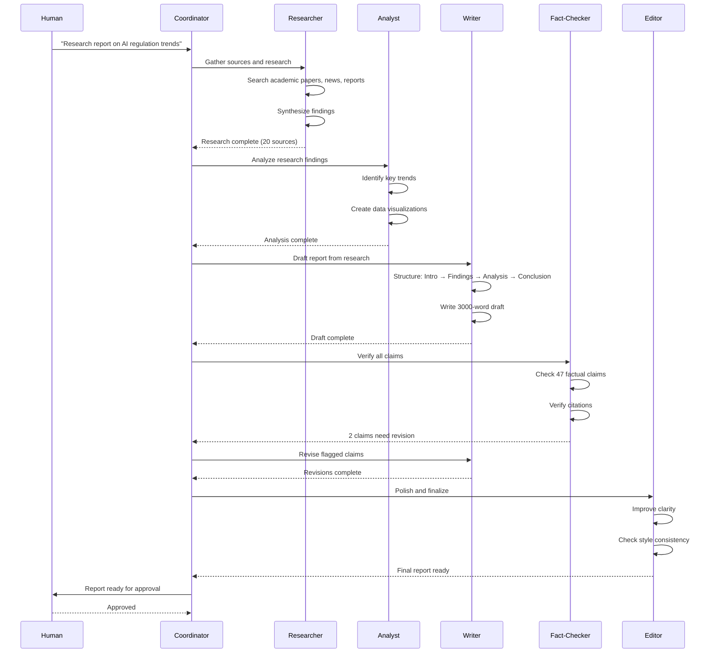
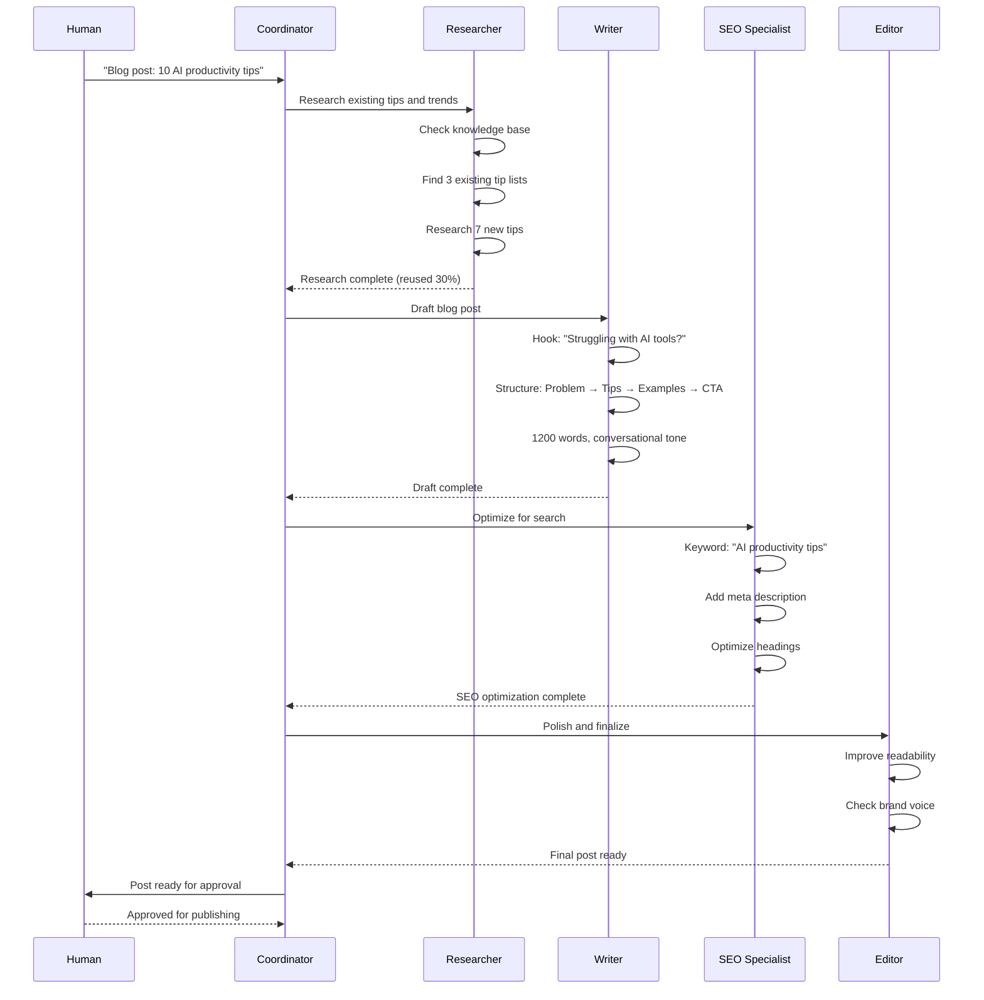
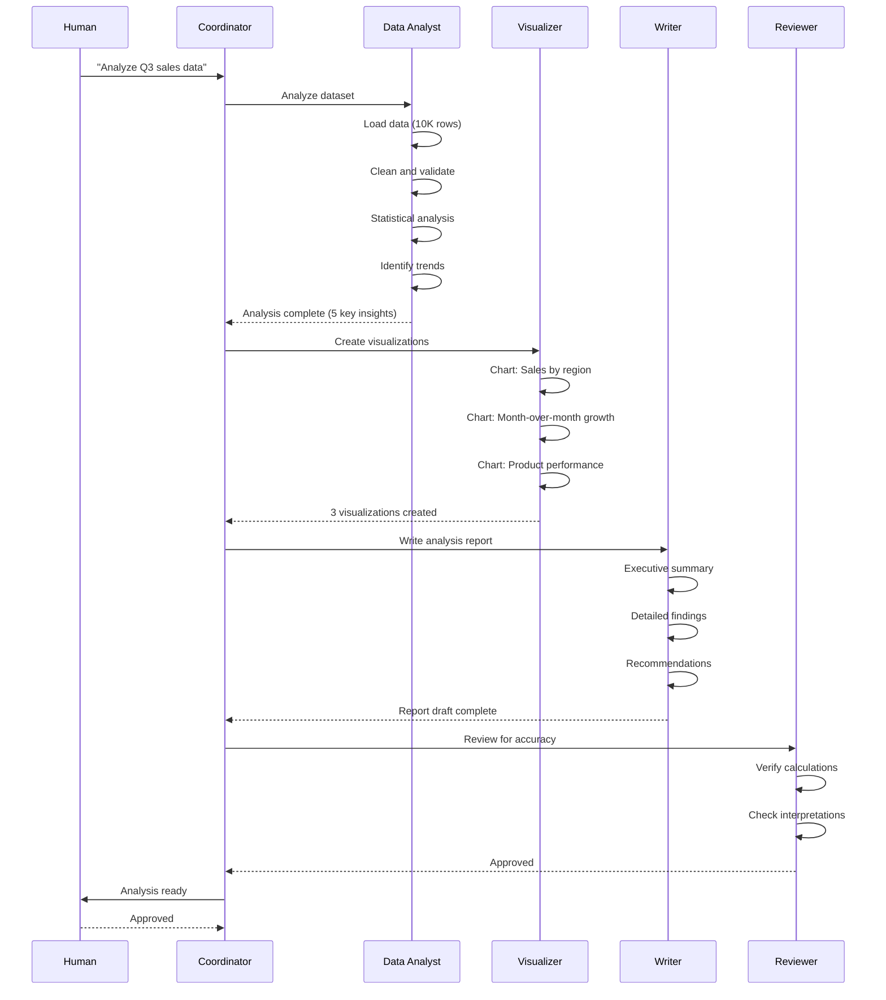

# Product Requirements Document: Unified Multi-Agent System for Non-Development Work

**Version:** 1.0  
**Date:** October 18, 2026  
**Status:** Draft for Review  
**Companion to:** Unified Multi-Agent Development System PRD

---

## Executive Summary

This PRD defines a unified multi-agent system for **non-development work** - content creation, research, data analysis, operations, and other knowledge work. While the companion development PRD focuses on code, this system coordinates AI agents for general knowledge work.

### What Problem Does This Solve?

Current AI-assisted knowledge work challenges:
- **Context Loss**: Agents lose research context on restart
- **Coordination Chaos**: Multiple agents working on related content without alignment
- **Quality Issues**: No systematic verification for non-code outputs
- **Duplication**: Agents recreate work that already exists
- **Human Bottlenecks**: Pure automation loses judgment; pure manual loses speed
- **Inconsistent Voice**: Multiple agents produce inconsistent tone and style

This system addresses these challenges through structured workflows, persistent context, and domain-appropriate quality gates.

---

## Vision

**Build a multi-agent system for knowledge work that:**
- Supports 20-30+ concurrent agents
- Persists research and context across crashes
- Produces high-quality content through systematic review
- Maintains consistent voice and style across agents
- Keeps humans in control at critical decision points
- Works across multiple content types and domains

---

## Core Principles (Non-Negotiable)

### 1. Context Persistence
All research, drafts, and decisions must survive crashes through persistent storage.

### 2. Structured Workflows
Prevent chaos through explicit workflow orchestration for different content types.

### 3. Systematic Review
Every output flows through quality gates appropriate to its domain.

### 4. Human Control
Humans approve at critical junctures; agents research and draft.

### 5. Radical Efficiency
Research before creating; reuse existing content; avoid duplication.

### 6. Measurable Impact
Track output quality, research depth, time saved, and reuse percentage.

---

## System Architecture

### High-Level Components

```
┌─────────────────────────────────────────────────────────────┐


---

## System Requirements

### Cross-Platform Compatibility

**Requirement:** The system must work on both Windows and Linux/macOS operating systems.

**Rationale:**
- Content creators and knowledge workers use diverse operating systems
- System should not force OS choice on users
- Cross-platform support enables broader adoption across organizations

**Platform-Specific Considerations:**

**Windows:**
- Must support Windows 10+ or Windows 11
- PowerShell and Command Prompt compatibility for CLI
- Path handling must account for Windows path separators (`\` vs `/`)
- Line ending handling (CRLF vs LF) must be transparent for documents

**Linux/macOS:**
- Must support major Linux distributions (Ubuntu 20.04+, Debian, Fedora)
- Must support macOS 11+ (Big Sur and later)
- Native Unix shell compatibility (bash, zsh)
- Standard Unix path conventions

**Cross-Platform Requirements:**
- File system operations must be OS-agnostic
- Process management must work across platforms
- Environment variable handling must be consistent
- CLI commands must have identical behavior across platforms
- Document storage must use platform-independent formats

### Hardware Requirements

**Minimum Requirements:**
- **Memory:** 4GB RAM
- **Storage:** 10GB free disk space (for documents, research, drafts)
- **Network:** Internet connection for LLM API calls

**Recommended Requirements (for 20+ agents):**
- **Memory:** 8GB RAM
- **Storage:** 50GB free disk space (for knowledge base, document versions)
- **Network:** Reliable internet connection

**Rationale:**
- Content work is lightweight compared to software development
- Storage needs grow with knowledge base size
- Network required for LLM APIs and research

### Software Requirements

**Document Processing:**
- **Markdown Support:** Required for document storage and formatting
- **PDF Generation:** Optional for final output formats
- **Image Processing:** Optional for content with visuals

**File System:**
- **Document Storage:** Standard file system with folders for drafts, research, finals
- **Search:** File-based search or optional search indexing
- **Rationale:** Content stored as files (markdown, text), not in database

**Optional Integrations:**
- **Plagiarism Detection:** Copyscape, Turnitin, or similar
- **Grammar Checking:** Grammarly, LanguageTool
- **SEO Tools:** SEO analysis services for content optimization

### LLM Provider Requirements

**Minimum:** At least one supported provider configured

**Supported Providers:**
- **Anthropic Claude:** API key with Claude 3.5 Sonnet access (recommended for long-form content)
- **OpenAI:** API key with GPT-4 access
- **Google Gemini:** API key with Gemini 1.5 Pro access (recommended for research with long context)
- **Local LLM:** Ollama with llama3 or similar (development only, not recommended for production content)

**Rationale:**
- Multi-provider support prevents vendor lock-in
- Different providers excel at different content types
- Provider diversity enables cost optimization

---

## Content Governance Requirements

### Access Control

**User Roles:**
- **MUST:** Implement role-based access control (RBAC)
- **Required Roles:**
  - **Admin:** Manage system, view all projects, modify configuration
  - **Editor:** Approve content, manage workflows, view all drafts
  - **Writer:** Create content, submit for review, view own work
  - **Viewer:** View published content, view metrics (read-only)

**API Key Management:**
- **SHOULD:** Store LLM provider API keys securely (environment variables recommended)
- **MUST NOT:** Hardcode API keys in configuration files

### Content Protection

**Version Control:**
- **MUST:** Track all content versions with timestamps and authors
- **MUST:** Support rollback to previous versions
- **MUST:** Maintain approval history for published content

**Attribution & Licensing:**
- **MUST:** Maintain clear attribution for all sources
- **MUST:** Track content ownership and licensing
- **MUST:** Support plagiarism detection for quality assurance

**Content Access Levels:**
- **SHOULD:** Support content classification (public, internal, confidential)
- **SHOULD:** Restrict access based on content classification

**Rationale:**
- Content governance ensures quality and compliance
- Proper attribution prevents plagiarism and legal issues
- Version control enables content accountability

---

## Scalability Requirements

### Agent Capacity Tiers

**Tier 1 (MVP):**
- **Capacity:** 5 concurrent agents
- **Storage:** File-based with basic search
- **Use Case:** Individual content creators, small teams

**Tier 2 (Production):**
- **Capacity:** 20 concurrent agents
- **Storage:** File-based with indexed search
- **Use Case:** Content teams (5-10 people), multiple content types

**Tier 3 (Scale):**
- **Capacity:** 30+ concurrent agents
- **Storage:** File-based with advanced search and caching
- **Use Case:** Large content organizations, multiple departments

### Token Budget Management

**Requirements:**
- **MUST:** Support configurable daily token budget per project
- **MUST:** Support configurable per-content-piece token budget
- **MUST:** Gracefully handle budget exhaustion (queue work, don't fail)
- **MUST:** Alert when approaching budget limits (80%, 90%, 95%)

**Content-Specific Budgets:**
- Research reports: Higher budget (deep research required)
- Blog posts: Medium budget (moderate research)
- Social media: Lower budget (minimal research)

### Storage Scaling

**Requirements:**
- **MUST:** Support document versioning (file-based with timestamps)
- **SHOULD:** Implement automatic archival of old versions
- **MUST:** Support knowledge base growth to 10,000+ documents
- **SHOULD:** Support media asset management (images, videos)

**Rationale:**
- Content stored as files in organized folder structure
- Version history maintained through file copies or git
- Knowledge base grows with reusable content library

---

## Configuration Requirements

### Project-Level Configuration

**Required Configuration Options:**
- **Content Type:** Research, blog, technical docs, marketing, social media
- **Quality Standards:** Minimum quality score, review requirements
- **Style Guide:** Voice, tone, formatting rules
- **Research Depth:** Minimum sources required
- **Token Efficiency:** Budget limits per content type

**Configuration Format:**
```yaml
project:
  name: string
  type: "research" | "blog" | "technical-docs" | "marketing" | "social-media"
  quality:
    minimum_score: number (0-10)
    review_required: boolean
    fact_check_required: boolean
  style:
    voice: string
    tone: string
    avoid_patterns: array
  research:
    minimum_sources: number
    citation_format: "APA" | "MLA" | "Chicago"
  token_efficiency:
    budget_per_piece: number
```

### Agent-Level Configuration

**Required Configuration Options:**
- **Model Selection:** Per-role model mapping (researcher, writer, editor, etc.)
- **Token Limits:** Per-agent token budgets
- **Specialization:** Domain expertise (tech, finance, health, etc.)

**Configuration Format:**
```yaml
agents:
  researcher:
    model: string
    token_limit: number
    specialization: array
  writer:
    model: string
    token_limit: number
    style_enforcement: boolean
  fact_checker:
    model: string
    token_limit: number
    confidence_threshold: number (0.0-1.0)
```

---

## User Interface Requirements

### CLI Interface (Primary)

**Required Commands:**

**System Management:**
- `init` - Initialize system
- `start-all` - Start all services
- `stop-all` - Stop all services
- `status` - Show system status

**Project Management:**
- `project create` - Create new content project
- `project list` - List all projects
- `project switch` - Switch active project

**Content Management:**
- `request` - Submit content request
- `draft show` - Show draft content
- `approve` - Approve content for publishing
- `publish` - Publish approved content

**Knowledge Base:**
- `kb search` - Search knowledge base
- `kb add` - Add to knowledge base
- `kb stats` - Knowledge base statistics

**Monitoring:**
- `metrics quality` - Quality metrics
- `metrics tokens` - Token usage
- `metrics reuse` - Content reuse percentage

### Dashboard Interface (Secondary)

**Required Features:**
- Content pipeline visualization (research → draft → review → approved → published)
- Quality metrics dashboard
- Knowledge base browser
- Approval workflow management
- Agent activity monitoring

---

## Observability Requirements

### Metrics Collection

**Required Metrics:**

**Quality Metrics:**
- Content quality scores (per piece, per type)
- Fact-check pass rate
- First-pass approval rate
- Revision count per piece

**Efficiency Metrics:**
- Time per content piece (by type)
- Token usage per piece
- Knowledge base reuse percentage
- Research depth (sources per piece)

**Agent Performance:**
- Output quality by agent
- Time efficiency by agent
- Specialization effectiveness

### Alerting

**Recommended Alerts:**
- Token budget approaching limit (80%, 90%)
- Quality score below threshold
- Fact-check failures requiring review
- Plagiarism detected above similarity threshold

**Rationale:**
- Alerts help maintain content quality
- Budget alerts prevent cost overruns
- Quality alerts enable proactive intervention


│                     Human Interface Layer                    │
│  (CLI, Dashboard, Content Preview, Approval Workflows)       │
└─────────────────────────────────────────────────────────────┘
                              ↓
┌─────────────────────────────────────────────────────────────┐
│                   Orchestration Layer                        │
│  - Coordinator                                               │
│  - Router (Workflow Selection)                               │
│  - Scheduler (Capacity Management)                           │
└─────────────────────────────────────────────────────────────┘
                              ↓
┌─────────────────────────────────────────────────────────────┐
│                    Agent Execution Layer                     │
│  - Worker Agents                                             │
│  - Specialized Agents (Researcher, Writer, Analyst, Editor)  │
│  - Review Agents (Fact-Check, Style, Quality)                │
└─────────────────────────────────────────────────────────────┘
                              ↓
┌─────────────────────────────────────────────────────────────┐
│                   Verification Layer                         │
│  - Quality Review (Domain-Specific)                          │
│  - Fact Verification                                         │
│  - Style Consistency Check                                   │
│  - Plagiarism Detection                                      │
└─────────────────────────────────────────────────────────────┘
                              ↓
┌─────────────────────────────────────────────────────────────┐
│                   Monitoring Layer                           │
│  - Project Monitor (Per-Project Health)                      │
│  - System Patrol (Cross-Project Monitoring)                  │
│  - Quality Metrics (Output Quality Tracking)                 │
└─────────────────────────────────────────────────────────────┘
                              ↓
┌─────────────────────────────────────────────────────────────┐
│                    Persistence Layer                         │
│  - Document Storage (Drafts, Research, Finals)               │
│  - Knowledge Base (Reusable Content)                         │
│  - Decision Artifacts (Style Guides, Glossaries)             │
│  - Metrics Database (Quality Metrics)                        │
└─────────────────────────────────────────────────────────────┘
```

---

## Detailed Requirements

## 1. Context Persistence System

### 1.1 Document Storage

**Why This Matters:**
Unlike code that lives in version control, knowledge work produces documents, research notes, and drafts that need structured storage with versioning and retrieval.

**Requirements:**
- Persistent storage for drafts, research, and final outputs
- Version history for all documents
- Metadata tagging (topic, domain, status, quality score)
- Full-text search across all stored content
- Automatic deduplication detection

**Storage Structure:**
```
project/
├── research/
│   ├── topic-a/
│   │   ├── sources.md          # Collected sources
│   │   ├── notes.md            # Research notes
│   │   └── synthesis.md        # Synthesized findings
│   └── topic-b/
├── drafts/
│   ├── article-1/
│   │   ├── v1-outline.md
│   │   ├── v2-first-draft.md
│   │   └── v3-revised.md
│   └── article-2/
├── finals/
│   ├── published/
│   └── approved/
└── knowledge-base/
    ├── reusable-sections/
    ├── templates/
    └── style-guides/
```

### 1.2 Knowledge Base

**Why This Matters:**
Agents often recreate content that already exists. A searchable knowledge base enables reuse and prevents duplication.


---

## Multi-Agent Platform Support

### Overview

**Requirement:** The system must support multiple content creation agent platforms working together within the same project.

**Rationale:**
- Different content agents have different strengths (e.g., Claude for long-form, GPT-4 for creative, Gemini for research)
- Teams may have licenses for multiple platforms
- Avoid vendor lock-in to a single content agent platform
- Enable best-of-breed approach (use the right agent for the right content type)

### Supported Content Agent Platforms

**Tier 1 (Full Integration):**
- **Claude (Anthropic):** Full integration for long-form content, research, analysis
- **GPT-4 (OpenAI):** Creative writing, marketing copy, social media
- **Gemini (Google):** Research with long context, data analysis, fact-checking

**Tier 2 (Basic Integration):**
- **Jasper:** Marketing copy and SEO optimization
- **Copy.ai:** Short-form content and social media
- **Writesonic:** Blog posts and articles

**Tier 3 (Experimental):**
- **Local LLMs (Ollama):** Privacy-sensitive content, offline work
- **Custom Agents:** User-defined agents via plugin system

### Agent Interoperability Requirements

**Common Protocol:**
- **MUST:** Define standard agent communication protocol for content work
- **MUST:** Support agent-to-agent handoff across platforms
- **MUST:** Maintain research context across platform boundaries
- **MUST:** Provide unified content tracking regardless of agent platform

**Protocol Specification:**
```yaml
content_agent_protocol:
  version: "1.0"
  
  agent_identity:
    platform: string          # "claude", "gpt4", "gemini"
    agent_id: string          # Unique agent identifier
    capabilities: array       # ["research", "writing", "editing", "fact-check"]
    
  context_format:
    type: "markdown" | "json"
    schema_version: string
    
  handoff_protocol:
    state_transfer: "file-based" | "api"
    context_compression: boolean
    
  content_tracking:
    format: "standard"        # Common content format
    status_updates: "real-time" | "polling"
```

### Platform-Specific Adapters

**Requirements:**
- **MUST:** Implement adapter for each supported platform
- **MUST:** Abstract platform differences behind common interface
- **MUST:** Handle platform-specific authentication
- **MUST:** Map platform capabilities to content roles

**Adapter Interface:**
```python
class ContentAgentAdapter:
    """Base adapter interface for content agent platforms"""
    
    def authenticate(self, credentials: dict) -> bool:
        """Authenticate with platform"""
        pass
    
    def spawn_agent(self, content_request: ContentRequest, config: dict) -> Agent:
        """Spawn agent for content creation"""
        pass
    
    def transfer_context(self, from_agent: Agent, to_agent: Agent) -> bool:
        """Transfer research and context between agents"""
        pass
    
    def get_capabilities(self) -> list[str]:
        """Get platform capabilities"""
        pass
    
    def supports_long_context(self) -> bool:
        """Check if platform supports long context (100K+ tokens)"""
        pass
```

**Platform-Specific Implementations:**

**Claude Adapter:**
```python
class ClaudeAdapter(ContentAgentAdapter):
    """Adapter for Claude (Anthropic) platform"""
    
    capabilities = [
        "long-form-writing",
        "research",
        "analysis",
        "technical-writing",
        "editing"
    ]
    
    supports_long_context = True  # 200K tokens
    context_format = "markdown"
    best_for = ["research-reports", "technical-docs", "analysis"]
```

**GPT-4 Adapter:**
```python
class GPT4Adapter(ContentAgentAdapter):
    """Adapter for GPT-4 (OpenAI) platform"""
    
    capabilities = [
        "creative-writing",
        "marketing-copy",
        "social-media",
        "brainstorming"
    ]
    
    supports_long_context = True  # 128K tokens
    context_format = "markdown"
    best_for = ["blog-posts", "marketing", "creative-content"]
```

**Gemini Adapter:**
```python
class GeminiAdapter(ContentAgentAdapter):
    """Adapter for Gemini (Google) platform"""
    
    capabilities = [
        "research",
        "fact-checking",
        "data-analysis",
        "long-context-synthesis"
    ]
    
    supports_long_context = True  # 1M tokens
    context_format = "markdown"
    best_for = ["research", "fact-checking", "data-analysis"]
```

### Agent Selection Strategy

**Requirements:**
- **MUST:** Select appropriate agent platform based on content type
- **MUST:** Support user override of agent selection
- **MUST:** Fall back to alternative platform if primary unavailable
- **SHOULD:** Learn from agent performance to optimize selection

**Selection Rules:**
```yaml
agent_selection:
  by_content_type:
    research_report:
      primary: "gemini"
      fallback: "claude"
      reason: "Long context for research synthesis"
      
    blog_post:
      primary: "gpt4"
      fallback: "claude"
      reason: "Creative, engaging writing"
      
    technical_documentation:
      primary: "claude"
      fallback: "gpt4"
      reason: "Technical accuracy, clarity"
      
    marketing_copy:
      primary: "gpt4"
      fallback: "jasper"
      reason: "Persuasive, brand-aligned"
      
    fact_checking:
      primary: "gemini"
      fallback: "claude"
      reason: "Research capabilities, source verification"
      
    social_media:
      primary: "gpt4"
      fallback: "copy.ai"
      reason: "Short-form, platform-optimized"
  
  by_project_requirements:
    high_accuracy:
      preferred_platforms: ["claude", "gemini"]
      required_features: ["fact-checking", "source-verification"]
      
    creative_focus:
      preferred_platforms: ["gpt4", "claude"]
      required_features: ["creative-writing", "brainstorming"]
      
    research_heavy:
      preferred_platforms: ["gemini", "claude"]
      required_features: ["long-context", "research", "synthesis"]
```

### Cross-Platform Context Transfer

**Requirements:**
- **MUST:** Transfer research context when handing off between platforms
- **MUST:** Preserve content state across platform boundaries
- **MUST:** Handle platform-specific context formats
- **MUST:** Minimize context loss during transfer

**Context Transfer Protocol:**
```yaml
context_transfer:
  source_platform: string
  target_platform: string
  
  context_payload:
    content_id: string
    content_state: object
    research_notes: array
    sources: array
    decision_history: array
    session_metadata: object
    
  transfer_method:
    file: "markdown-files"      # Primary method for content
    api: "rest-api"             # For API-based platforms
    
  compression:
    enabled: boolean
    algorithm: "gzip"
    
  validation:
    checksum: string
    verify_integrity: boolean
```

**Example Cross-Platform Handoff:**
```
Content Request: Write comprehensive AI trends report

1. Gemini (Research):
   - Gathers 50+ sources
   - Synthesizes findings with 1M token context
   - Creates research notes
   - Saves to: research/ai-trends/
   
2. Claude (Writing):
   - Reads research from files
   - Structures 5000-word report
   - Maintains technical accuracy
   - Saves draft to: drafts/ai-trends/
   
3. GPT-4 (Polish):
   - Reads draft
   - Improves engagement and flow
   - Adds compelling examples
   - Saves final to: finals/ai-trends/
   
4. Claude (Review):
   - Reviews for accuracy
   - Checks against research
   - Approves for publishing
```

### Configuration Requirements

**Project-Level Configuration:**
```yaml
multi_agent_config:
  enabled: boolean
  
  platforms:
    claude:
      enabled: boolean
      api_key: env:ANTHROPIC_API_KEY
      model: "claude-3-5-sonnet-20241022"
      roles: ["researcher", "writer", "editor", "reviewer"]
      
    gpt4:
      enabled: boolean
      api_key: env:OPENAI_API_KEY
      model: "gpt-4-turbo"
      roles: ["writer", "copywriter", "creative"]
      
    gemini:
      enabled: boolean
      api_key: env:GOOGLE_API_KEY
      model: "gemini-1.5-pro"
      roles: ["researcher", "fact-checker", "analyst"]
  
  selection_strategy:
    mode: "automatic" | "manual" | "hybrid"
    prefer_platform: string  # Optional: prefer specific platform
    
  handoff_policy:
    automatic: boolean
    require_approval: boolean
    preserve_context: true
```

### Monitoring and Metrics

**Requirements:**
- **MUST:** Track agent performance by platform
- **MUST:** Monitor cross-platform handoffs
- **MUST:** Measure context transfer success rate
- **MUST:** Compare cost and quality across platforms

**Platform Metrics:**
```yaml
platform_metrics:
  by_platform:
    claude:
      content_pieces: 89
      avg_quality_score: 9.1
      avg_cost_per_piece: $2.45
      handoff_success_rate: 98%
      best_for: ["technical-docs", "analysis"]
      
    gpt4:
      content_pieces: 134
      avg_quality_score: 8.7
      avg_cost_per_piece: $1.89
      handoff_success_rate: 97%
      best_for: ["blog-posts", "marketing"]
      
    gemini:
      content_pieces: 45
      avg_quality_score: 9.3
      avg_cost_per_piece: $1.12
      handoff_success_rate: 99%
      best_for: ["research", "fact-checking"]
      
  cross_platform:
    handoffs_total: 78
    handoff_success_rate: 98%
    context_loss_rate: 2%
    avg_handoff_time: 8s
```

### Error Handling for Multi-Platform

**Platform-Specific Errors:**
```yaml
platform_errors:
  PLATFORM_UNAVAILABLE:
    severity: P1
    recovery: "Fallback to alternative platform"
    
  CONTEXT_TRANSFER_FAILED:
    severity: P1
    recovery: "Retry with smaller context chunks"
    
  AUTHENTICATION_FAILED:
    severity: P0
    recovery: "Prompt for new credentials"
    
  CAPABILITY_NOT_SUPPORTED:
    severity: P2
    recovery: "Route to platform with capability"
    
  HANDOFF_TIMEOUT:
    severity: P1
    recovery: "Cancel handoff, continue with current platform"
    
  QUALITY_BELOW_THRESHOLD:
    severity: P2
    recovery: "Try alternative platform for revision"
```

### Security Considerations

**Requirements:**
- **MUST:** Isolate credentials per platform
- **MUST:** Audit all cross-platform transfers
- **MUST:** Encrypt content during transfer
- **MUST:** Validate agent identity across platforms

**Security Controls:**
```yaml
security:
  credential_isolation:
    per_platform: true
    vault_integration: true
    rotation_policy: "30-days"
    
  content_transfer:
    encryption: "AES-256"
    integrity_check: "SHA-256"
    audit_logging: true
    
  agent_verification:
    verify_identity: true
    api_key_validation: true
```

### Cost Optimization

**Requirements:**
- **MUST:** Track cost per platform
- **MUST:** Optimize platform selection for cost
- **SHOULD:** Provide cost estimates before content creation
- **SHOULD:** Alert when approaching budget limits

**Cost Management:**
```yaml
cost_optimization:
  by_platform:
    claude:
      cost_per_1k_tokens: $0.015
      best_value_for: ["long-form", "technical"]
      
    gpt4:
      cost_per_1k_tokens: $0.03
      best_value_for: ["creative", "short-form"]
      
    gemini:
      cost_per_1k_tokens: $0.007
      best_value_for: ["research", "analysis"]
  
  budget_alerts:
    daily_limit: $100
    alert_at: [80%, 90%, 95%]
    
  cost_estimation:
    enabled: true
    show_before_creation: true
```

### Rationale

**Why This Matters:**
- **Flexibility:** Use best agent for each content type
- **Quality:** Leverage platform strengths (Gemini for research, GPT-4 for creative)
- **Cost Optimization:** Choose cost-effective platform per content type
- **Resilience:** Fallback options if primary platform unavailable
- **Vendor Independence:** Avoid lock-in to single platform


---

## Error Handling and Recovery Requirements

### Error Classification

**Requirement:** All errors must be classified by severity and recoverability for content work.

**Error Severity Levels:**
- **P0 (Critical):** Content system cannot function, requires immediate human intervention
- **P1 (High):** Agent cannot proceed with content creation, requires editor intervention
- **P2 (Medium):** Agent can retry or work around, system patrol monitors
- **P3 (Low):** Informational, logged for quality analysis

**Recoverability Types:**
- **Transient:** Temporary failure, retry likely to succeed (API timeout, rate limit)
- **Permanent:** Persistent failure, retry will not help (invalid source, plagiarism detected)
- **Ambiguous:** Unknown if retry will help, requires review

### Error Message Structure

**Requirement:** All error messages must follow a structured format for both agent and human consumption.

**Required Error Fields:**
```yaml
error:
  code: string              # Machine-readable error code (e.g., "QUALITY_SCORE_BELOW_THRESHOLD")
  severity: string          # P0, P1, P2, P3
  recoverability: string    # transient, permanent, ambiguous
  message: string           # Human-readable description
  context:                  # Relevant context for debugging
    agent_id: string
    session_id: string
    content_id: string
    timestamp: string
    operation: string       # What was being attempted
  cause:                    # Root cause if known
    type: string
    message: string
    details: object         # Content-specific details
  recovery:                 # Suggested recovery actions
    automatic: array        # Actions system will attempt automatically
    manual: array           # Actions requiring human intervention
  documentation: string     # Link to relevant documentation
```

**Example Error Message:**
```json
{
  "error": {
    "code": "FACT_CHECK_FAILED",
    "severity": "P1",
    "recoverability": "permanent",
    "message": "3 factual claims could not be verified. Manual review required.",
    "context": {
      "agent_id": "writer-alice",
      "session_id": "session-456",
      "content_id": "blog-ai-trends",
      "timestamp": "2026-10-18T06:45:00Z",
      "operation": "fact_verification"
    },
    "cause": {
      "type": "UnverifiedClaims",
      "message": "Claims lack credible sources",
      "details": {
        "unverified_claims": [
          "AI market will reach $500B by 2027",
          "90% of companies use AI",
          "AI reduces costs by 40%"
        ],
        "confidence_scores": [0.3, 0.4, 0.2]
      }
    },
    "recovery": {
      "automatic": [
        "Flagged claims in draft",
        "Escalated to editor",
        "Saved draft with annotations"
      ],
      "manual": [
        "Review flagged claims in draft",
        "Find credible sources or remove claims",
        "Run: system-cli content verify --id blog-ai-trends"
      ]
    },
    "documentation": "https://docs.system.com/errors/fact-check-failed"
  }
}
```

### Agent-Facing Error Handling

**Requirements for Agent Troubleshooting:**

1. **Structured Error Context:**
   - **MUST:** Include full context (agent ID, session ID, content ID, operation)
   - **MUST:** Include relevant state (token usage, sources checked, quality score)
   - **MUST:** Include timestamp for correlation with logs

2. **Recovery Guidance:**
   - **MUST:** Provide specific recovery steps for known errors
   - **MUST:** Indicate if retry is appropriate
   - **MUST:** Suggest alternative approaches if available

3. **Error Correlation:**
   - **MUST:** Link related errors (e.g., multiple quality issues)
   - **MUST:** Provide trace ID for distributed tracing
   - **MUST:** Reference previous similar errors if pattern exists

**Example Agent Error Response:**
```
Error: QUALITY_SCORE_BELOW_THRESHOLD (P1, permanent)
Context: writer-alice, session-456, content: blog-ai-trends
Quality Score: 6.2 / 10.0 (threshold: 8.0)
Operation: Quality review

Issues Found:
- Clarity: 6.5/10 (jargon without explanation)
- Engagement: 5.8/10 (weak opening hook)
- Completeness: 7.0/10 (missing examples)

Recovery Actions:
1. [AUTOMATIC] Saved draft with quality annotations
2. [AUTOMATIC] Generated improvement suggestions
3. [MANUAL] Review suggestions and revise draft

Suggestions:
- Add concrete examples for each tip
- Simplify technical terms or add explanations
- Strengthen opening with compelling hook

Expected Resolution: 15-20 minutes
Editor review recommended.

Documentation: https://docs.system.com/errors/quality-below-threshold
```

### Human-Facing Error Handling

**Requirements for Human Understanding:**

1. **Clear, Non-Technical Language:**
   - **MUST:** Explain error in plain language
   - **MUST:** Avoid technical jargon
   - **MUST:** Explain impact on content delivery

2. **Actionable Guidance:**
   - **MUST:** Provide specific next steps
   - **MUST:** Include exact commands to run
   - **MUST:** Estimate time to resolution

3. **Context Preservation:**
   - **MUST:** Show what was being created
   - **MUST:** Show current state of content
   - **MUST:** Indicate if work is blocked or can continue

**Example Human Error Message:**
```
⚠️  Content Quality Below Standard

What happened:
Your blog post "AI Trends 2027" scored 6.2/10, below the required 
8.0 threshold. The content needs improvement before publishing.

Issues:
✗ Clarity (6.5/10): Technical terms need explanation
✗ Engagement (5.8/10): Opening needs stronger hook
✓ Accuracy (9.0/10): All facts verified
✓ Completeness (7.0/10): Covers main points

Impact:
- Draft saved, not published
- Other content can continue normally
- No work has been lost

What to do:
1. Review the draft with annotations:
   $ system-cli content show blog-ai-trends

2. Apply suggested improvements:
   - Add concrete examples for each tip
   - Simplify or explain technical terms
   - Strengthen opening paragraph

3. Re-submit for review:
   $ system-cli content submit blog-ai-trends

Estimated time: 15-20 minutes

Need help? https://docs.system.com/guides/improving-quality
```

### Error Recovery Strategies

**Automatic Recovery (No Human Intervention):**

1. **Transient Failures:**
   - **API Timeouts:** Retry with exponential backoff (3 attempts)
   - **Rate Limits:** Queue work, retry after cooldown period
   - **Token Exhaustion:** Automatic agent handoff
   - **Source Unavailable:** Try alternative sources

2. **Recoverable Failures:**
   - **Minor Quality Issues:** Auto-suggest improvements
   - **Formatting Errors:** Auto-fix if possible
   - **Missing Citations:** Flag for manual addition

**Manual Recovery (Human Intervention Required):**

1. **Permanent Failures:**
   - **Plagiarism Detected:** Escalate immediately, require rewrite
   - **Fact Check Failed:** Require source verification or removal
   - **Quality Below Threshold:** Require revision with guidance
   - **Brand Voice Mismatch:** Require style adjustment

2. **Ambiguous Failures:**
   - **Low Confidence Claims:** Request source verification
   - **Unclear Requirements:** Request clarification
   - **Subjective Quality Issues:** Request editor review

### Error Logging and Monitoring

**Requirements:**

1. **Structured Error Logs:**
   - **MUST:** Log all errors with full context
   - **MUST:** Use consistent schema across all components
   - **MUST:** Include correlation IDs for tracing

2. **Error Aggregation:**
   - **MUST:** Group similar errors together
   - **MUST:** Track error frequency and trends
   - **MUST:** Identify error patterns (e.g., recurring quality issues)

3. **Error Alerting:**
   - **SHOULD:** Alert on P0 errors immediately
   - **SHOULD:** Alert on P1 error patterns (>5 in 1 hour)
   - **SHOULD:** Daily digest of P2/P3 errors

**Error Metrics:**
```yaml
error_metrics:
  by_severity:
    p0_count: 0          # Target: 0
    p1_count: 4          # Target: <10 per day
    p2_count: 15         # Target: <30 per day
    p3_count: 52         # Informational
    
  by_recoverability:
    transient: 45        # Automatically recovered
    permanent: 18        # Required human intervention
    ambiguous: 8         # Required investigation
    
  recovery_metrics:
    automatic_success_rate: 88%    # Target: >85%
    manual_resolution_time: 12min  # Target: <20min
    escalation_rate: 8%            # Target: <15%
    
  content_quality_metrics:
    quality_failures: 12           # Below threshold
    fact_check_failures: 3         # Unverified claims
    plagiarism_detections: 0       # Target: 0
    style_violations: 8            # Brand voice issues
```

### Error Documentation

**Requirements:**

1. **Error Catalog:**
   - **MUST:** Maintain catalog of all error codes
   - **MUST:** Document common causes and solutions
   - **MUST:** Include examples for each error type

2. **Troubleshooting Guides:**
   - **MUST:** Provide step-by-step troubleshooting for common errors
   - **MUST:** Include diagnostic commands
   - **MUST:** Link to related documentation

3. **Error History:**
   - **MUST:** Track error resolution history
   - **MUST:** Document successful recovery strategies
   - **MUST:** Share learnings across team

**Example Error Catalog Entry:**
```markdown
## Error: QUALITY_SCORE_BELOW_THRESHOLD

**Code:** QUALITY_SCORE_BELOW_THRESHOLD
**Severity:** P1 (High)
**Recoverability:** Permanent

**Description:**
Occurs when content quality score falls below the configured 
threshold (default: 8.0/10). Content cannot be published until 
quality improves.

**Common Causes:**
1. Weak opening hook (low engagement score)
2. Technical jargon without explanation (low clarity score)
3. Missing examples or evidence (low completeness score)
4. Inconsistent tone (low consistency score)

**Resolution Steps:**
1. View quality report: `system-cli content quality <content-id>`
2. Review specific issues and suggestions
3. Revise content addressing flagged issues
4. Re-submit: `system-cli content submit <content-id>`

**Prevention:**
- Use content templates for consistent structure
- Follow style guide for brand voice
- Include concrete examples for each point
- Have peer review before submission

**Related Errors:**
- FACT_CHECK_FAILED
- STYLE_VIOLATION
- PLAGIARISM_DETECTED

**Documentation:** https://docs.system.com/errors/quality-below-threshold
```

### Content-Specific Error Types

**Quality Errors:**
- `QUALITY_SCORE_BELOW_THRESHOLD`: Overall quality too low
- `CLARITY_SCORE_LOW`: Content difficult to understand
- `ENGAGEMENT_SCORE_LOW`: Content not compelling
- `COMPLETENESS_SCORE_LOW`: Missing required elements

**Verification Errors:**
- `FACT_CHECK_FAILED`: Unverified factual claims
- `SOURCE_UNAVAILABLE`: Cannot access cited source
- `CITATION_MISSING`: Claim lacks proper citation
- `CONFIDENCE_TOO_LOW`: Verification confidence below threshold

**Governance Errors:**
- `PLAGIARISM_DETECTED`: Content matches existing work
- `STYLE_VIOLATION`: Doesn't match brand voice
- `SENSITIVE_DATA_DETECTED`: Contains PII or confidential info
- `LEGAL_REVIEW_REQUIRED`: Content needs legal approval

**System Errors:**
- `TOKEN_BUDGET_EXHAUSTED`: Daily token limit reached
- `AGENT_HANDOFF_FAILED`: Cannot transfer to new agent
- `KNOWLEDGE_BASE_UNAVAILABLE`: Cannot access reusable content
- `API_RATE_LIMIT`: LLM provider rate limit hit

### Rationale

**Why This Matters:**
- **Agent Efficiency:** Structured errors enable agents to self-recover and improve content quality
- **Human Productivity:** Clear error messages reduce revision time and improve content quality
- **Content Quality:** Systematic error handling ensures consistent quality standards
- **Learning:** Error patterns inform content strategy and prevent future issues


**Requirements:**
- Searchable repository of reusable content
- Templates for common content types
- Style guides and voice guidelines
- Domain-specific glossaries
- Automatic similarity detection

**Example Knowledge Base:**
```yaml
knowledge_base:
  reusable_sections:
    - id: "company-intro"
      content: "Our company was founded in..."
      tags: ["about", "company", "intro"]
      usage_count: 47
      last_updated: "2026-10-15"
      
  templates:
    - id: "blog-post-template"
      structure: "Hook → Problem → Solution → CTA"
      word_count: "800-1200"
      tone: "conversational, authoritative"
      
  style_guides:
    - id: "brand-voice"
      tone: "Professional yet approachable"
      avoid: ["jargon", "passive voice", "buzzwords"]
      prefer: ["active voice", "concrete examples", "clear language"]
```

### 1.3 Decision Artifacts

**Requirements:**
- **Style Guides**: Define voice, tone, and writing standards
- **Content Briefs**: Document content strategy and goals
- **Editorial Guidelines**: Review criteria and quality standards
- **Domain Glossaries**: Shared terminology and definitions

---

## 2. Orchestration System

### 2.1 Coordinator

**Requirements:**
- Primary human interface for content requests
- Orchestrates but doesn't create content
- Creates work bundles for complex projects
- Spawns specialized agents based on content type
- Handles escalations and approval workflows

**Example Interaction:**
```
Human: "Create a 2000-word article on AI safety regulations"

Coordinator:
1. Analyzes request → Complex research article
2. Creates work bundle: "ai-safety-article"
3. Spawns Researcher agent → Gather sources
4. Spawns Writer agent → Draft article
5. Spawns Fact-Checker → Verify claims
6. Spawns Editor → Polish and finalize
7. Routes to human for final approval
```

### 2.2 Router (Workflow Selection)

**Requirements:**
- Automatic workflow selection based on content type
- Support for multiple content domains:
  - **Research Reports**: Deep research with citations
  - **Blog Posts**: Engaging, SEO-optimized content
  - **Technical Documentation**: Clear, accurate, comprehensive
  - **Marketing Copy**: Persuasive, brand-aligned
  - **Data Analysis**: Insights from data with visualizations
  - **Social Media**: Short-form, platform-optimized

**Workflow Mapping:**
```yaml
workflows:
  research_report:
    agents: [Researcher, Analyst, Writer, Fact-Checker, Editor]
    review: [Fact Verification, Citation Check, Quality Review]
    
  blog_post:
    agents: [Researcher, Writer, SEO Specialist, Editor]
    review: [Style Check, SEO Check, Quality Review]
    
  technical_docs:
    agents: [Technical Writer, Reviewer, Editor]
    review: [Accuracy Check, Completeness Check, Clarity Review]
    
  marketing_copy:
    agents: [Copywriter, Brand Specialist, Editor]
    review: [Brand Alignment, Persuasiveness Check, Legal Review]
```

---

## 3. Agent Execution System

### 3.1 Specialized Agents

**Why This Matters:**
Different content types require different expertise. Specialized agents bring domain-specific knowledge without requiring human mastery of all areas.

**Agent Types:**

#### Research Agents
- **Researcher**: Gathers sources, synthesizes findings
- **Fact-Checker**: Verifies claims and citations
- **Data Analyst**: Analyzes data, creates visualizations

#### Content Creation Agents
- **Writer**: Creates drafts following briefs
- **Copywriter**: Writes persuasive marketing content
- **Technical Writer**: Creates clear technical documentation
- **SEO Specialist**: Optimizes content for search

#### Review Agents
- **Editor**: Polishes language, improves clarity
- **Style Reviewer**: Ensures brand voice consistency
- **Quality Reviewer**: Assesses overall quality
- **Legal Reviewer**: Checks compliance and risk

### 3.2 Efficiency Framework (Research Before Creating)

**Why This Matters:**
Like the minimalism ladder for code, knowledge work needs a framework to avoid recreating existing content.

**The Research Ladder:**
Before creating any content, agents must climb the ladder:

1. **Does it need to exist?** - Skip content nobody asked for
2. **Already in knowledge base?** - Reuse existing content
3. **Similar content exists?** - Adapt rather than recreate
4. **Template available?** - Use template as starting point
5. **Research exists?** - Build on existing research
6. **Otherwise** - Create from scratch with proper research

**Example:**
```
Request: "Write about our company's AI safety approach"

Ladder Climb:
1. Does it need to exist? Yes (requested)
2. Already in knowledge base? Yes! Found "ai-safety-overview.md"
3. Action: Reuse 80%, update 20% with recent developments

Result: 30 minutes vs 4 hours from scratch
```

---

## 4. Verification System

### 4.1 Quality Review Framework

**Why This Matters:**
Unlike code that has tests, content quality is subjective. A structured review framework ensures consistent quality standards.

**Review Dimensions:**

1. **Accuracy**: Facts, data, citations correct
2. **Clarity**: Easy to understand, well-structured
3. **Completeness**: Covers all required points
4. **Consistency**: Matches brand voice and style
5. **Engagement**: Compelling, holds attention
6. **SEO** (if applicable): Optimized for search

**Review Checklist:**
```yaml
quality_review:
  accuracy:
    - All facts verified with sources
    - Data and statistics current
    - Citations properly formatted
    - No misleading claims
    
  clarity:
    - Clear thesis/main point
    - Logical flow and structure
    - Transitions between sections
    - No jargon without explanation
    
  completeness:
    - All brief requirements met
    - Key questions answered
    - Appropriate depth for audience
    - Call-to-action included (if needed)
    
  consistency:
    - Matches brand voice
    - Consistent terminology
    - Tone appropriate for audience
    - Style guide followed
    
  engagement:
    - Strong opening hook
    - Compelling examples
    - Varied sentence structure
    - Satisfying conclusion
```

### 4.2 Fact Verification

**Requirements:**
- Verify all factual claims with sources
- Check data and statistics for accuracy
- Validate citations and references
- Flag unverifiable claims for human review

**Verification Process:**
```
1. Extract all factual claims from content
2. For each claim:
   - Find supporting source
   - Verify claim matches source
   - Check source credibility
   - Note confidence level
3. Flag claims without verification
4. Generate verification report
```

### 4.3 Plagiarism Detection

**Requirements:**
- Check content against existing published work
- Detect unattributed quotes or paraphrasing
- Ensure proper citation of sources
- Flag similarity above threshold for review

---

## 5. Domain-Specific Workflows

### 5.1 Research Report Workflow



### 5.2 Blog Post Workflow



### 5.3 Data Analysis Workflow



---

## 6. Monitoring System

### 6.1 Quality Metrics

**Requirements:**
- Track output quality scores
- Monitor review pass/fail rates
- Measure research depth (sources per output)
- Track reuse percentage (knowledge base utilization)
- Monitor time per content type

**Quality Dashboard:**
```yaml
quality_metrics:
  overall_quality_score: 8.7/10
  
  by_content_type:
    research_reports:
      avg_quality: 9.2/10
      avg_sources: 23
      avg_time: 4.5 hours
      
    blog_posts:
      avg_quality: 8.5/10
      avg_sources: 8
      avg_time: 2 hours
      reuse_rate: 35%
      
    technical_docs:
      avg_quality: 9.0/10
      avg_accuracy: 98%
      avg_time: 3 hours
      
  review_metrics:
    first_pass_rate: 73%
    avg_revisions: 1.4
    fact_check_issues: 0.08 per article
```

### 6.2 Agent Performance

**Requirements:**
- Track agent output quality by type
- Monitor agent efficiency (time per task)
- Measure agent specialization effectiveness
- Identify agents needing improvement

---

## 7. Human Interface System

### 7.1 Content Preview

**Requirements:**
- Real-time preview of drafts
- Side-by-side comparison (draft vs final)
- Inline commenting and feedback
- Approval workflow with version tracking

### 7.2 Approval Workflows

**Requirements:**
- Multi-stage approval (draft → review → final)
- Role-based approval (editor, legal, executive)
- Approval history and audit trail
- Rejection with feedback loop

---

## 8. Use Cases

### 8.1 Content Marketing Team

**Scenario:** Marketing team needs 20 blog posts per month

**Without System:**
- 1 writer: 20 posts × 4 hours = 80 hours/month
- Quality inconsistent
- No systematic fact-checking
- Frequent duplication

**With System:**
- 5 agents working in parallel
- Reuse 30% from knowledge base
- Systematic quality review
- 20 posts × 2 hours = 40 hours/month
- **50% time savings, higher quality**

### 8.2 Research Organization

**Scenario:** Think tank producing monthly research reports

**Without System:**
- 1 researcher: 1 report × 40 hours = 40 hours
- Manual fact-checking
- No research reuse
- Inconsistent citation format

**With System:**
- Researcher + Analyst + Writer + Fact-Checker
- Reuse previous research
- Automated fact verification
- 1 report × 20 hours = 20 hours
- **50% time savings, higher accuracy**

### 8.3 Technical Documentation

**Scenario:** Software company maintaining product docs

**Without System:**
- Docs outdated
- Inconsistent style
- Missing sections
- Manual updates

**With System:**
- Automated doc generation from code
- Consistent style enforcement
- Completeness checking
- Version-synced updates
- **Always current, comprehensive**

---

## Success Metrics

### Quality Metrics
- **Output Quality Score:** Target 8.5+/10
- **Fact-Check Pass Rate:** Target 95%+
- **First-Pass Approval Rate:** Target 70%+
- **Reuse Percentage:** Target 30%+

### Efficiency Metrics
- **Time Reduction:** Target -40% vs manual
- **Cost per Output:** Track cost trends
- **Agent Utilization:** Target 80%+ capacity
- **Research Depth:** Track sources per output

### Reliability Metrics
- **Agent Uptime:** Target 99%+
- **Context Recovery:** Track recovery success rate
- **Quality Consistency:** Track variance in quality scores

---

## Implementation Phases

### Phase 1: Foundation (8-10 weeks)
- Document storage system
- Basic coordinator and router
- Researcher and Writer agents
- Simple quality review
- CLI interface

### Phase 2: Specialization (6-8 weeks)
- Specialized agents (all types)
- Knowledge base with search
- Fact verification system
- Style consistency checking
- Approval workflows

### Phase 3: Monitoring (4-6 weeks)
- Quality metrics dashboard
- Agent performance tracking
- System health monitoring
- Escalation system

### Phase 4: Scale (6-8 weeks)
- Multi-project support
- Advanced knowledge base
- Plagiarism detection
- Cross-domain workflows

---

## Comparison: Development vs Non-Development Systems

| Aspect | Development System | Non-Development System |
|--------|-------------------|------------------------|
| **Primary Output** | Code | Content/Documents |
| **Verification** | Tests, Code Review | Fact-Check, Quality Review |
| **Persistence** | Version Control (Git) | Document Storage |
| **Minimalism** | Code Ladder | Research Ladder |
| **Quality Gate** | Merge Queue | Approval Workflow |
| **Reuse** | Code Libraries | Knowledge Base |
| **Collaboration** | PRs, Branches | Drafts, Reviews |

---

## Open Questions

1. **Quality Scoring:** How to objectively measure content quality?
2. **Fact Verification:** What confidence threshold for automated verification?
3. **Knowledge Base:** How to prevent knowledge base bloat?
4. **Voice Consistency:** How to maintain consistent voice across agents?
5. **Legal Review:** When is legal review required vs optional?

---

## Appendix A: Content Type Specifications

### Research Report
- **Length:** 2000-5000 words
- **Sources:** 15-30 citations
- **Structure:** Abstract → Introduction → Methodology → Findings → Analysis → Conclusion
- **Review:** Fact verification required, peer review recommended

### Blog Post
- **Length:** 800-1500 words
- **Sources:** 3-10 citations
- **Structure:** Hook → Problem → Solution → Examples → CTA
- **Review:** Style check, SEO optimization

### Technical Documentation
- **Length:** Variable
- **Sources:** Code references, API docs
- **Structure:** Overview → Setup → Usage → Examples → Troubleshooting
- **Review:** Accuracy check, completeness check

### Marketing Copy
- **Length:** 100-500 words
- **Sources:** Product specs, brand guidelines
- **Structure:** Headline → Benefits → Features → CTA
- **Review:** Brand alignment, legal review

---

## Appendix B: Communication Mode Requirements

**Agent-to-Agent Communication (Caveman Mode Allowed):**

When agents communicate with each other (not with humans), they MAY use caveman mode for token efficiency:

**Allowed in Agent-to-Agent:**
- Abbreviated syntax: `Research → 20 sources → synthesis`
- Symbols: `→`, `≠`, `✓`, `✗`
- Shortened phrases: "Draft = 1200 words"
- Minimal context: Assume shared understanding
- Token-optimized format

**Example Agent-to-Agent Message:**
```
Task: blog-post-ai-tips
Status: research ✓, draft 80%, seo pending
Sources: 8 articles, 3 studies
Next: complete draft → seo optimize → editor review
Quality: 8.5/10 target
```

**Human-Facing Documents (Unslop Required):**

When creating documents for humans (articles, reports, documentation), agents MUST use unslop mode:

**Required for Human Documents:**
- Clear, complete sentences
- Proper grammar and structure
- Concrete examples and data
- Educational explanations
- No AI slop patterns
- Readable by target audience

**Example Human-Facing Document:**
```markdown
## Blog Post Progress: AI Productivity Tips

**Research Complete:**
- Analyzed 8 articles on AI productivity tools
- Reviewed 3 academic studies on AI adoption
- Identified 10 actionable tips with evidence

**Draft Status:**
- 1,200 words written (target: 1,500)
- 8 tips completed with examples
- 2 tips remaining

**Quality Metrics:**
- Readability: Grade 8 level (target audience)
- SEO: Primary keyword density 1.2%
- Engagement: 3 concrete examples per tip

**Next Steps:**
1. Complete final 2 tips
2. Add meta description
3. Optimize headings for SEO
4. Submit for editorial review
```

**Configuration:**

```yaml
# config/communication-modes.yaml
communication_modes:
  agent_to_agent:
    mode: caveman
    allow_abbreviations: true
    allow_symbols: true
    optimize_for: tokens
    
  human_facing:
    mode: unslop
    require_complete_sentences: true
    require_examples: true
    optimize_for: clarity
    
  documents:
    - type: "Research Report"
      mode: unslop
      anti_slop: true
      
    - type: "Blog Post"
      mode: unslop
      anti_slop: true
      
    - type: "Technical Documentation"
      mode: unslop
      anti_slop: true
      
    - type: "Agent Logs"
      mode: caveman
      anti_slop: false
      
    - type: "Status Updates"
      mode: caveman
      anti_slop: false
```

**Rationale:**

- **Token Efficiency**: Agent-to-agent communication happens frequently. Caveman mode reduces token usage by 40-60% without losing meaning between agents.
- **Human Readability**: Documents for humans must be clear, educational, and professional. Unslop mode ensures quality.
- **Context Awareness**: Agents share context and can interpret abbreviated communication. Humans need full explanations.

---

## Appendix C: Glossary

- **Knowledge Base:** Searchable repository of reusable content, templates, and guidelines
- **Research Ladder:** Framework for avoiding content duplication (similar to code minimalism ladder)
- **Quality Review:** Systematic evaluation of content across multiple dimensions
- **Fact Verification:** Process of validating factual claims with credible sources
- **Content Brief:** Document defining content goals, audience, and requirements
- **Style Guide:** Guidelines for voice, tone, and writing standards
- **Approval Workflow:** Multi-stage process for reviewing and approving content
- **Reuse Percentage:** Metric tracking how much existing content is reused vs created new

---

**End of Document**
