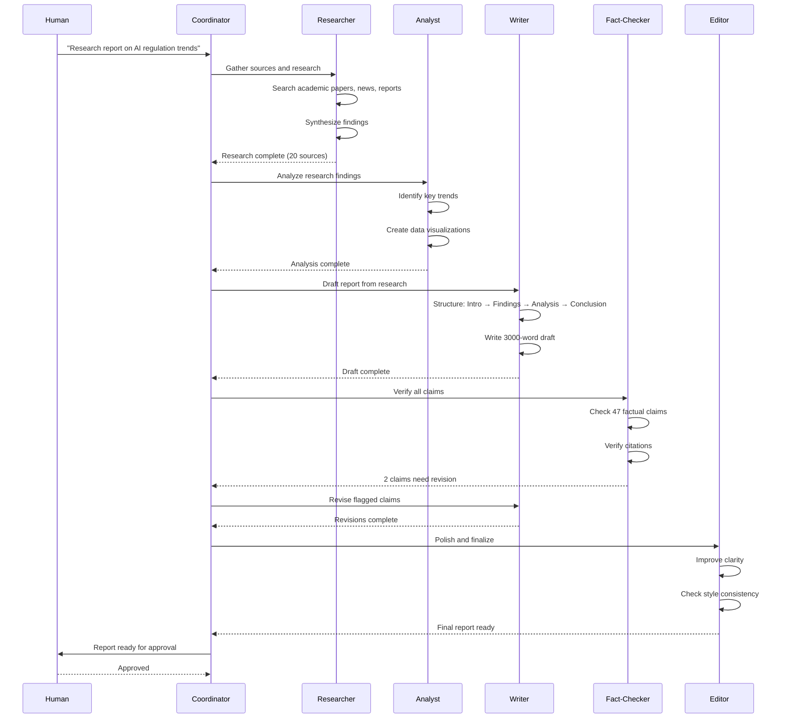
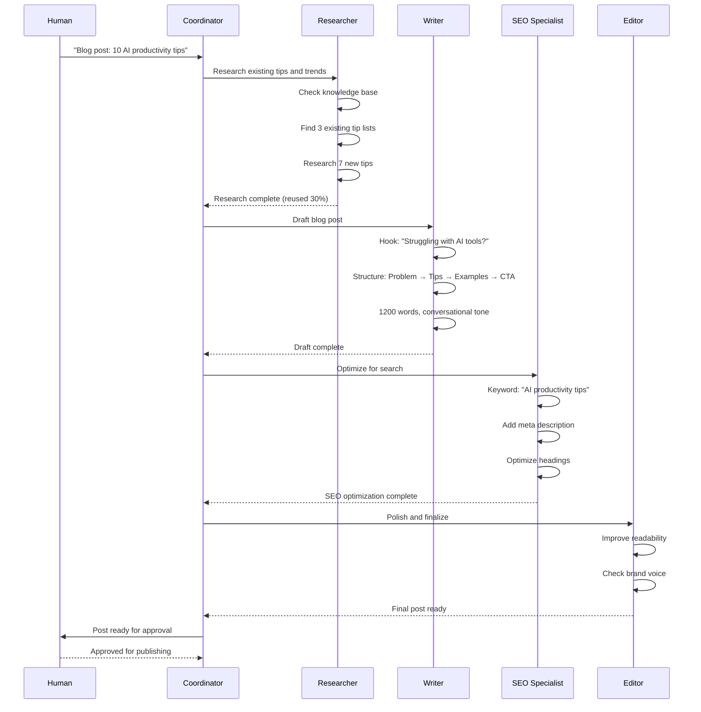
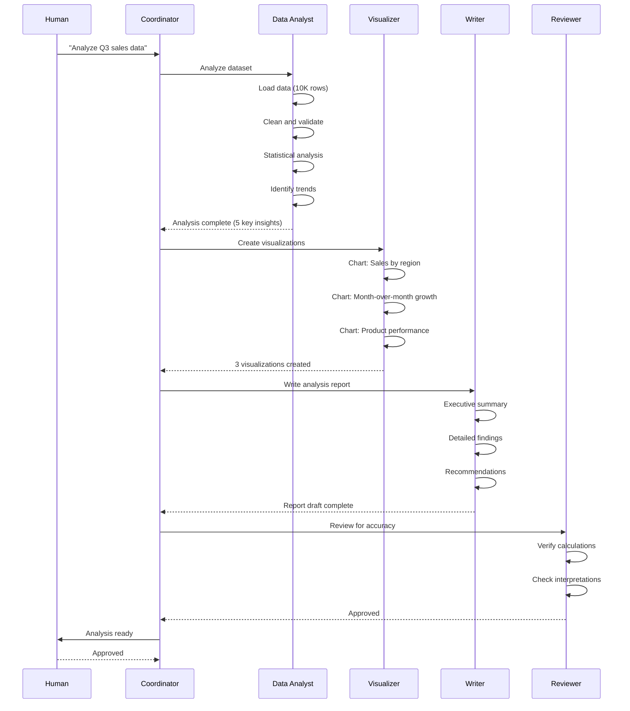

# Product Requirements Document: Unified Multi-Agent System for Non-Development Work

**Version:** 1.0  
**Date:** October 18, 2026  
**Status:** Draft for Review  
**Companion to:** Unified Multi-Agent Development System PRD

---

## Executive Summary

This PRD defines a unified multi-agent system for **non-development work** - content creation, research, data analysis, operations, and other knowledge work. While the companion development PRD focuses on code, this system coordinates AI agents for general knowledge work.

### What Problem Does This Solve?

Current AI-assisted knowledge work challenges:
- **Context Loss**: Agents lose research context on restart
- **Coordination Chaos**: Multiple agents working on related content without alignment
- **Quality Issues**: No systematic verification for non-code outputs
- **Duplication**: Agents recreate work that already exists
- **Human Bottlenecks**: Pure automation loses judgment; pure manual loses speed
- **Inconsistent Voice**: Multiple agents produce inconsistent tone and style

This system addresses these challenges through structured workflows, persistent context, and domain-appropriate quality gates.

---

## Vision

**Build a multi-agent system for knowledge work that:**
- Supports 20-30+ concurrent agents
- Persists research and context across crashes
- Produces high-quality content through systematic review
- Maintains consistent voice and style across agents
- Keeps humans in control at critical decision points
- Works across multiple content types and domains

---

## Core Principles (Non-Negotiable)

### 1. Context Persistence
All research, drafts, and decisions must survive crashes through persistent storage.

### 2. Structured Workflows
Prevent chaos through explicit workflow orchestration for different content types.

### 3. Systematic Review
Every output flows through quality gates appropriate to its domain.

### 4. Human Control
Humans approve at critical junctures; agents research and draft.

### 5. Radical Efficiency
Research before creating; reuse existing content; avoid duplication.

### 6. Measurable Impact
Track output quality, research depth, time saved, and reuse percentage.

---

## System Architecture

### High-Level Components

```
┌─────────────────────────────────────────────────────────────┐
│                     Human Interface Layer                    │
│  (CLI, Dashboard, Content Preview, Approval Workflows)       │
└─────────────────────────────────────────────────────────────┘
                              ↓
┌─────────────────────────────────────────────────────────────┐
│                   Orchestration Layer                        │
│  - Coordinator                                               │
│  - Router (Workflow Selection)                               │
│  - Scheduler (Capacity Management)                           │
└─────────────────────────────────────────────────────────────┘
                              ↓
┌─────────────────────────────────────────────────────────────┐
│                    Agent Execution Layer                     │
│  - Worker Agents                                             │
│  - Specialized Agents (Researcher, Writer, Analyst, Editor)  │
│  - Review Agents (Fact-Check, Style, Quality)                │
└─────────────────────────────────────────────────────────────┘
                              ↓
┌─────────────────────────────────────────────────────────────┐
│                   Verification Layer                         │
│  - Quality Review (Domain-Specific)                          │
│  - Fact Verification                                         │
│  - Style Consistency Check                                   │
│  - Plagiarism Detection                                      │
└─────────────────────────────────────────────────────────────┘
                              ↓
┌─────────────────────────────────────────────────────────────┐
│                   Monitoring Layer                           │
│  - Project Monitor (Per-Project Health)                      │
│  - System Patrol (Cross-Project Monitoring)                  │
│  - Quality Metrics (Output Quality Tracking)                 │
└─────────────────────────────────────────────────────────────┘
                              ↓
┌─────────────────────────────────────────────────────────────┐
│                    Persistence Layer                         │
│  - Document Storage (Drafts, Research, Finals)               │
│  - Knowledge Base (Reusable Content)                         │
│  - Decision Artifacts (Style Guides, Glossaries)             │
│  - Metrics Database (Quality Metrics)                        │
└─────────────────────────────────────────────────────────────┘
```

---

## Detailed Requirements

## 1. Context Persistence System

### 1.1 Document Storage

**Why This Matters:**
Unlike code that lives in version control, knowledge work produces documents, research notes, and drafts that need structured storage with versioning and retrieval.

**Requirements:**
- Persistent storage for drafts, research, and final outputs
- Version history for all documents
- Metadata tagging (topic, domain, status, quality score)
- Full-text search across all stored content
- Automatic deduplication detection

**Storage Structure:**
```
project/
├── research/
│   ├── topic-a/
│   │   ├── sources.md          # Collected sources
│   │   ├── notes.md            # Research notes
│   │   └── synthesis.md        # Synthesized findings
│   └── topic-b/
├── drafts/
│   ├── article-1/
│   │   ├── v1-outline.md
│   │   ├── v2-first-draft.md
│   │   └── v3-revised.md
│   └── article-2/
├── finals/
│   ├── published/
│   └── approved/
└── knowledge-base/
    ├── reusable-sections/
    ├── templates/
    └── style-guides/
```

### 1.2 Knowledge Base

**Why This Matters:**
Agents often recreate content that already exists. A searchable knowledge base enables reuse and prevents duplication.

**Requirements:**
- Searchable repository of reusable content
- Templates for common content types
- Style guides and voice guidelines
- Domain-specific glossaries
- Automatic similarity detection

**Example Knowledge Base:**
```yaml
knowledge_base:
  reusable_sections:
    - id: "company-intro"
      content: "Our company was founded in..."
      tags: ["about", "company", "intro"]
      usage_count: 47
      last_updated: "2026-10-15"
      
  templates:
    - id: "blog-post-template"
      structure: "Hook → Problem → Solution → CTA"
      word_count: "800-1200"
      tone: "conversational, authoritative"
      
  style_guides:
    - id: "brand-voice"
      tone: "Professional yet approachable"
      avoid: ["jargon", "passive voice", "buzzwords"]
      prefer: ["active voice", "concrete examples", "clear language"]
```

### 1.3 Decision Artifacts

**Requirements:**
- **Style Guides**: Define voice, tone, and writing standards
- **Content Briefs**: Document content strategy and goals
- **Editorial Guidelines**: Review criteria and quality standards
- **Domain Glossaries**: Shared terminology and definitions

---

## 2. Orchestration System

### 2.1 Coordinator

**Requirements:**
- Primary human interface for content requests
- Orchestrates but doesn't create content
- Creates work bundles for complex projects
- Spawns specialized agents based on content type
- Handles escalations and approval workflows

**Example Interaction:**
```
Human: "Create a 2000-word article on AI safety regulations"

Coordinator:
1. Analyzes request → Complex research article
2. Creates work bundle: "ai-safety-article"
3. Spawns Researcher agent → Gather sources
4. Spawns Writer agent → Draft article
5. Spawns Fact-Checker → Verify claims
6. Spawns Editor → Polish and finalize
7. Routes to human for final approval
```

### 2.2 Router (Workflow Selection)

**Requirements:**
- Automatic workflow selection based on content type
- Support for multiple content domains:
  - **Research Reports**: Deep research with citations
  - **Blog Posts**: Engaging, SEO-optimized content
  - **Technical Documentation**: Clear, accurate, comprehensive
  - **Marketing Copy**: Persuasive, brand-aligned
  - **Data Analysis**: Insights from data with visualizations
  - **Social Media**: Short-form, platform-optimized

**Workflow Mapping:**
```yaml
workflows:
  research_report:
    agents: [Researcher, Analyst, Writer, Fact-Checker, Editor]
    review: [Fact Verification, Citation Check, Quality Review]
    
  blog_post:
    agents: [Researcher, Writer, SEO Specialist, Editor]
    review: [Style Check, SEO Check, Quality Review]
    
  technical_docs:
    agents: [Technical Writer, Reviewer, Editor]
    review: [Accuracy Check, Completeness Check, Clarity Review]
    
  marketing_copy:
    agents: [Copywriter, Brand Specialist, Editor]
    review: [Brand Alignment, Persuasiveness Check, Legal Review]
```

---

## 3. Agent Execution System

### 3.1 Specialized Agents

**Why This Matters:**
Different content types require different expertise. Specialized agents bring domain-specific knowledge without requiring human mastery of all areas.

**Agent Types:**

#### Research Agents
- **Researcher**: Gathers sources, synthesizes findings
- **Fact-Checker**: Verifies claims and citations
- **Data Analyst**: Analyzes data, creates visualizations

#### Content Creation Agents
- **Writer**: Creates drafts following briefs
- **Copywriter**: Writes persuasive marketing content
- **Technical Writer**: Creates clear technical documentation
- **SEO Specialist**: Optimizes content for search

#### Review Agents
- **Editor**: Polishes language, improves clarity
- **Style Reviewer**: Ensures brand voice consistency
- **Quality Reviewer**: Assesses overall quality
- **Legal Reviewer**: Checks compliance and risk

### 3.2 Efficiency Framework (Research Before Creating)

**Why This Matters:**
Like the minimalism ladder for code, knowledge work needs a framework to avoid recreating existing content.

**The Research Ladder:**
Before creating any content, agents must climb the ladder:

1. **Does it need to exist?** - Skip content nobody asked for
2. **Already in knowledge base?** - Reuse existing content
3. **Similar content exists?** - Adapt rather than recreate
4. **Template available?** - Use template as starting point
5. **Research exists?** - Build on existing research
6. **Otherwise** - Create from scratch with proper research

**Example:**
```
Request: "Write about our company's AI safety approach"

Ladder Climb:
1. Does it need to exist? Yes (requested)
2. Already in knowledge base? Yes! Found "ai-safety-overview.md"
3. Action: Reuse 80%, update 20% with recent developments

Result: 30 minutes vs 4 hours from scratch
```

---

## 4. Verification System

### 4.1 Quality Review Framework

**Why This Matters:**
Unlike code that has tests, content quality is subjective. A structured review framework ensures consistent quality standards.

**Review Dimensions:**

1. **Accuracy**: Facts, data, citations correct
2. **Clarity**: Easy to understand, well-structured
3. **Completeness**: Covers all required points
4. **Consistency**: Matches brand voice and style
5. **Engagement**: Compelling, holds attention
6. **SEO** (if applicable): Optimized for search

**Review Checklist:**
```yaml
quality_review:
  accuracy:
    - All facts verified with sources
    - Data and statistics current
    - Citations properly formatted
    - No misleading claims
    
  clarity:
    - Clear thesis/main point
    - Logical flow and structure
    - Transitions between sections
    - No jargon without explanation
    
  completeness:
    - All brief requirements met
    - Key questions answered
    - Appropriate depth for audience
    - Call-to-action included (if needed)
    
  consistency:
    - Matches brand voice
    - Consistent terminology
    - Tone appropriate for audience
    - Style guide followed
    
  engagement:
    - Strong opening hook
    - Compelling examples
    - Varied sentence structure
    - Satisfying conclusion
```

### 4.2 Fact Verification

**Requirements:**
- Verify all factual claims with sources
- Check data and statistics for accuracy
- Validate citations and references
- Flag unverifiable claims for human review

**Verification Process:**
```
1. Extract all factual claims from content
2. For each claim:
   - Find supporting source
   - Verify claim matches source
   - Check source credibility
   - Note confidence level
3. Flag claims without verification
4. Generate verification report
```

### 4.3 Plagiarism Detection

**Requirements:**
- Check content against existing published work
- Detect unattributed quotes or paraphrasing
- Ensure proper citation of sources
- Flag similarity above threshold for review

---

## 5. Domain-Specific Workflows

### 5.1 Research Report Workflow



### 5.2 Blog Post Workflow



### 5.3 Data Analysis Workflow



---

## 6. Monitoring System

### 6.1 Quality Metrics

**Requirements:**
- Track output quality scores
- Monitor review pass/fail rates
- Measure research depth (sources per output)
- Track reuse percentage (knowledge base utilization)
- Monitor time per content type

**Quality Dashboard:**
```yaml
quality_metrics:
  overall_quality_score: 8.7/10
  
  by_content_type:
    research_reports:
      avg_quality: 9.2/10
      avg_sources: 23
      avg_time: 4.5 hours
      
    blog_posts:
      avg_quality: 8.5/10
      avg_sources: 8
      avg_time: 2 hours
      reuse_rate: 35%
      
    technical_docs:
      avg_quality: 9.0/10
      avg_accuracy: 98%
      avg_time: 3 hours
      
  review_metrics:
    first_pass_rate: 73%
    avg_revisions: 1.4
    fact_check_issues: 0.08 per article
```

### 6.2 Agent Performance

**Requirements:**
- Track agent output quality by type
- Monitor agent efficiency (time per task)
- Measure agent specialization effectiveness
- Identify agents needing improvement

---

## 7. Human Interface System

### 7.1 Content Preview

**Requirements:**
- Real-time preview of drafts
- Side-by-side comparison (draft vs final)
- Inline commenting and feedback
- Approval workflow with version tracking

### 7.2 Approval Workflows

**Requirements:**
- Multi-stage approval (draft → review → final)
- Role-based approval (editor, legal, executive)
- Approval history and audit trail
- Rejection with feedback loop

---

## 8. Use Cases

### 8.1 Content Marketing Team

**Scenario:** Marketing team needs 20 blog posts per month

**Without System:**
- 1 writer: 20 posts × 4 hours = 80 hours/month
- Quality inconsistent
- No systematic fact-checking
- Frequent duplication

**With System:**
- 5 agents working in parallel
- Reuse 30% from knowledge base
- Systematic quality review
- 20 posts × 2 hours = 40 hours/month
- **50% time savings, higher quality**

### 8.2 Research Organization

**Scenario:** Think tank producing monthly research reports

**Without System:**
- 1 researcher: 1 report × 40 hours = 40 hours
- Manual fact-checking
- No research reuse
- Inconsistent citation format

**With System:**
- Researcher + Analyst + Writer + Fact-Checker
- Reuse previous research
- Automated fact verification
- 1 report × 20 hours = 20 hours
- **50% time savings, higher accuracy**

### 8.3 Technical Documentation

**Scenario:** Software company maintaining product docs

**Without System:**
- Docs outdated
- Inconsistent style
- Missing sections
- Manual updates

**With System:**
- Automated doc generation from code
- Consistent style enforcement
- Completeness checking
- Version-synced updates
- **Always current, comprehensive**

---

## Success Metrics

### Quality Metrics
- **Output Quality Score:** Target 8.5+/10
- **Fact-Check Pass Rate:** Target 95%+
- **First-Pass Approval Rate:** Target 70%+
- **Reuse Percentage:** Target 30%+

### Efficiency Metrics
- **Time Reduction:** Target -40% vs manual
- **Cost per Output:** Track cost trends
- **Agent Utilization:** Target 80%+ capacity
- **Research Depth:** Track sources per output

### Reliability Metrics
- **Agent Uptime:** Target 99%+
- **Context Recovery:** Track recovery success rate
- **Quality Consistency:** Track variance in quality scores

---

## Implementation Phases

### Phase 1: Foundation (8-10 weeks)
- Document storage system
- Basic coordinator and router
- Researcher and Writer agents
- Simple quality review
- CLI interface

### Phase 2: Specialization (6-8 weeks)
- Specialized agents (all types)
- Knowledge base with search
- Fact verification system
- Style consistency checking
- Approval workflows

### Phase 3: Monitoring (4-6 weeks)
- Quality metrics dashboard
- Agent performance tracking
- System health monitoring
- Escalation system

### Phase 4: Scale (6-8 weeks)
- Multi-project support
- Advanced knowledge base
- Plagiarism detection
- Cross-domain workflows

---

## Comparison: Development vs Non-Development Systems

| Aspect | Development System | Non-Development System |
|--------|-------------------|------------------------|
| **Primary Output** | Code | Content/Documents |
| **Verification** | Tests, Code Review | Fact-Check, Quality Review |
| **Persistence** | Version Control (Git) | Document Storage |
| **Minimalism** | Code Ladder | Research Ladder |
| **Quality Gate** | Merge Queue | Approval Workflow |
| **Reuse** | Code Libraries | Knowledge Base |
| **Collaboration** | PRs, Branches | Drafts, Reviews |

---

## Open Questions

1. **Quality Scoring:** How to objectively measure content quality?
2. **Fact Verification:** What confidence threshold for automated verification?
3. **Knowledge Base:** How to prevent knowledge base bloat?
4. **Voice Consistency:** How to maintain consistent voice across agents?
5. **Legal Review:** When is legal review required vs optional?

---

## Appendix A: Content Type Specifications

### Research Report
- **Length:** 2000-5000 words
- **Sources:** 15-30 citations
- **Structure:** Abstract → Introduction → Methodology → Findings → Analysis → Conclusion
- **Review:** Fact verification required, peer review recommended

### Blog Post
- **Length:** 800-1500 words
- **Sources:** 3-10 citations
- **Structure:** Hook → Problem → Solution → Examples → CTA
- **Review:** Style check, SEO optimization

### Technical Documentation
- **Length:** Variable
- **Sources:** Code references, API docs
- **Structure:** Overview → Setup → Usage → Examples → Troubleshooting
- **Review:** Accuracy check, completeness check

### Marketing Copy
- **Length:** 100-500 words
- **Sources:** Product specs, brand guidelines
- **Structure:** Headline → Benefits → Features → CTA
- **Review:** Brand alignment, legal review

---

## Appendix B: Communication Mode Requirements

**Agent-to-Agent Communication (Caveman Mode Allowed):**

When agents communicate with each other (not with humans), they MAY use caveman mode for token efficiency:

**Allowed in Agent-to-Agent:**
- Abbreviated syntax: `Research → 20 sources → synthesis`
- Symbols: `→`, `≠`, `✓`, `✗`
- Shortened phrases: "Draft = 1200 words"
- Minimal context: Assume shared understanding
- Token-optimized format

**Example Agent-to-Agent Message:**
```
Task: blog-post-ai-tips
Status: research ✓, draft 80%, seo pending
Sources: 8 articles, 3 studies
Next: complete draft → seo optimize → editor review
Quality: 8.5/10 target
```

**Human-Facing Documents (Unslop Required):**

When creating documents for humans (articles, reports, documentation), agents MUST use unslop mode:

**Required for Human Documents:**
- Clear, complete sentences
- Proper grammar and structure
- Concrete examples and data
- Educational explanations
- No AI slop patterns
- Readable by target audience

**Example Human-Facing Document:**
```markdown
## Blog Post Progress: AI Productivity Tips

**Research Complete:**
- Analyzed 8 articles on AI productivity tools
- Reviewed 3 academic studies on AI adoption
- Identified 10 actionable tips with evidence

**Draft Status:**
- 1,200 words written (target: 1,500)
- 8 tips completed with examples
- 2 tips remaining

**Quality Metrics:**
- Readability: Grade 8 level (target audience)
- SEO: Primary keyword density 1.2%
- Engagement: 3 concrete examples per tip

**Next Steps:**
1. Complete final 2 tips
2. Add meta description
3. Optimize headings for SEO
4. Submit for editorial review
```

**Configuration:**

```yaml
# config/communication-modes.yaml
communication_modes:
  agent_to_agent:
    mode: caveman
    allow_abbreviations: true
    allow_symbols: true
    optimize_for: tokens
    
  human_facing:
    mode: unslop
    require_complete_sentences: true
    require_examples: true
    optimize_for: clarity
    
  documents:
    - type: "Research Report"
      mode: unslop
      anti_slop: true
      
    - type: "Blog Post"
      mode: unslop
      anti_slop: true
      
    - type: "Technical Documentation"
      mode: unslop
      anti_slop: true
      
    - type: "Agent Logs"
      mode: caveman
      anti_slop: false
      
    - type: "Status Updates"
      mode: caveman
      anti_slop: false
```

**Rationale:**

- **Token Efficiency**: Agent-to-agent communication happens frequently. Caveman mode reduces token usage by 40-60% without losing meaning between agents.
- **Human Readability**: Documents for humans must be clear, educational, and professional. Unslop mode ensures quality.
- **Context Awareness**: Agents share context and can interpret abbreviated communication. Humans need full explanations.

---

## Appendix C: Glossary

- **Knowledge Base:** Searchable repository of reusable content, templates, and guidelines
- **Research Ladder:** Framework for avoiding content duplication (similar to code minimalism ladder)
- **Quality Review:** Systematic evaluation of content across multiple dimensions
- **Fact Verification:** Process of validating factual claims with credible sources
- **Content Brief:** Document defining content goals, audience, and requirements
- **Style Guide:** Guidelines for voice, tone, and writing standards
- **Approval Workflow:** Multi-stage process for reviewing and approving content
- **Reuse Percentage:** Metric tracking how much existing content is reused vs created new

---

**End of Document**
