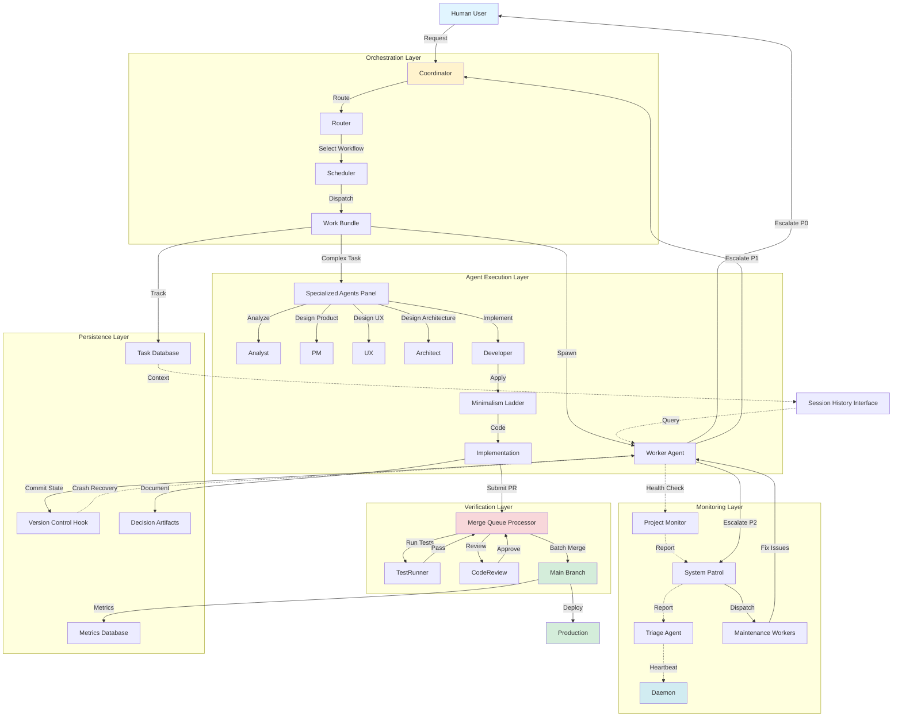
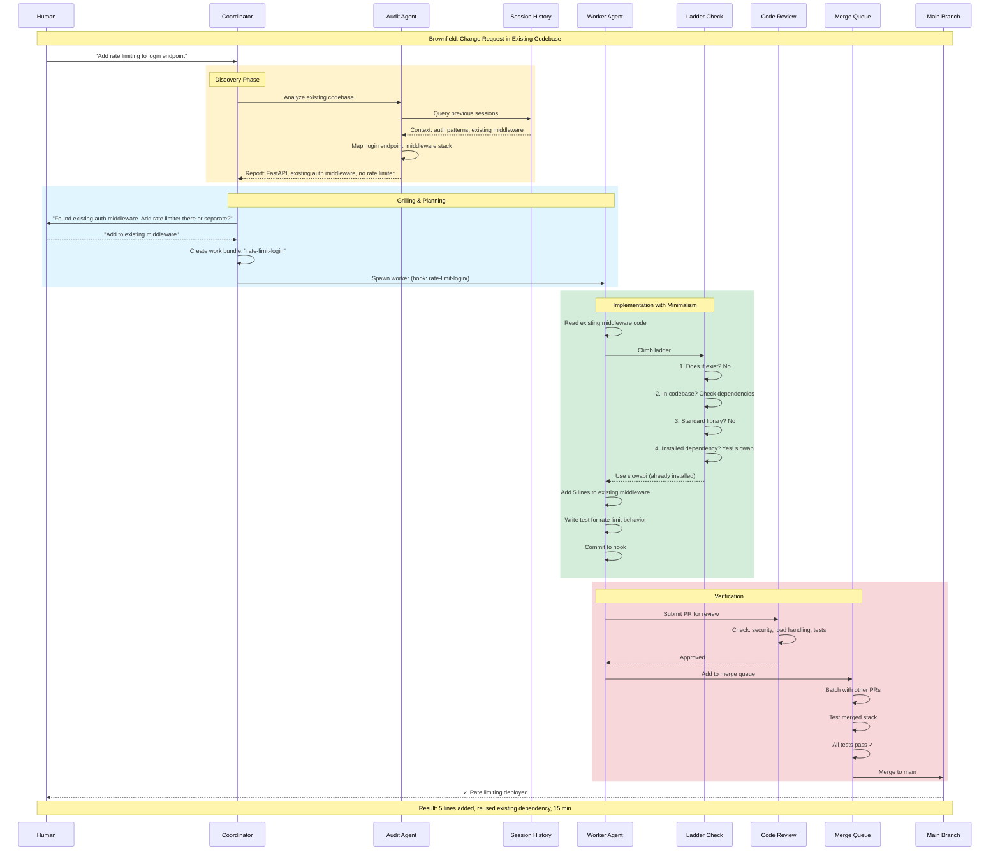
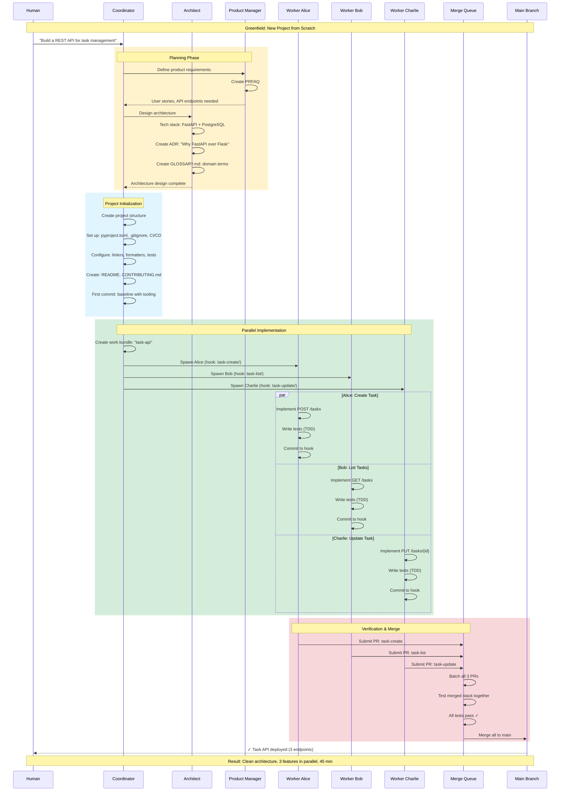
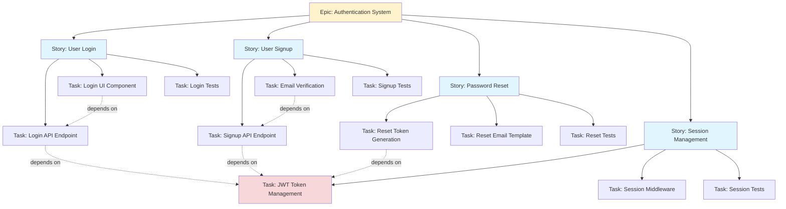

# Product Requirements Document: Unified Multi-Agent Development System

**Version:** 1.0  
**Date:** October 17, 2026  
**Status:** Draft for Review

---

## Executive Summary

This PRD defines a unified multi-agent development system for AI-assisted software development. The system combines distributed coordination, structured workflows, radical minimalism, and engineering fundamentals.

### What Problem Does This Solve?

Current AI-assisted development challenges:
- **Context Loss**: Agents lose state on restart, breaking multi-agent workflows
- **Over-Engineering**: Agents write more code than necessary, increasing maintenance cost
- **Quality Issues**: Without systematic verification, bugs reach production
- **Coordination Chaos**: Multiple agents without structure create conflicts
- **Human Bottlenecks**: Pure automation loses judgment; pure manual loses speed
- **Vendor Lock-in**: Skills and workflows tied to specific AI tools

This system addresses these challenges through proven architectural patterns and engineering principles.

---

## Vision

**Build a multi-agent development system that:**
- Supports 20-30+ concurrent agents
- Persists context across crashes and restarts
- Produces minimal, high-quality code through systematic verification
- Keeps humans in control at critical decision points
- Works across multiple AI runtimes and platforms
- Measures and optimizes for real impact: code size, cost, time, and quality

---

## Core Principles (Non-Negotiable)

### 1. Context Persistence
All agent work state must survive crashes and restarts through version-controlled storage.

### 2. Structured Workflows
Prevent chaos through explicit workflow orchestration and task tracking.

### 3. Systematic Verification
Every change flows through automated quality gates before reaching main.

### 4. Human Control
Humans approve at critical junctures; agents propose and execute.

### 5. Radical Minimalism
Solve before writing; measure the impact of not writing code.

### 6. Measurable Impact
Track code size, cost, time, test coverage, and production reliability.

---

## System Architecture

### High-Level Components

```
┌─────────────────────────────────────────────────────────────┐
│                     Human Interface Layer                    │

---

## System Requirements

### Cross-Platform Compatibility

**Requirement:** The system must work on both Windows and Linux/macOS operating systems.

**Rationale:**
- Development teams use diverse operating systems
- System should not force OS choice on users
- Cross-platform support enables broader adoption

**Platform-Specific Considerations:**

**Windows:**
- Must support Windows 10+ or Windows 11
- WSL2 (Windows Subsystem for Linux) acceptable for Git worktree operations
- PowerShell and Command Prompt compatibility for CLI
- Path handling must account for Windows path separators (`\` vs `/`)
- Line ending handling (CRLF vs LF) must be transparent

**Linux/macOS:**
- Must support major Linux distributions (Ubuntu 20.04+, Debian, Fedora, Arch)
- Must support macOS 11+ (Big Sur and later)
- Native Unix shell compatibility (bash, zsh)
- Standard Unix path conventions

**Cross-Platform Requirements:**
- File system operations must be OS-agnostic
- Process management must work across platforms
- Environment variable handling must be consistent
- CLI commands must have identical behavior across platforms
- Configuration files must use platform-independent formats (YAML, JSON)

**Implementation Constraints:**
- Use cross-platform libraries for file operations
- Abstract OS-specific operations behind common interfaces
- Test on all supported platforms before release
- Document platform-specific limitations if any exist


### Hardware Requirements

**Minimum Requirements:**
- **Memory:** 8GB RAM
- **Storage:** 10GB free disk space
- **Network:** Stable internet connection for LLM API calls

**Recommended Requirements (for 20+ agents):**
- **Memory:** 16GB RAM
- **Storage:** 50GB free disk space (for session history, logs, metrics)
- **Network:** High-bandwidth connection (1 Mbps+ sustained)

**Rationale:**
- Agent sessions consume memory proportional to context size
- Version control worktrees require disk space
- LLM API calls require reliable network connectivity

### Software Requirements

**Version Control:**
- **Git:** 2.30+ (required for worktree support)
- **Rationale:** Hooks system depends on Git worktrees for context persistence

**Runtime Environment:**
- **Python:** 3.10+ OR **Node.js:** 18+
- **Rationale:** Implementation language choice, both must be supported

**Database:**
- **Development:** SQLite 3.35+ (embedded, zero-config)
- **Production:** PostgreSQL 14+ (for 20+ agents)
- **Rationale:** SQLite sufficient for small scale, PostgreSQL required for production scale

**Optional:**
- **Container Runtime:** Docker 20+ (for agent isolation)
- **Rationale:** Optional isolation layer for security-sensitive deployments

### LLM Provider Requirements

**Minimum:** At least one supported provider configured

**Supported Providers:**
- **Anthropic Claude:** API key with Claude 3.5 Sonnet access
- **OpenAI:** API key with GPT-4 access  
- **Google Gemini:** API key with Gemini 1.5 Pro access
- **Local LLM:** Ollama with llama3 or similar (development only)

**Rationale:**
- Multi-provider support prevents vendor lock-in
- Local LLM support enables offline development
- Provider diversity enables cost optimization

---

## Security Requirements

### Authentication & Authorization

**API Key Management:**
- **MUST:** Store API keys in environment variables or secure vault
- **MUST NOT:** Hardcode API keys in configuration files or code
- **MUST:** Support integration with HashiCorp Vault or equivalent secret management

**Access Control:**
- **MUST:** Implement role-based access control (RBAC)
- **Required Roles:**
  - **Admin:** Manage agents, view all projects, modify system configuration
  - **Developer:** Spawn agents, view own projects, submit work requests
  - **Viewer:** View metrics, view own projects (read-only)

**Audit Logging:**
- **MUST:** Log all agent operations with timestamp, user, action
- **MUST:** Audit log must be immutable (append-only)
- **MUST:** Retain audit logs for minimum 90 days

### Data Protection

**Secrets Management:**
- **MUST:** Never commit secrets to version control
- **MUST:** Provide integration with external secret management systems
- **MUST:** Rotate API keys on schedule or on-demand

**Least Privilege:**
- **MUST:** Agents operate with minimum required permissions
- **MUST:** File system access limited to project directories
- **MUST:** Network access limited to required LLM providers

**Rationale:**
- Security breaches can expose API keys and sensitive code
- Audit trails enable incident investigation
- Least privilege limits blast radius of compromised agents

---

## Scalability Requirements

### Agent Capacity Tiers

**Tier 1 (MVP):**
- **Capacity:** 5 concurrent agents
- **Database:** SQLite
- **Use Case:** Individual developers, proof of concept

**Tier 2 (Production):**
- **Capacity:** 20 concurrent agents
- **Database:** PostgreSQL
- **Use Case:** Small teams (5-10 developers)

**Tier 3 (Scale):**
- **Capacity:** 30+ concurrent agents
- **Database:** PostgreSQL with connection pooling
- **Use Case:** Large teams (10+ developers), multiple projects

**Rationale:**
- Different team sizes have different scaling needs
- Database choice impacts maximum agent capacity
- Clear tiers enable incremental scaling

### Token Budget Management

**Requirements:**
- **MUST:** Support configurable daily token budget per project
- **MUST:** Support configurable per-task token budget
- **MUST:** Gracefully handle budget exhaustion (queue work, don't fail)
- **MUST:** Alert when approaching budget limits (80%, 90%, 95%)

**Rationale:**
- Prevents runaway costs from agent loops
- Enables cost predictability and control
- Alerts enable proactive intervention

### Database Scaling

**Requirements:**
- **MUST:** Support migration from SQLite to PostgreSQL without data loss
- **MUST:** Handle concurrent database access from multiple agents
- **MUST:** Implement connection pooling for PostgreSQL
- **SHOULD:** Support optional federation for 30+ agents across workspaces

**Rationale:**
- Teams grow over time, database must scale with them
- Concurrent access requires proper transaction handling
- Federation enables horizontal scaling beyond single database

---

## Configuration Requirements

### Project-Level Configuration

**Required Configuration Options:**
- **Minimalism Level:** `lite`, `full`, `ultra`
- **Testing Requirements:** Coverage target (%), TDD enforcement (boolean)
- **Review Policy:** Required reviewers (number), auto-merge rules (boolean)
- **Token Efficiency:** Compression level, budget limits
- **LLM Provider:** Default provider, fallback provider

**Configuration Format:**
- **MUST:** Use YAML or JSON (human-readable, version-controllable)
- **MUST:** Support environment variable substitution
- **MUST:** Validate configuration on load with clear error messages

**Example Schema:**
```yaml
project:
  name: string
  type: "development" | "non-development"
  minimalism:
    level: "lite" | "full" | "ultra"
    enforce: boolean
  testing:
    coverage_target: number (0-100)
    tdd_required: boolean
  review:
    required: boolean
    auto_merge: boolean
  token_efficiency:
    compression: "lite" | "full" | "ultra"
    budget_per_task: number
  llm_provider:
    default: string
    fallback: string
```

### Agent-Level Configuration

**Required Configuration Options:**
- **Model Selection:** Per-role model mapping (coordinator, worker, reviewer, etc.)
- **Token Limits:** Per-agent token budgets
- **Compression:** Context compression strategy
- **Handoff Threshold:** When to trigger agent handoff (e.g., 90% token usage)

**Configuration Format:**
```yaml
agents:
  coordinator:
    model: string
    token_limit: number
    compression: "lite" | "full" | "ultra"
  worker:
    model: string
    token_limit: number
    compression: "lite" | "full" | "ultra"
    handoff_threshold: number (0.0-1.0)
  specialized:
    architect:
      model: string
      token_limit: number
    reviewer:
      model: string
      token_limit: number
```

**Rationale:**
- Different projects have different quality/cost trade-offs
- Configuration must be version-controlled alongside code
- Clear schema prevents configuration errors

---

## User Interface Requirements

### CLI Interface (Primary)

**Required Commands:**

**System Management:**
- `init` - Initialize system database and configuration
- `start-all` - Start all system services
- `stop-all` - Stop all system services
- `status` - Show system status
- `health-check` - Run comprehensive health check

**Project Management:**
- `project create` - Create new project
- `project list` - List all projects
- `project switch` - Switch active project

**Agent Management:**
- `agents list` - List all agents
- `agents spawn` - Spawn new agent
- `agents status` - Check agent status
- `agents handoff` - Handoff work between agents

**Work Management:**
- `request` - Submit work request
- `work-bundle show` - Show work bundle details
- `watch` - Watch task progress in real-time

**Monitoring:**
- `metrics tokens` - Token usage metrics
- `metrics cost` - Cost metrics
- `metrics quality` - Quality metrics
- `metrics agents` - Agent performance metrics

**Debugging:**
- `debug replay` - Replay agent session
- `debug context` - Inspect agent context
- `logs` - View system logs

**CLI Requirements:**
- **MUST:** Provide help text for all commands
- **MUST:** Support shell completion (bash, zsh, fish)
- **MUST:** Return appropriate exit codes (0 = success, non-zero = error)
- **MUST:** Output structured data (JSON) when `--json` flag provided

### Dashboard Interface (Secondary)

**Required Features:**
- Real-time agent activity monitoring
- Work bundle status visualization
- Merge queue state display
- Escalation tracking and management
- Metrics and trends (charts/graphs)

**Dashboard Requirements:**
- **MUST:** Auto-refresh without page reload
- **MUST:** Support filtering and search
- **SHOULD:** Support command palette for quick actions
- **SHOULD:** Export data to CSV/JSON

**Rationale:**
- CLI is primary interface for automation and scripting
- Dashboard provides visual overview for monitoring
- Both interfaces must provide same functionality

---

## Observability Requirements

### Metrics Collection

**Required Metrics:**

**Token Usage:**
- Per-agent token consumption
- Per-task token consumption
- Per-project daily/weekly/monthly totals
- Token efficiency (tokens per line of code)

**Cost Tracking:**
- Per-agent cost (based on LLM provider pricing)
- Per-task cost
- Per-project daily/weekly/monthly costs
- Cost per feature delivered

**Quality Metrics:**
- Test coverage percentage
- Bug escape rate (bugs found in production)
- Code review findings (per severity)
- Merge queue success rate

**Agent Performance:**
- Task completion time (median, p95, p99)
- Token efficiency per agent
- Handoff rate (frequency of agent handoffs)
- Escalation rate (frequency of escalations)

**Metrics Requirements:**
- **MUST:** Store metrics in time-series database
- **MUST:** Support metric aggregation (sum, avg, min, max, percentiles)
- **MUST:** Retain metrics for minimum 90 days
- **SHOULD:** Support metric export to external systems (Prometheus, Grafana)

### Alerting

**Required Alerts:**

**Budget Alerts:**
- Token budget at 80% (warning)
- Token budget at 90% (critical)
- Token budget at 95% (emergency)

**Agent Failure Alerts:**
- Agent stuck (no progress for 10 minutes)
- Agent crashed (unexpected termination)
- Agent escalated (P0/P1 escalation)

**Quality Alerts:**
- Test failure in merge queue
- Merge queue blocked (no merges for 30 minutes)
- Code coverage below threshold

**System Health Alerts:**
- Daemon down (watchdog failure)
- Database unavailable
- LLM provider error rate > 5%

**Alerting Requirements:**
- **MUST:** Support multiple notification channels (email, Slack, PagerDuty)
- **MUST:** Support alert severity levels (info, warning, critical, emergency)
- **MUST:** Support alert deduplication (don't spam same alert)
- **SHOULD:** Support alert escalation policies

**Rationale:**
- Metrics enable data-driven optimization
- Alerts enable proactive issue resolution


---

## Installation and Deployment Requirements

### Overview

**Requirement:** The system installation must be easy, idempotent, updateable, and non-intrusive. It must be possible to easily remove the system from repositories without leaving artifacts or breaking existing workflows.

**Rationale:**
- Teams need to try the system without committing to permanent changes
- Installation should not disrupt existing development workflows
- Updates should be seamless and safe
- Removal should be clean and complete
- System should work alongside existing tools

### Installation Requirements

**Easy Installation:**
- **MUST:** Provide single-command installation
- **MUST:** Complete installation in under 5 minutes
- **MUST:** Require minimal user input (API keys only)
- **MUST:** Provide clear progress indicators
- **MUST:** Validate prerequisites before installation

**Installation Methods:**
```bash
# Method 1: Package manager (preferred)
npm install -g unified-multi-agent-system
# or
pip install unified-multi-agent-system

# Method 2: Installer script
curl -fsSL https://install.umas.dev | bash

# Method 3: Container
docker run -v $(pwd):/workspace umas/system:latest init
```

**Prerequisites Check:**
```bash
$ umas check-prerequisites

Checking prerequisites...
✓ Git 2.30+ installed (found: 2.42.0)
✓ Python 3.10+ OR Node.js 18+ (found: Python 3.11.5)
✓ 10GB free disk space (found: 45GB)
✓ Internet connection available
✗ LLM API key not configured

Action required:
Set API key: export ANTHROPIC_API_KEY=your-key-here

Run 'umas init' to complete installation.
```

### Idempotent Installation

**Requirements:**
- **MUST:** Running installation multiple times produces same result
- **MUST:** Detect existing installation and skip redundant steps
- **MUST:** Preserve user configuration across reinstalls
- **MUST:** Update only changed components

**Idempotency Guarantees:**
```bash
# First install
$ umas init
Installing Unified Multi-Agent System...
✓ Created configuration directory: ~/.umas/
✓ Initialized database
✓ Created default project
Installation complete!

# Second install (idempotent)
$ umas init
Unified Multi-Agent System already installed.
✓ Configuration exists: ~/.umas/
✓ Database exists (no changes)
✓ Default project exists (no changes)
No action needed. System ready.

# Force reinstall (preserves config)
$ umas init --force
Reinstalling Unified Multi-Agent System...
✓ Backed up existing configuration
✓ Reinstalled system components
✓ Restored user configuration
Reinstallation complete!
```

### Non-Intrusive Installation

**Requirements:**
- **MUST:** Not modify existing project files without explicit permission
- **MUST:** Store system files in dedicated directory (`.umas/` or `~/.umas/`)
- **MUST:** Use Git hooks only if user approves
- **MUST:** Not interfere with existing Git workflows
- **MUST:** Work alongside existing CI/CD pipelines

**File System Layout:**
```
# Global installation (user-level)
~/.umas/
├── config.yaml           # User configuration
├── database.db           # System database
├── logs/                 # System logs
└── cache/                # Temporary cache

# Project-level (optional, user must approve)
project/
├── .umas/                # Project-specific config (gitignored)
│   ├── config.yaml
│   ├── hooks/            # Git hooks (optional)
│   └── worktrees/        # Agent worktrees
├── .gitignore            # Updated to ignore .umas/ (if approved)
└── (existing project files unchanged)
```

**Permission-Based Installation:**
```bash
$ umas init --project

Unified Multi-Agent System - Project Setup

This will create the following in your project:
  - .umas/ directory (for system files)
  - Git hooks (for context persistence)
  - .gitignore entry (to ignore .umas/)

Your existing files will NOT be modified.

Proceed? [y/N]: y

✓ Created .umas/ directory
✓ Installed Git hooks
✓ Updated .gitignore
Project setup complete!
```

### Updateable Installation

**Requirements:**
- **MUST:** Support in-place updates without data loss
- **MUST:** Provide rollback mechanism if update fails
- **MUST:** Preserve user configuration during updates
- **MUST:** Notify users of breaking changes
- **MUST:** Support automatic and manual update modes

**Update Process:**
```bash
# Check for updates
$ umas update --check
Current version: 1.0.1
Latest version: 1.2.0
Update available!

Changes in 1.2.0:
  - New: Multi-platform agent support
  - Improved: Error handling and recovery
  - Fixed: Token budget calculation bug

Run 'umas update' to install.

# Automatic update
$ umas update
Updating Unified Multi-Agent System...
✓ Backed up current installation
✓ Downloaded version 1.2.0
✓ Migrated database schema
✓ Preserved user configuration
✓ Verified installation
Update complete! (1.0.1 → 1.2.0)

Rollback available: umas rollback --to 1.0.1

# Manual update with review
$ umas update --manual
Updating Unified Multi-Agent System...
✓ Downloaded version 1.2.0

Review changes before applying:
  - Database migration required (automatic)
  - Configuration format changed (automatic migration)
  - New CLI commands available

Apply update? [y/N]: y
```

**Rollback Support:**
```bash
# Rollback to previous version
$ umas rollback
Rolling back to version 1.0.1...
✓ Restored previous installation
✓ Reverted database schema
✓ Restored configuration
Rollback complete!

# Rollback to specific version
$ umas rollback --to 1.0.0
```

### Easy Removal

**Requirements:**
- **MUST:** Provide single-command uninstallation
- **MUST:** Remove all system files cleanly
- **MUST:** Optionally preserve user data (configuration, database)
- **MUST:** Restore project to pre-installation state
- **MUST:** Not leave orphaned files or configurations

**Uninstallation Process:**
```bash
# Uninstall with data preservation
$ umas uninstall
Uninstalling Unified Multi-Agent System...

What would you like to do with your data?
  1. Remove everything (clean uninstall)
  2. Keep configuration and database (for reinstall)
  3. Export data before removal

Choice [1-3]: 2

✓ Removed system binaries
✓ Removed Git hooks
✓ Removed .umas/ directories from projects
✓ Preserved configuration: ~/.umas/config.yaml
✓ Preserved database: ~/.umas/database.db

Uninstallation complete!
To reinstall: umas init (will restore your configuration)

# Complete removal
$ umas uninstall --purge
This will remove ALL system files and data.
This action cannot be undone.

Proceed? [y/N]: y

✓ Removed system binaries
✓ Removed configuration
✓ Removed database
✓ Removed all project files
✓ Removed Git hooks

Complete removal finished.
```

**Project Cleanup:**
```bash
# Remove system from specific project
$ umas remove --project
Removing Unified Multi-Agent System from project...

This will remove:
  - .umas/ directory
  - Git hooks
  - .gitignore entry

Your code and git history will NOT be affected.

Proceed? [y/N]: y

✓ Removed .umas/ directory
✓ Removed Git hooks
✓ Cleaned .gitignore
Project cleanup complete!
```

### Configuration Management

**Requirements:**
- **MUST:** Store configuration in version-controllable format (YAML/JSON)
- **MUST:** Support environment variable overrides
- **MUST:** Provide configuration validation
- **MUST:** Support configuration migration across versions

**Configuration Locations:**
```yaml
# Priority order (highest to lowest)
1. Environment variables (UMAS_*)
2. Project config (.umas/config.yaml)
3. User config (~/.umas/config.yaml)
4. System defaults
```

**Configuration Validation:**
```bash
$ umas config validate
Validating configuration...
✓ Syntax valid (YAML)
✓ Schema valid (all required fields present)
✓ API keys configured
✓ Database accessible
✗ Token budget exceeds recommended limit

Warning: Daily token budget (1M) is very high.
Recommended: 100K tokens/day for typical usage.

Configuration valid with 1 warning.
```

### Compatibility Requirements

**Requirements:**
- **MUST:** Not conflict with existing development tools
- **MUST:** Work alongside other AI coding assistants
- **MUST:** Respect existing Git hooks (chain, don't replace)
- **MUST:** Not interfere with CI/CD pipelines
- **MUST:** Support custom project structures

**Git Hook Chaining:**
```bash
# Existing pre-commit hook
#!/bin/bash
npm run lint
npm run test

# After UMAS installation (chained)
#!/bin/bash
# UMAS: Context persistence
~/.umas/hooks/pre-commit

# User hooks (preserved)
npm run lint
npm run test
```

### Installation Verification

**Requirements:**
- **MUST:** Provide post-installation verification
- **MUST:** Test all critical components
- **MUST:** Verify API connectivity
- **MUST:** Provide troubleshooting guidance

**Verification Process:**
```bash
$ umas verify
Verifying Unified Multi-Agent System installation...

System Components:
✓ CLI installed and accessible
✓ Database initialized and accessible
✓ Configuration valid

Connectivity:
✓ LLM provider reachable (Anthropic Claude)
✓ Internet connection stable

Project Setup:
✓ Git repository detected
✓ Hooks installed correctly
✓ Worktree support available

All checks passed! System ready to use.

Quick start:
  1. Create project: umas project create my-project
  2. Submit request: umas request "Add login feature"
  3. Monitor progress: umas watch
```

### Migration Support

**Requirements:**
- **MUST:** Support migration from other AI coding tools
- **MUST:** Import existing project configuration
- **MUST:** Preserve existing workflows
- **SHOULD:** Provide migration guides for common tools

**Migration Examples:**
```bash
# Migrate from Cursor
$ umas migrate --from cursor
Migrating from Cursor...
✓ Imported project configuration
✓ Converted .cursorrules to UMAS format
✓ Preserved existing workflows
Migration complete!

# Migrate from GitHub Copilot
$ umas migrate --from copilot
Migrating from GitHub Copilot...
✓ Detected Copilot configuration
✓ Created compatible UMAS configuration
✓ Copilot can continue working alongside UMAS
Migration complete!
```

### Rationale

**Why This Matters:**
- **Adoption:** Easy installation lowers barrier to entry
- **Trust:** Non-intrusive installation builds user confidence
- **Flexibility:** Easy removal enables risk-free trial
- **Maintenance:** Idempotent updates reduce operational burden
- **Compatibility:** Works alongside existing tools without conflicts


---

## Multi-Agent Platform Support

### Overview

**Requirement:** The system must support multiple coding agent platforms (Claude Code, GitHub Copilot, IBM Bob, etc.) working together within the same project.

**Rationale:**
- Different coding agents have different strengths (e.g., Claude Code for architecture, Copilot for autocomplete, Bob for enterprise workflows)
- Teams may have licenses for multiple platforms
- Avoid vendor lock-in to a single coding agent platform
- Enable best-of-breed approach (use the right agent for the right task)

### Supported Coding Agent Platforms

**Tier 1 (Full Integration):**
- **Claude Code:** Full integration with context persistence, hooks, and workflows
- **IBM Bob:** Enterprise-grade integration with security and compliance features
- **GitHub Copilot:** Code completion and suggestion integration

**Tier 2 (Basic Integration):**
- **Cursor:** IDE-based agent with API integration
- **Cody (Sourcegraph):** Code intelligence and search integration
- **Tabnine:** Code completion integration

**Tier 3 (Experimental):**
- **Codex (OpenAI):** Direct API integration
- **Custom Agents:** User-defined agents via plugin system

### Agent Interoperability Requirements

**Common Protocol:**
- **MUST:** Define standard agent communication protocol
- **MUST:** Support agent-to-agent handoff across platforms
- **MUST:** Maintain context across platform boundaries
- **MUST:** Provide unified work tracking regardless of agent platform

**Protocol Specification:**
```yaml
agent_protocol:
  version: "1.0"
  
  agent_identity:
    platform: string          # "claude-code", "ibm-bob", "copilot"
    agent_id: string          # Unique agent identifier
    capabilities: array       # ["code-generation", "review", "refactor"]
    
  context_format:
    type: "json" | "markdown"
    schema_version: string
    
  handoff_protocol:
    state_transfer: "hooks" | "api" | "file-based"
    context_compression: boolean
    
  work_tracking:
    task_format: "standard"   # Common task format
    status_updates: "real-time" | "polling"
```

### Platform-Specific Adapters

**Requirements:**
- **MUST:** Implement adapter for each supported platform
- **MUST:** Abstract platform differences behind common interface
- **MUST:** Handle platform-specific authentication
- **MUST:** Map platform capabilities to system roles

**Adapter Interface:**
```python
class CodingAgentAdapter:
    """Base adapter interface for coding agent platforms"""
    
    def authenticate(self, credentials: dict) -> bool:
        """Authenticate with platform"""
        pass
    
    def spawn_agent(self, task: Task, config: dict) -> Agent:
        """Spawn agent for task"""
        pass
    
    def transfer_context(self, from_agent: Agent, to_agent: Agent) -> bool:
        """Transfer context between agents"""
        pass
    
    def get_capabilities(self) -> list[str]:
        """Get platform capabilities"""
        pass
    
    def supports_hooks(self) -> bool:
        """Check if platform supports hooks"""
        pass
```

**Platform-Specific Implementations:**

**Claude Code Adapter:**
```python
class ClaudeCodeAdapter(CodingAgentAdapter):
    """Adapter for Claude Code platform"""
    
    capabilities = [
        "code-generation",
        "architecture-design",
        "code-review",
        "refactoring",
        "documentation"
    ]
    
    supports_hooks = True
    context_format = "markdown"
```

**IBM Bob Adapter:**
```python
class IBMBobAdapter(CodingAgentAdapter):
    """Adapter for IBM Bob platform"""
    
    capabilities = [
        "code-generation",
        "security-review",
        "compliance-check",
        "enterprise-integration"
    ]
    
    supports_hooks = True
    context_format = "json"
    enterprise_features = ["audit-logging", "rbac", "secret-management"]
```

**GitHub Copilot Adapter:**
```python
class CopilotAdapter(CodingAgentAdapter):
    """Adapter for GitHub Copilot"""
    
    capabilities = [
        "code-completion",
        "code-generation",
        "inline-suggestions"
    ]
    
    supports_hooks = False  # IDE-based, no direct hook support
    context_format = "file-based"
```

### Agent Selection Strategy

**Requirements:**
- **MUST:** Select appropriate agent platform based on task type
- **MUST:** Support user override of agent selection
- **MUST:** Fall back to alternative platform if primary unavailable
- **SHOULD:** Learn from agent performance to optimize selection

**Selection Rules:**
```yaml
agent_selection:
  by_task_type:
    architecture_design:
      primary: "claude-code"
      fallback: "ibm-bob"
      reason: "Long context, design thinking"
      
    code_generation:
      primary: "ibm-bob"
      fallback: "claude-code"
      reason: "Enterprise compliance, security"
      
    code_completion:
      primary: "copilot"
      fallback: "tabnine"
      reason: "Real-time suggestions, IDE integration"
      
    security_review:
      primary: "ibm-bob"
      fallback: "claude-code"
      reason: "Enterprise security standards"
      
    refactoring:
      primary: "claude-code"
      fallback: "ibm-bob"
      reason: "Code understanding, minimalism"
  
  by_project_type:
    enterprise:
      preferred_platforms: ["ibm-bob", "claude-code"]
      required_features: ["audit-logging", "compliance"]
      
    open_source:
      preferred_platforms: ["claude-code", "copilot"]
      required_features: ["code-generation", "review"]
      
    startup:
      preferred_platforms: ["claude-code", "copilot"]
      required_features: ["speed", "cost-efficiency"]
```

### Cross-Platform Context Transfer

**Requirements:**
- **MUST:** Transfer context when handing off between platforms
- **MUST:** Preserve work state across platform boundaries
- **MUST:** Handle platform-specific context formats
- **MUST:** Minimize context loss during transfer

**Context Transfer Protocol:**
```yaml
context_transfer:
  source_platform: string
  target_platform: string
  
  context_payload:
    task_id: string
    work_state: object
    code_changes: array
    decision_history: array
    session_metadata: object
    
  transfer_method:
    hooks: "git-worktree"      # For hook-supporting platforms
    api: "rest-api"             # For API-based platforms
    file: "shared-filesystem"   # For file-based platforms
    
  compression:
    enabled: boolean
    algorithm: "gzip" | "brotli"
    
  validation:
    checksum: string
    verify_integrity: boolean
```

**Example Cross-Platform Handoff:**
```
Task: Implement authentication system

1. Claude Code (Architecture):
   - Designs system architecture
   - Creates ADR for tech stack
   - Defines API contracts
   - Commits to hook: auth-system/
   
2. IBM Bob (Implementation):
   - Reads architecture from hook
   - Implements with security best practices
   - Adds compliance checks
   - Commits to hook: auth-system/
   
3. Copilot (Refinement):
   - Provides inline suggestions
   - Optimizes code patterns
   - IDE-based improvements
   
4. Claude Code (Review):
   - Reviews implementation
   - Checks against architecture
   - Approves for merge
```

### Configuration Requirements

**Project-Level Configuration:**
```yaml
multi_agent_config:
  enabled: boolean
  
  platforms:
    claude_code:
      enabled: boolean
      api_key: env:CLAUDE_API_KEY
      model: "claude-3-5-sonnet-20241022"
      roles: ["architect", "reviewer", "developer"]
      
    ibm_bob:
      enabled: boolean
      api_key: env:IBM_BOB_API_KEY
      endpoint: "https://bob.ibm.com/api"
      roles: ["developer", "security-reviewer"]
      enterprise_features:
        audit_logging: true
        compliance_mode: "strict"
        
    copilot:
      enabled: boolean
      api_key: env:GITHUB_TOKEN
      roles: ["code-completion"]
      ide_integration: true
  
  selection_strategy:
    mode: "automatic" | "manual" | "hybrid"
    prefer_platform: string  # Optional: prefer specific platform
    
  handoff_policy:
    automatic: boolean
    require_approval: boolean
    preserve_context: true
```

### Monitoring and Metrics

**Requirements:**
- **MUST:** Track agent performance by platform
- **MUST:** Monitor cross-platform handoffs
- **MUST:** Measure context transfer success rate
- **MUST:** Compare cost and quality across platforms

**Platform Metrics:**
```yaml
platform_metrics:
  by_platform:
    claude_code:
      tasks_completed: 145
      avg_quality_score: 9.2
      avg_cost_per_task: $0.45
      handoff_success_rate: 98%
      
    ibm_bob:
      tasks_completed: 89
      avg_quality_score: 9.5
      avg_cost_per_task: $0.52
      handoff_success_rate: 99%
      compliance_pass_rate: 100%
      
    copilot:
      suggestions_accepted: 1247
      avg_quality_score: 8.1
      cost_per_suggestion: $0.001
      
  cross_platform:
    handoffs_total: 67
    handoff_success_rate: 97%
    context_loss_rate: 3%
    avg_handoff_time: 12s
```

### Error Handling for Multi-Platform

**Platform-Specific Errors:**
```yaml
platform_errors:
  PLATFORM_UNAVAILABLE:
    severity: P1
    recovery: "Fallback to alternative platform"
    
  CONTEXT_TRANSFER_FAILED:
    severity: P1
    recovery: "Retry with compression disabled"
    
  AUTHENTICATION_FAILED:
    severity: P0
    recovery: "Prompt for new credentials"
    
  CAPABILITY_NOT_SUPPORTED:
    severity: P2
    recovery: "Route to platform with capability"
    
  HANDOFF_TIMEOUT:
    severity: P1
    recovery: "Cancel handoff, continue with current platform"
```

### Security Considerations

**Requirements:**
- **MUST:** Isolate credentials per platform
- **MUST:** Audit all cross-platform transfers
- **MUST:** Encrypt context during transfer
- **MUST:** Validate agent identity across platforms

**Security Controls:**
```yaml
security:
  credential_isolation:
    per_platform: true
    vault_integration: true
    rotation_policy: "30-days"
    
  context_transfer:
    encryption: "AES-256"
    integrity_check: "SHA-256"
    audit_logging: true
    
  agent_verification:
    verify_identity: true
    certificate_pinning: true
    mutual_tls: true
```

### Rationale

**Why This Matters:**
- **Flexibility:** Use best agent for each task type
- **Resilience:** Fallback options if primary platform unavailable
- **Cost Optimization:** Choose cost-effective platform per task
- **Vendor Independence:** Avoid lock-in to single platform
- **Enterprise Readiness:** Support enterprise platforms like IBM Bob with compliance features


---

## Error Handling and Recovery Requirements

### Error Classification

**Requirement:** All errors must be classified by severity and recoverability.

**Error Severity Levels:**
- **P0 (Critical):** System cannot function, requires immediate human intervention
- **P1 (High):** Agent cannot proceed, requires coordinator intervention
- **P2 (Medium):** Agent can retry or work around, system patrol monitors
- **P3 (Low):** Informational, logged for analysis

**Recoverability Types:**
- **Transient:** Temporary failure, retry likely to succeed (network timeout, rate limit)
- **Permanent:** Persistent failure, retry will not help (invalid API key, missing file)
- **Ambiguous:** Unknown if retry will help, requires investigation

### Error Message Structure

**Requirement:** All error messages must follow a structured format for both agent and human consumption.

**Required Error Fields:**
```yaml
error:
  code: string              # Machine-readable error code (e.g., "AGENT_TOKEN_EXHAUSTED")
  severity: string          # P0, P1, P2, P3
  recoverability: string    # transient, permanent, ambiguous
  message: string           # Human-readable description
  context:                  # Relevant context for debugging
    agent_id: string
    session_id: string
    task_id: string
    timestamp: string
    operation: string       # What was being attempted
  cause:                    # Root cause if known
    type: string
    message: string
    stack_trace: string     # For development environments only
  recovery:                 # Suggested recovery actions
    automatic: array        # Actions system will attempt automatically
    manual: array           # Actions requiring human intervention
  documentation: string     # Link to relevant documentation
```

**Example Error Message:**
```json
{
  "error": {
    "code": "MERGE_QUEUE_CONFLICT",
    "severity": "P1",
    "recoverability": "permanent",
    "message": "Merge conflict detected in src/auth.py. Manual resolution required.",
    "context": {
      "agent_id": "worker-alice",
      "session_id": "session-789",
      "task_id": "auth-feature",
      "timestamp": "2026-10-18T06:45:00Z",
      "operation": "merge_to_main"
    },
    "cause": {
      "type": "MergeConflict",
      "message": "Conflicting changes in src/auth.py lines 42-58",
      "files": ["src/auth.py"]
    },
    "recovery": {
      "automatic": [
        "Escalated to coordinator",
        "Notified human via Slack"
      ],
      "manual": [
        "Review conflicting changes in src/auth.py",
        "Resolve conflicts manually",
        "Run: system-cli merge-queue retry --task auth-feature"
      ]
    },
    "documentation": "https://docs.system.com/errors/merge-conflict"
  }
}
```

### Agent-Facing Error Handling

**Requirements for Agent Troubleshooting:**

1. **Structured Error Context:**
   - **MUST:** Include full context (agent ID, session ID, task ID, operation)
   - **MUST:** Include relevant state (token usage, file paths, command executed)
   - **MUST:** Include timestamp for correlation with logs

2. **Recovery Guidance:**
   - **MUST:** Provide specific recovery steps for known errors
   - **MUST:** Indicate if retry is appropriate
   - **MUST:** Suggest alternative approaches if available

3. **Error Correlation:**
   - **MUST:** Link related errors (e.g., cascade failures)
   - **MUST:** Provide trace ID for distributed tracing
   - **MUST:** Reference previous similar errors if pattern exists

**Example Agent Error Response:**
```
Error: AGENT_TOKEN_EXHAUSTED (P1, transient)
Context: worker-alice, session-789, task: auth-feature
Token Usage: 145,000 / 150,000 (97%)
Operation: Implementing login endpoint

Recovery Actions:
1. [AUTOMATIC] Committing current state to hook: auth-feature/
2. [AUTOMATIC] Spawning fresh agent (worker-bob) with same hook
3. [AUTOMATIC] Transferring context to worker-bob

Expected Resolution: 30 seconds
No human intervention required.

Documentation: https://docs.system.com/errors/token-exhausted
```

### Human-Facing Error Handling

**Requirements for Human Understanding:**

1. **Clear, Non-Technical Language:**
   - **MUST:** Explain error in plain language
   - **MUST:** Avoid technical jargon unless necessary
   - **MUST:** Explain impact on work progress

2. **Actionable Guidance:**
   - **MUST:** Provide specific next steps
   - **MUST:** Include exact commands to run
   - **MUST:** Estimate time to resolution

3. **Context Preservation:**
   - **MUST:** Show what was being attempted
   - **MUST:** Show current state of work
   - **MUST:** Indicate if work is blocked or can continue

**Example Human Error Message:**
```
⚠️  Merge Conflict Detected

What happened:
Your authentication feature cannot be merged because another change 
modified the same code (src/auth.py, lines 42-58).

Impact:
- Work is paused, waiting for your input
- Other features can continue normally
- No code has been lost

What to do:
1. Review the conflicting changes:
   $ system-cli diff show auth-feature

2. Choose resolution approach:
   a) Keep your changes:    $ system-cli merge resolve --keep-mine
   b) Keep other changes:   $ system-cli merge resolve --keep-theirs
   c) Merge manually:       $ system-cli merge resolve --manual

3. Resume work:
   $ system-cli resume auth-feature

Estimated time: 5-10 minutes

Need help? https://docs.system.com/guides/resolving-conflicts
```

### Error Recovery Strategies

**Automatic Recovery (No Human Intervention):**

1. **Transient Failures:**
   - **Network Timeouts:** Retry with exponential backoff (3 attempts)
   - **Rate Limits:** Queue work, retry after cooldown period
   - **Token Exhaustion:** Automatic agent handoff
   - **Temporary File Locks:** Wait and retry (max 30 seconds)

2. **Recoverable Failures:**
   - **Test Failures:** Re-run tests, bisect if batch fails
   - **Linter Errors:** Auto-fix if possible, otherwise escalate
   - **Missing Dependencies:** Install if in package manifest

**Manual Recovery (Human Intervention Required):**

1. **Permanent Failures:**
   - **Invalid API Keys:** Prompt for new credentials
   - **Merge Conflicts:** Guide through resolution
   - **Architecture Violations:** Escalate to architect agent
   - **Security Issues:** Escalate to human immediately

2. **Ambiguous Failures:**
   - **Unknown Errors:** Provide full context, request guidance
   - **Unexpected Behavior:** Offer debug session replay
   - **Performance Issues:** Suggest profiling, await decision

### Error Logging and Monitoring

**Requirements:**

1. **Structured Error Logs:**
   - **MUST:** Log all errors with full context
   - **MUST:** Use consistent schema across all components
   - **MUST:** Include correlation IDs for tracing

2. **Error Aggregation:**
   - **MUST:** Group similar errors together
   - **MUST:** Track error frequency and trends
   - **MUST:** Identify error patterns (e.g., same error recurring)

3. **Error Alerting:**
   - **MUST:** Alert on P0 errors immediately
   - **MUST:** Alert on P1 error patterns (>3 in 10 minutes)
   - **MUST:** Daily digest of P2/P3 errors

**Error Metrics:**
```yaml
error_metrics:
  by_severity:
    p0_count: 0          # Target: 0
    p1_count: 3          # Target: <5 per day
    p2_count: 12         # Target: <20 per day
    p3_count: 45         # Informational
    
  by_recoverability:
    transient: 38        # Automatically recovered
    permanent: 15        # Required human intervention
    ambiguous: 7         # Required investigation
    
  recovery_metrics:
    automatic_success_rate: 92%    # Target: >90%
    manual_resolution_time: 8min   # Target: <15min
    escalation_rate: 5%            # Target: <10%
```

### Error Documentation

**Requirements:**

1. **Error Catalog:**
   - **MUST:** Maintain catalog of all error codes
   - **MUST:** Document common causes and solutions
   - **MUST:** Include examples for each error type

2. **Troubleshooting Guides:**
   - **MUST:** Provide step-by-step troubleshooting for common errors
   - **MUST:** Include diagnostic commands
   - **MUST:** Link to related documentation

3. **Error History:**
   - **MUST:** Track error resolution history
   - **MUST:** Document successful recovery strategies
   - **MUST:** Share learnings across team

**Example Error Catalog Entry:**
```markdown
## Error: MERGE_QUEUE_CONFLICT

**Code:** MERGE_QUEUE_CONFLICT
**Severity:** P1 (High)
**Recoverability:** Permanent

**Description:**
Occurs when two or more changes modify the same lines of code, 
creating a merge conflict that cannot be automatically resolved.

**Common Causes:**
1. Multiple agents working on same file simultaneously
2. Manual changes made outside system
3. Stale branch merged after main updated

**Resolution Steps:**
1. View conflict: `system-cli diff show <task-id>`
2. Choose resolution strategy:
   - Keep your changes: `--keep-mine`
   - Keep other changes: `--keep-theirs`
   - Manual merge: `--manual`
3. Resume work: `system-cli resume <task-id>`

**Prevention:**
- Use work bundles to coordinate related changes
- Keep branches short-lived (<24 hours)
- Merge frequently to avoid drift

**Related Errors:**
- MERGE_QUEUE_BLOCKED
- GIT_CONFLICT

**Documentation:** https://docs.system.com/errors/merge-conflict
```

### Rationale

**Why This Matters:**
- **Agent Efficiency:** Structured errors enable agents to self-recover without human intervention
- **Human Productivity:** Clear error messages reduce troubleshooting time from hours to minutes
- **System Reliability:** Automatic recovery handles 90%+ of errors without human involvement
- **Learning:** Error patterns inform system improvements and prevent future issues


- Observability is critical for production systems


│  (CLI, Dashboard, Metrics Display, Escalation Channels)     │
└─────────────────────────────────────────────────────────────┘
                              ↓
┌─────────────────────────────────────────────────────────────┐
│                   Orchestration Layer                        │
│  - Coordinator                                               │
│  - Router (Skill Selection)                                  │
│  - Scheduler (Capacity Management)                           │
└─────────────────────────────────────────────────────────────┘
                              ↓
┌─────────────────────────────────────────────────────────────┐
│                    Agent Execution Layer                     │
│  - Worker Agents                                             │
│  - Specialized Agents (PM, Architect, UX, Dev, Analyst)     │
│  - Review Agents (Code Review, Audit, TDD)                   │
└─────────────────────────────────────────────────────────────┘
                              ↓
┌─────────────────────────────────────────────────────────────┐
│                   Verification Layer                         │
│  - Merge Queue Processor                                     │
│  - Test Runner (TDD, E2E)                                    │
│  - Minimalism Checker (Ladder Enforcement)                   │
└─────────────────────────────────────────────────────────────┘
                              ↓
┌─────────────────────────────────────────────────────────────┐
│                   Monitoring Layer                           │
│  - Project Monitor (Per-Project Health)                      │
│  - System Patrol (Cross-Project Monitoring)                  │
│  - Telemetry (Observability Framework)                      │
└─────────────────────────────────────────────────────────────┘
                              ↓
┌─────────────────────────────────────────────────────────────┐
│                    Persistence Layer                         │
│  - Version Control Worktrees (Hooks)                        │
│  - Issue Tracker (Task Database)                             │
│  - Decision Artifacts (GLOSSARY.md, ADRs, Specs)            │
│  - Metrics Database (Local Metrics)                          │
└─────────────────────────────────────────────────────────────┘
```

---

## Detailed Requirements

## System Workflow

The following diagram illustrates how work flows through the system from human request to production deployment:



**Key Workflow Paths:**

1. **Simple Task Path** (Human → Coordinator → Worker Agent → Verification → Production)
   - Direct execution for straightforward changes
   - Minimalism ladder applied
   - Automated verification

2. **Complex Task Path** (Human → Coordinator → Specialized Agents Panel → Implementation → Verification → Production)
   - Multi-agent collaboration for complex features
   - Grilling sessions for alignment
   - Architecture and design review

3. **Monitoring Path** (Daemon → Triage Agent → System Patrol → Project Monitor → Worker Agents)
   - Hierarchical health monitoring
   - Automatic recovery from failures
   - Maintenance worker dispatch

4. **Escalation Path** (Worker Agent → P0/P1/P2 → Human/Coordinator/System Patrol)
   - Severity-based routing
   - Human intervention for critical issues
   - Automated handling for routine issues

5. **Persistence Path** (All Agents → Hooks/Database/Artifacts)
   - Continuous state persistence
   - Context recovery after crashes
   - Decision documentation

---


## Use Case Workflows

### Brownfield Change Request Workflow

The following diagram shows how the system handles a change request in an existing codebase (brownfield project):



**Key Characteristics of Brownfield Workflow:**

1. **Discovery Phase**: Audit agent analyzes existing codebase first
2. **Context Recovery**: Query session history for previous decisions
3. **Pattern Respect**: Work within existing architecture and conventions
4. **Grilling**: Clarify integration approach with human
5. **Minimalism**: Reuse existing dependencies and patterns
6. **Incremental**: Small, focused change that doesn't disrupt existing code

**Example Timeline:**
- Discovery: 2 minutes (audit existing code)
- Grilling: 1 minute (clarify approach)
- Implementation: 10 minutes (5 lines + test)
- Review: 2 minutes (automated checks)
- Merge: 5 minutes (batch queue)
- **Total: ~20 minutes**

---

### Greenfield New Project Workflow

The following diagram shows how the system handles a new project from scratch (greenfield):



**Key Characteristics of Greenfield Workflow:**

1. **Planning Phase**: Product and architecture design upfront
2. **Baseline Setup**: Establish conventions, tooling, documentation from day one
3. **Parallel Work**: Multiple agents work simultaneously on different features
4. **Clean Patterns**: No legacy constraints, apply best practices from start
5. **Batch Verification**: Test all features together before merge
6. **Fast Iteration**: No technical debt, no legacy patterns to work around

**Example Timeline:**
- Planning: 10 minutes (PRFAQ + architecture)
- Initialization: 5 minutes (project structure + tooling)
- Parallel Implementation: 25 minutes (3 agents working simultaneously)
- Verification: 5 minutes (batch merge queue)
- **Total: ~45 minutes for 3 features**

---

### Comparison: Brownfield vs Greenfield

| Aspect | Brownfield (Change Request) | Greenfield (New Project) |
|--------|----------------------------|--------------------------|
| **Discovery** | Required (audit existing code) | Not needed (clean slate) |
| **Context** | Query session history | Create from scratch |
| **Constraints** | Work within existing patterns | Establish new patterns |
| **Grilling** | Clarify integration approach | Define product vision |
| **Parallelism** | Limited (dependencies on existing code) | High (independent features) |
| **Minimalism** | Reuse existing code/dependencies | Choose minimal dependencies |
| **Speed** | Slower (understand existing code) | Faster (no legacy to understand) |
| **Risk** | Breaking existing functionality | Over-engineering |
| **Verification** | Test against existing behavior | Test new behavior only |

**When to Use Each Approach:**

**Brownfield:**
- Adding features to existing applications
- Bug fixes in production code
- Refactoring legacy code
- Integrating with existing systems

**Greenfield:**
- New microservices
- Proof of concepts
- Internal tools
- New product features (isolated)


## 1. Context Persistence System

### 1.1 Version-Controlled State Storage

**Why This Matters:**
AI agents lose all context when they crash or restart. A single crash can lose hours of work. Version control worktrees solve this by treating agent state as version-controlled data.

**Requirements:**
- Each agent gets a version control worktree (hook) for persistent state
- Work state survives crashes and restarts
- Version-controlled history with rollback capability
- Separation of agent identity (persistent) from sessions (ephemeral)

**How It Works:**
An agent's "hook" is a version control worktree - a separate working directory linked to the main repository. When an agent works, it commits state changes to its hook. If the agent crashes, a new session can resume from the last committed state. The hook IS the assignment - if work is hooked, it executes immediately without confirmation.

**Example:**
```
project/.vcs/worktrees/
  ├── worker-alice/      # Alice's persistent state
  ├── worker-bob/        # Bob's persistent state
  └── merge-queue/       # Merge queue state
```

### 1.2 Decision Artifacts

**Why This Matters:**
Decisions fade from memory. Without documentation, teams repeat discussions, make inconsistent choices, and lose context. Decision artifacts create a durable record that new team members and future agents can reference.

**Requirements:**
- **Product briefs and PRFAQs**: Document product decisions and user value
- **Architecture documents (ADRs)**: Record technical decisions with rationale
- **Specifications**: Bridge product and technical perspectives
- **Project glossary (GLOSSARY.md)**: Define shared language and domain terms
- **Shortcut comments**: Mark deferred work for debt tracking

**How It Works:**
Each type of artifact serves a specific purpose:
- **PRFAQ** (Press Release + FAQ): Describes the product from user perspective before building
- **ADR** (Architecture Decision Record): "We chose X over Y because Z, accepting trade-off T"
- **Spec**: Technical requirements derived from product brief
- **GLOSSARY.md**: "In this codebase, 'session' means X, not Y" - prevents miscommunication
- **Shortcut comments**: `// SHORTCUT: Using simple auth now, add advanced auth later` - tracked in debt ledger


---

## 2.4 Work Decomposition and Dependency Management

**Why This Matters:**
Complex work must be broken into parallelizable tasks with clear dependencies. Like Agile epics decompose into stories, the system creates a dependency graph that enables maximum parallelism while respecting constraints. Parent tasks auto-complete when all child tasks finish.

**Requirements:**
- **Hierarchical Task Structure**: Epic → Story → Subtask hierarchy
- **Dependency Mapping**: Explicit dependencies between tasks (blocks, blocked-by)
- **Parallel Execution**: Identify and execute independent tasks simultaneously
- **Auto-Completion**: Parent tasks complete automatically when all children finish
- **Dependency Visualization**: Graph view of task dependencies
- **Critical Path Analysis**: Identify bottleneck tasks that block others

**How It Works:**



**Dependency Types:**

1. **Blocks**: Task A must complete before Task B can start
   ```yaml
   task_a:
     id: "jwt-token-management"
     blocks: ["login-api", "signup-api", "reset-api"]
   ```

2. **Blocked By**: Task B cannot start until Task A completes
   ```yaml
   task_b:
     id: "login-ui"
     blocked_by: ["login-api"]
   ```

3. **Parallel**: Tasks can execute simultaneously (no dependencies)
   ```yaml
   parallel_tasks:
     - "login-tests"
     - "signup-tests"
     - "reset-tests"
   ```

**Work Bundle Structure:**

```yaml
work_bundle:
  id: "auth-system"
  type: "epic"
  status: "in_progress"
  
  stories:
    - id: "user-login"
      type: "story"
      status: "in_progress"
      parent: "auth-system"
      
      tasks:
        - id: "login-api"
          type: "task"
          status: "completed"
          parent: "user-login"
          blocked_by: ["jwt-token-management"]
          agent: "alice"
          hook: "login-api/"
          
        - id: "login-ui"
          type: "task"
          status: "in_progress"
          parent: "user-login"
          blocked_by: ["login-api"]
          agent: "bob"
          hook: "login-ui/"
          
        - id: "login-tests"
          type: "task"
          status: "pending"
          parent: "user-login"
          blocked_by: ["login-api", "login-ui"]
          agent: null
          hook: null
    
    - id: "session-management"
      type: "story"
      status: "completed"
      parent: "auth-system"
      
      tasks:
        - id: "jwt-token-management"
          type: "task"
          status: "completed"
          parent: "session-management"
          blocks: ["login-api", "signup-api", "reset-api"]
          agent: "charlie"
          hook: "jwt-tokens/"
```

**Auto-Completion Logic:**

```python
def check_completion(task_id):
    """Check if task and its ancestors should auto-complete"""
    task = get_task(task_id)
    
    # Mark task as completed
    task.status = "completed"
    task.completed_at = now()
    
    # Check parent (story level)
    parent = get_task(task.parent)
    if parent and all_children_completed(parent):
        parent.status = "completed"
        parent.completed_at = now()
        
        # Check grandparent (epic level)
        grandparent = get_task(parent.parent)
        if grandparent and all_children_completed(grandparent):
            grandparent.status = "completed"
            grandparent.completed_at = now()
            
            # Notify human: Epic completed
            notify_completion(grandparent)
    
    # Unblock dependent tasks
    unblock_dependent_tasks(task_id)
```

**Parallel Execution Strategy:**

```python
def schedule_parallel_work(work_bundle):
    """Schedule maximum parallel work respecting dependencies"""
    
    # Build dependency graph
    graph = build_dependency_graph(work_bundle)
    
    # Find tasks with no dependencies (ready to execute)
    ready_tasks = find_tasks_with_no_dependencies(graph)
    
    # Dispatch agents for ready tasks (up to capacity limit)
    for task in ready_tasks:
        if has_capacity():
            spawn_agent(task)
        else:
            queue_task(task)
    
    # When task completes, check for newly unblocked tasks
    on_task_complete = lambda task_id: schedule_parallel_work(work_bundle)
```

**Example: Parallel Execution Timeline**

```
Time: 0min
├─ Task: JWT Token Management (Charlie) [CRITICAL PATH]
│
Time: 15min (JWT complete)
├─ Task: Login API (Alice)        [PARALLEL]
├─ Task: Signup API (Bob)         [PARALLEL]
└─ Task: Reset API (David)        [PARALLEL]
│
Time: 30min (APIs complete)
├─ Task: Login UI (Alice)         [PARALLEL]
├─ Task: Signup UI (Bob)          [PARALLEL]
└─ Task: Reset UI (David)         [PARALLEL]
│
Time: 45min (UIs complete)
├─ Task: Login Tests (Alice)      [PARALLEL]
├─ Task: Signup Tests (Bob)       [PARALLEL]
└─ Task: Reset Tests (David)      [PARALLEL]
│
Time: 55min (All tests complete)
└─ Epic: Authentication System [AUTO-COMPLETED]

Total: 55 minutes (vs 165 minutes sequential)
Speedup: 3x through parallelization
```

**Critical Path Identification:**

```bash
# Identify critical path (longest dependency chain)
$ system-cli work critical-path auth-system

Critical Path (55 minutes):
1. JWT Token Management (15 min) [BLOCKER]
2. Login API (15 min) [depends on JWT]
3. Login UI (15 min) [depends on API]
4. Login Tests (10 min) [depends on UI]

Recommendation: Prioritize JWT Token Management
- Blocks 3 parallel streams
- Delays entire epic if not completed first
```

**Dependency Visualization:**

```bash
# View dependency graph
$ system-cli work graph auth-system

Epic: Authentication System
├─ Story: User Login [IN_PROGRESS]
│  ├─ Login API [COMPLETED] ← depends on JWT
│  ├─ Login UI [IN_PROGRESS] ← depends on Login API
│  └─ Login Tests [PENDING] ← depends on Login UI
│
├─ Story: User Signup [IN_PROGRESS]
│  ├─ Signup API [IN_PROGRESS] ← depends on JWT
│  ├─ Email Verification [PENDING] ← depends on Signup API
│  └─ Signup Tests [PENDING] ← depends on Email Verification
│
├─ Story: Password Reset [PENDING]
│  └─ (blocked by JWT completion)
│
└─ Story: Session Management [COMPLETED]
   └─ JWT Token Management [COMPLETED] [CRITICAL]

Parallel Capacity: 3/5 agents active
Next to unblock: Password Reset (when JWT completes)
```

**Benefits:**

1. **Maximum Parallelism**: Execute independent tasks simultaneously
2. **Clear Dependencies**: Explicit blocking relationships prevent conflicts
3. **Auto-Completion**: Reduce manual tracking overhead
4. **Critical Path Visibility**: Focus on bottleneck tasks
5. **Predictable Timelines**: Estimate completion based on dependency graph
6. **Efficient Resource Use**: Keep agents busy with ready tasks


These artifacts provide durable context that survives team changes and agent restarts.

### 1.3 Session Discovery

**Requirements:**
- Agents can query predecessors for context
- Discover previous sessions via event logs
- Enable context recovery without re-reading entire codebase

**Implementation:**
- `.events.jsonl` logs for all agent operations
- Session query interface
- Indexed search across session history

---

## 2. Orchestration System

### 2.1 Coordinator

**Why This Matters:**
In multi-agent systems, someone needs to coordinate work without becoming a bottleneck. The Coordinator is your primary interface - you tell it what you want, and it orchestrates the work across multiple agents without doing the implementation itself.

**Requirements:**
- Primary human interface for work coordination
- Orchestrates but doesn't execute (delegation over implementation)
- Creates work bundles with dependency tracking
- Spawns and manages worker agents
- Handles escalations from agents

**How It Works:**
You tell the Coordinator: "Build authentication system." The Coordinator:
1. Breaks it into tasks (login, signup, password reset, session management)
2. Creates a work bundle to track these tasks
3. Spawns worker agents for each task
4. Monitors progress and handles escalations
5. Reports completion when all tasks are done

The Coordinator never writes code - it coordinates. This separation ensures clear responsibility and prevents coordination bottlenecks.

### 2.2 Router (Skill Selection)

**Requirements:**
- Automatic skill/workflow selection based on request
- Playbooks for common scenarios
- User can override automatic routing

**Implementation:**
- Analyze request and invoke correct workflow
- Support for user-invoked and model-invoked skills
- Configurable routing behavior

### 2.3 Scheduler (Capacity Management)

**Requirements:**
- Prevent API rate limit exhaustion
- Batch agent dispatch under configurable limits
- Deferred dispatch when capacity constrained
- Direct dispatch when capacity available

**Implementation:**
- Configurable concurrency limits
- Queue-based dispatch system
- Real-time capacity monitoring

---

## 3. Agent Execution System

### 3.1 Worker Agents

**Requirements:**
- Spawned for specific tasks
- Ephemeral sessions, persistent identity
- Work assigned via hooks
- Report completion and escalate blockers

**Implementation:**
- Task-specific agent spawning
- Hook-based work assignment
- Completion protocol (gt done)
- Escalation protocol (gt escalate)

### 3.2 Specialized Agents

**Why This Matters:**
Different aspects of software need different expertise. Rather than requiring humans to have expertise in all areas, specialized agents bring distinct perspectives to complex decisions.

**Requirements:**
- **Product Manager**: User needs and product decisions
- **Architect**: Technical design and architecture decisions
- **UX Designer**: User experience and interface design
- **Developer**: Implementation with minimalism enforcement
- **Analyst**: Requirements analysis and clarification

**How It Works:**
For complex features, multiple specialized agents discuss the problem:
1. **Analyst** clarifies requirements through grilling sessions
2. **PM** defines product decisions and user value
3. **UX Designer** designs the user experience
4. **Architect** designs the technical approach
5. **Developer** implements with minimalism enforcement

Each agent has role-specific prompts and capabilities, bringing expertise without requiring human mastery of all domains.

**Example:**
Building a payment system:
- PM: "Users need to save cards for faster checkout"
- UX: "Show saved cards with last 4 digits, default selection"
- Architect: "Use payment provider's API, store tokens not cards"
- Developer: "Reuse existing API client, add 3 endpoints, 1 component"

### 3.3 Minimalism Enforcement (The Ladder)

**Why This Matters:**
AI agents tend to over-engineer solutions, writing custom implementations when simpler alternatives exist. Enforcing minimalism reduces code by 53%, cost by 26%, and time by 41% - while maintaining 98% test coverage for risky logic.

**Requirements:**
Before writing any code, agents must climb the ladder and stop at the first rung that holds:
1. **Does it need to exist?** - Skip features nobody asked for
2. **Already in this codebase?** - Reuse existing helpers, components, patterns
3. **Standard library or platform feature?** - Use built-in capabilities
4. **Installed dependency?** - Use what's already there
5. **Can it be one line?** - One line that's clear at a glance
6. **Otherwise** - The minimum code that works

**How It Works:**
The ladder runs AFTER understanding the problem, not instead of it. Agents read the code the change touches and trace the real flow before picking a rung. They're lazy about the solution, never about reading or scope analysis.

**Example:**
User asks for a date picker. Without the ladder: 335 lines (custom calendar component). With the ladder: 10 lines (reuse existing Input component with type="date", browser provides calendar).

---

## 4. Verification System

### 4.1 Merge Queue Processor

**Why This Matters:**
Traditional merging tests PRs in isolation. Two PRs that pass individually can break when combined. The Merge Queue Processor prevents this by testing the merged result before committing to main, ensuring the main branch stays green.

**Requirements:**
- Batch merge queue with bisecting verification
- Batch pending merge requests
- Test merged stack
- Bisect to isolate failures
- Merge only verified work to main

**How It Works (Batch Merge):**
1. **Batch** - Collect all ready-to-merge PRs (e.g., PR-A, PR-B, PR-C)
2. **Merge First** - Combine ALL changes into a temporary branch
3. **Test Together** - Run full test suite on the merged stack
4. **If Green** - Merge all PRs to main at once
5. **If Red** - Bisect to isolate the failing PR:
   - Split batch in half (test A+B, test C)
   - Recursively bisect until culprit found
   - Merge only the good ones

**Example:**
```
Traditional: PR1 ✓, PR2 ✓ → merge both → main ✗ (broken)
Batch-Style:  PR1+PR2 → test together → ✗ → bisect → PR1 ✓, PR2 ✗ → merge PR1 only
```

The Merge Queue Processor is a specialized agent that never writes application code, only merges branches mechanically.

### 4.2 Test-Driven Development

**Why This Matters:**
Tests catch bugs before production, but writing tests for everything wastes time. The key is selective testing: risky logic (branches, loops, parsers, money, security) gets tests; trivial changes don't.

**Requirements:**
- Red-green-refactor discipline for risky logic
- Logic with branches, loops, parsers, money, or security leaves a test
- Trivial changes need no test (e.g., renaming, formatting)
- Self-checks for scripts (scripts test themselves)

**How It Works:**
1. **Red**: Write failing test first (defines expected behavior)
2. **Green**: Write minimum code to pass the test
3. **Refactor**: Clean up while keeping tests green

**What Gets Tested:**
- ✓ Conditional logic (if/else, switch)
- ✓ Loops and iteration
- ✓ Parsers and data transformation
- ✓ Money calculations
- ✓ Security checks
- ✗ Simple getters/setters
- ✗ Pure formatting changes
- ✗ Configuration files

This selective approach balances quality with efficiency.

### 4.3 Code Review

**Why This Matters:**
Traditional code review focuses on style and standards. Production-focused review asks: "Will this break in production?" This catches real issues before they cause outages.

**Requirements:**
- **Two-axis review**: Standards (code quality) and Spec (requirements)
- Review like on-call engineer (production impact mindset)
- Check: bugs, security, load, missing tests, performance, what to cut
- Each finding explains: what, problem, fix, consequence

**How It Works:**
Review happens on two parallel dimensions:
1. **Standards Axis**: Code quality, style, patterns, maintainability
2. **Spec Axis**: Does it solve the right problem? Does it meet requirements?

**Production-Impact Checklist:**
- Will this break under load?
- Are there security vulnerabilities?
- What happens if this fails?
- Are error cases handled?
- Is there a rollback plan?
- What can we cut to reduce risk?

Each finding must be actionable: "Line 42: SQL injection risk. Use parameterized query. Could expose user data."

### 4.4 Audit

**Requirements:**
- Whole-repo analysis ranked by impact
- Map codebase: entry points, data flow, expected load
- Prioritize findings by business impact
- Tell user what to fix first

**Implementation:**
- Codebase mapping
- Impact-based ranking
- Actionable recommendations
- Regular audit cycles

---

## 5. Monitoring System

### 5.1 Three-Tier Watchdog System

**Why This Matters:**
At scale (20-30+ agents), manual monitoring becomes impossible. A single-tier monitor creates a single point of failure. The three-tier watchdog system provides resilient health monitoring where each tier monitors the one below.

**Requirements:**
```
Daemon (system process) ← heartbeat every 3 min
└── Triage Agent (AI agent) ← intelligent triage
    └── System Patrol (AI agent) ← continuous patrol
        └── Project Monitors & Merge Queue Processors ← per-project agents
```

**How It Works:**
- **Daemon** (system process): Monitors Triage Agent via heartbeat every 3 minutes. If Triage Agent dies, Daemon restarts it.
- **Triage Agent** (AI agent): Intelligent triage. Monitors System Patrol. If System Patrol gets stuck, Triage Agent investigates and restarts.
- **System Patrol** (AI agent): Continuous patrol across all projects. Monitors Project Monitors and Merge Queue Processors. Dispatches maintenance workers for issues.
- **Project Monitors & Merge Queue Processors**: Per-project agents that monitor worker agents and process merge queues.

Each tier can restart the one below, creating a resilient chain for hierarchical monitoring at scale.

### 5.2 Project Monitor (Per-Project Health)

**Requirements:**
- Monitor project-specific agents
- Detect stuck agents
- Trigger recovery (nudge or handoff)
- Manage session cleanup
- Track completion

**Implementation:**
- Health check polling
- Stuck detection heuristics
- Recovery protocols
- Lifecycle management

### 5.3 Telemetry (Observability Framework)

**Requirements:**
- Structured logs and metrics for all operations
- Session lifecycle events
- Agent state changes
- Command durations
- Work tracking operations

**Implementation:**
- Standard protocol-compatible backend
- Structured event schema
- Real-time dashboards
- Historical analysis

---

## 6. Human Interface System

### 6.1 CLI

**Requirements:**
- Primary interface for all operations
- Work bundle management
- Agent operations
- Configuration
- Monitoring and health

**Implementation:**
- Comprehensive command set
- Shell completions
- Help system
- Error messages with recovery suggestions

### 6.2 Dashboard

**Requirements:**
- Web-based monitoring interface
- Real-time agent activity
- Work bundle status
- Merge queue state
- Escalations
- Metrics and trends

**Implementation:**
- Auto-refreshing UI
- Command palette
- Historical data views
- Export capabilities

### 6.3 Metrics Display

**Requirements:**
- Non-intrusive metrics display
- Cost per task and per turn
- Token usage and agent time
- Code reuse percentage
- Test status after last change
- Foldable to one line

**Implementation:**
- Runtime-specific integration
- Real-time updates
- Historical tracking
- Board view for cross-project metrics

### 6.4 Escalation Channels

**Requirements:**
- Severity-routed escalation
- P0 (Critical) → Immediate human attention
- P1 (High) → Coordinator intervention
- P2 (Medium) → System Patrol

**Implementation:**
- Escalation creation and tracking
- Notification system
- Resolution workflow
- Escalation history

---

## 7. Runtime Flexibility

### 7.1 Multi-Runtime Support

**Requirements:**
- Primary runtime (with hooks support)
- Secondary runtimes (with executable lifecycle hooks)
- Additional runtimes as needed
- Custom agent presets via configuration

**Implementation:**
- Runtime-agnostic skill format
- Runtime-specific adapters
- Hook system for lifecycle events
- Configuration per runtime

### 7.2 Model Policy

**Requirements:**
- Role-based model mapping
- User override capability
- Per-runtime defaults
- Reasoning effort per role

**Implementation:**
- Canonical roles definition
- User override sheet
- Model selection logic
- Effort level configuration

---

## Conflicts and Decision Points

### 🚨 CONFLICT 1: Minimalism vs. Specialized Agents

**Issue:** Radical minimalism (solve before writing) conflicts with specialized agent approach (PM, Architect, UX, Dev, Analyst).

**Conflict:**
- Minimalism: "The best code is the code never written" - minimize everything
- Specialization: "Different aspects need different expertise" - multiple specialized agents

**Decision Needed:**
- **Option A:** Minimalism First - All agents follow the ladder principle, specialized agents only invoked when ladder fails
- **Option B:** Specialization First - Specialized agents make decisions, minimalism applied during implementation
- **Option C:** Hybrid - Router decides based on task complexity: simple tasks → minimalism only, complex tasks → specialized agents with minimalism enforcement

**Recommendation:** Option C (Hybrid)
- Simple, clear changes: Direct to minimalist implementation
- Medium complexity: Architect + minimalist Developer
- Large initiatives: Full specialized agent panel with minimalism enforcement at implementation

---

### 🚨 CONFLICT 2: Grilling vs. Propulsion Principle

**Issue:** Grilling sessions (deep questioning before implementation) conflict with propulsion principle (if work is hooked, execute immediately).

**Conflict:**
- Grilling: "Grill before implementing" - alignment through deep questioning
- Propulsion: "Hook → Execute" - no confirmation, no questions, no waiting

**Decision Needed:**
- **Option A:** Grilling Always - All work goes through grilling first, then hooks
- **Option B:** Propulsion Always - Hooked work executes immediately, grilling only for new requests
- **Option C:** Conditional - User-initiated work gets grilling, agent-to-agent handoffs execute immediately

**Recommendation:** Option C (Conditional)
- Human → Agent: Grilling session for alignment
- Agent → Agent: Hooked work executes immediately (propulsion)
- Escalations: Grilling at escalation point, then execution

---

### 🚨 CONFLICT 3: Convention Over Configuration vs. Model Policy Separation

**Issue:** Convention over configuration (minimal instructions) conflicts with model policy separation (role-based model mapping with user overrides).

**Conflict:**
- Convention: "Delete instructions rather than hedge them" - trust model intelligence
- Policy: "Different roles need different model capabilities" - explicit configuration

**Decision Needed:**
- **Option A:** Convention Wins - Single model, minimal configuration, trust intelligence
- **Option B:** Policy Wins - Explicit role-to-model mapping, user overrides
- **Option C:** Tiered - Default to convention, allow policy overrides for power users

**Recommendation:** Option C (Tiered)
- Default: Single model, minimal configuration
- Advanced: Role-based model mapping for users who need it
- Configuration optional, not required

---

### 🚨 CONFLICT 4: Diverse Panel vs. Single Agent Efficiency

**Issue:** Diverse panel (3 models for critical decisions) conflicts with efficiency and cost optimization.

**Conflict:**
- Panel: "Three-model panels improve decision quality through diversity"
- Efficiency: "More models = more cost, more time, more tokens"

**Decision Needed:**
- **Option A:** Always Panel - Critical decisions always use 3 models
- **Option B:** Never Panel - Single model for all decisions
- **Option C:** Selective Panel - User configures which decisions warrant panel

**Recommendation:** Option C (Selective Panel)
- Default: Single model
- Critical decisions (architecture, security, data loss): Optional panel
- User configures panel threshold
- Track panel vs. single-model outcomes

---

### 🚨 CONFLICT 5: Federated Work Coordination vs. Single Workspace

**Issue:** Federated work coordination (Federation Layer - work across multiple workspaces) adds complexity that may not be needed initially.

**Conflict:**
- Federation: "Federation enables horizontal scaling across workspaces"
- Simplicity: "Start with single workspace, add federation later"

**Decision Needed:**
- **Option A:** Federation from Day 1 - Build Federation Layer from the start
- **Option B:** Single Workspace Only - Never implement federation
- **Option C:** Phased Approach - Single workspace MVP, federation in v2

**Recommendation:** Option C (Phased Approach)
- MVP: Single workspace with all other features
- v2: Add Federation Layer if demand exists
- Design with federation in mind, implement later

---

### 🚨 CONFLICT 6: Test Coverage Requirements

**Issue:** Different test coverage philosophies need reconciliation.

**Conflict:**
- Selective: "Logic leaves a test" - selective testing for risky code only
- Comprehensive: "TDD for all features" - red-green-refactor for everything
- Generated: "Test generation for verification" - comprehensive test suites

**Decision Needed:**
- **Option A:** Selective Only - Only risky logic gets tests
- **Option B:** TDD Always - Everything gets red-green-refactor
- **Option C:** Tiered - User configures test coverage level per project

**Recommendation:** Option C (Tiered)
- Default: Selective testing (risky logic only)
- Strict mode: TDD for all features
- Project-level configuration
- Track test coverage and bug escape rate per mode

---

### 🚨 CONFLICT 7: Shortcut Comments vs. No Comments

**Issue:** Shortcut comments conflict with minimalism principle of "comment only the why."

**Conflict:**
- Shortcuts: "Mark shortcuts with structured comments for debt tracking"
- Minimalism: "Comment only what code cannot show"


---

## 8. Project Onboarding and Debugging

### 8.1 Brownfield vs. Greenfield Projects

**Why This Matters:**
The system must handle both existing codebases (brownfield) with legacy patterns and technical debt, and new projects (greenfield) where agents can establish best practices from the start. Each requires different onboarding strategies.

#### Greenfield Projects (New Projects)

**Requirements:**
- **Initial Setup**: Agents establish project structure, conventions, and tooling
- **Decision Artifacts from Day 1**: Create GLOSSARY.md, initial ADRs, project conventions
- **Clean Slate**: No legacy code to understand, agents can apply minimalism from start
- **Baseline Establishment**: Set up monitoring, testing, and quality gates immediately

**How It Works:**
1. **Project Initialization**: Coordinator creates project structure based on tech stack
2. **Convention Setting**: Architect agent defines coding standards, patterns, file organization
3. **Tooling Setup**: Configure linters, formatters, test runners, CI/CD pipelines
4. **Documentation**: Create README, CONTRIBUTING.md, GLOSSARY.md
5. **First Commit**: Establish baseline with all tooling and conventions in place

**Example Greenfield Setup:**
```
New Project Request: "Build a REST API for user management"

Coordinator Actions:
1. Create project structure (src/, tests/, docs/)
2. Set up package manager and dependencies
3. Configure linters and formatters
4. Create GLOSSARY.md with domain terms
5. Set up CI/CD pipeline
6. Create initial ADR for tech stack choices
7. Spawn worker agents for first features
```

#### Brownfield Projects (Existing Codebases)

**Requirements:**
- **Codebase Analysis**: Understand existing patterns, conventions, technical debt
- **Gradual Adoption**: Introduce system incrementally without disrupting existing workflows
- **Legacy Respect**: Work within existing constraints while improving incrementally
- **Debt Tracking**: Document shortcuts and technical debt for future cleanup

**How It Works:**
1. **Discovery Phase**: Audit agent analyzes codebase structure, patterns, dependencies
2. **Pattern Recognition**: Identify existing conventions, naming patterns, architecture
3. **GLOSSARY Creation**: Document existing domain language and technical terms
4. **Incremental Integration**: Add system components (hooks, monitoring) without breaking existing code
5. **Debt Ledger**: Track technical debt and shortcuts for prioritized cleanup

**Example Brownfield Onboarding:**
```
Existing Project: Legacy monolith with 100K+ lines

Coordinator Actions:
1. Run audit agent to map codebase structure
2. Identify entry points, data flow, dependencies
3. Create GLOSSARY.md from existing code patterns
4. Document existing conventions in ADRs
5. Set up hooks for new work only
6. Gradually introduce minimalism for new features
7. Track legacy patterns as technical debt
```

**Brownfield-Specific Challenges:**

- **Mixed Patterns**: New code follows minimalism, legacy code remains unchanged
- **Gradual Migration**: Refactor incrementally, not all at once
- **Context Recovery**: Session History Interface helps agents understand legacy decisions
- **Debt Prioritization**: Audit agent ranks technical debt by business impact

**Migration Strategy:**
1. **Phase 1**: Onboard system for new features only
2. **Phase 2**: Refactor high-impact legacy code
3. **Phase 3**: Gradually modernize remaining codebase
4. **Phase 4**: Full system adoption across entire codebase

### 8.2 Environment-Specific Debugging Requirements

**Why This Matters:**
Debugging requirements differ across environments. Development needs IDE integration with breakpoints and step-through debugging. Lower environments (staging, QA) need remote debugging capabilities. Production requires observability without disrupting service.

#### Development Environment (Local)

**Requirements:**
- **IDE Integration**: Support for popular IDEs (VS Code, IntelliJ, etc.)
- **Debug Ports**: Expose debugging ports for remote debugging
- **Hot Reload**: Support for code changes without restart
- **Local Observability**: Access to logs, metrics, traces locally
- **Breakpoint Debugging**: Full step-through debugging with variable inspection

**Implementation:**
```yaml
# Development Configuration
debug:
  enabled: true
  port: 5678  # Python debugpy
  # port: 9229  # Node.js inspector
  # port: 5005  # Java JDWP
  wait_for_client: false
  log_level: DEBUG
  
observability:
  local_telemetry: true
  console_logs: true
  metrics_endpoint: http://localhost:9090
  
hot_reload:
  enabled: true
  watch_patterns:
    - "src/**/*.py"
    - "src/**/*.ts"
```

**IDE Setup Examples:**

**VS Code (Python):**
```json
{
  "version": "0.2.0",
  "configurations": [
    {
      "name": "Debug Agent",
      "type": "python",
      "request": "attach",
      "connect": {
        "host": "localhost",
        "port": 5678
      },
      "pathMappings": [
        {
          "localRoot": "${workspaceFolder}",
          "remoteRoot": "."
        }
      ]
    }
  ]
}
```

**VS Code (Node.js):**
```json
{
  "version": "0.2.0",
  "configurations": [
    {
      "name": "Debug Agent",
      "type": "node",
      "request": "attach",
      "port": 9229,
      "restart": true,
      "sourceMaps": true
    }
  ]
}
```

#### Lower Environments (Staging, QA, UAT)

**Requirements:**
- **Remote Debugging**: Secure remote debugging access
- **Conditional Breakpoints**: Debug specific scenarios without affecting other users
- **Log Aggregation**: Centralized logging for troubleshooting
- **Distributed Tracing**: Track requests across services
- **Performance Profiling**: Identify bottlenecks in realistic load

**Implementation:**
```yaml
# Lower Environment Configuration
debug:
  enabled: true
  port: 5678
  wait_for_client: false
  log_level: INFO
  secure_tunnel: true  # SSH tunnel or VPN required
  
observability:
  telemetry_backend: "http://observability.staging.internal"
  log_aggregation: "elasticsearch.staging.internal"
  distributed_tracing: true
  trace_sampling_rate: 1.0  # 100% in lower envs
  
security:
  debug_access_control: true
  allowed_ips:
    - "10.0.0.0/8"  # Internal network only
  require_authentication: true
```

**Remote Debugging Setup:**
```bash
# SSH Tunnel for Remote Debugging
ssh -L 5678:localhost:5678 user@staging-server

# Then attach IDE debugger to localhost:5678
```

#### Production Environment

**Requirements:**
- **No Debug Ports**: Debug ports disabled for security
- **Observability-First**: Rely on logs, metrics, traces for troubleshooting
- **Minimal Performance Impact**: Observability overhead < 5%
- **Security**: No sensitive data in logs, encrypted telemetry
- **Incident Response**: Quick access to relevant logs and metrics

**Implementation:**
```yaml
# Production Configuration
debug:
  enabled: false  # NEVER enable in production
  
observability:
  telemetry_backend: "https://observability.prod.internal"
  log_aggregation: "https://logs.prod.internal"
  distributed_tracing: true
  trace_sampling_rate: 0.01  # 1% sampling in prod
  
  structured_logging:
    format: "json"
    level: "INFO"
    redact_sensitive_data: true
    
  metrics:
    export_interval: 60s
    aggregation: true
    
  alerting:
    error_rate_threshold: 0.01
    latency_p99_threshold: 1000ms
    escalation_policy: "pagerduty"

security:
  encrypt_telemetry: true
  audit_logging: true
  no_debug_endpoints: true
```

**Production Debugging Strategy:**

Instead of breakpoint debugging, use:
1. **Structured Logs**: Rich context in every log entry
2. **Distributed Traces**: Follow request flow across services
3. **Metrics**: Real-time performance indicators
4. **Error Tracking**: Automatic error capture with stack traces
5. **Feature Flags**: Enable/disable features without deployment

**Example Structured Log:**
```json
{
  "timestamp": "2026-10-18T00:00:00Z",
  "level": "ERROR",
  "service": "worker-agent",
  "trace_id": "abc123",
  "span_id": "def456",
  "agent_id": "worker-alice",
  "session_id": "session-789",
  "message": "Failed to merge PR",
  "error": {
    "type": "MergeConflict",
    "message": "Conflicting changes in src/main.py",
    "stack_trace": "..."
  },
  "context": {
    "pr_id": "123",
    "branch": "feature/auth",
    "files_changed": ["src/main.py", "tests/test_auth.py"]
  }
}
```

### 8.3 Debugging Workflow Integration

**Requirements:**
- **Agent Debugging**: Debug agent behavior and decision-making
- **System Debugging**: Debug orchestration and coordination
- **Application Debugging**: Debug generated application code
- **Integration Debugging**: Debug agent-to-agent communication

**Agent Debugging Tools:**

1. **Session Replay**: Replay agent sessions step-by-step
2. **Decision Logs**: Understand why agent made specific choices
3. **Context Inspection**: View agent's context at any point
4. **Tool Call Tracing**: Track all tool calls and responses

**Example Agent Debug Session:**
```bash
# Replay agent session
$ system-cli debug replay --session session-789

# Inspect agent context at specific point
$ system-cli debug context --session session-789 --step 42

# View decision reasoning


---

## 9. Agent Handoff and Token Management

### 9.1 Seamless Agent Handoff

**Why This Matters:**
AI agents have token limits (context windows). When an agent exhausts its tokens mid-task, work must transfer to a fresh agent without losing context or requiring human intervention. The system must support seamless handoff between agents (e.g., Alice → Bob) with zero or minimal changes.

**Requirements:**
- **Automatic Handoff**: Detect token exhaustion and trigger handoff automatically
- **Context Preservation**: New agent inherits full context from predecessor
- **Zero Human Intervention**: Handoff happens transparently
- **Work Continuity**: New agent continues exactly where predecessor left off
- **Identity Agnostic**: Work is tied to hook, not agent identity

**How It Works:**

The hook-based architecture makes handoff trivial because **work is tied to the hook, not the agent**. When Alice exhausts tokens:

1. **Detection**: System detects Alice approaching token limit (e.g., 90% usage)
2. **State Commit**: Alice commits current state to hook
3. **Handoff Trigger**: System spawns Bob with same hook
4. **Context Recovery**: Bob reads hook state and continues work
5. **Seamless Transition**: From user perspective, work never stopped

**Example Handoff Scenario:**

```
Initial State:
- Task: "Implement authentication system"
- Hook: /project/.vcs/worktrees/auth-feature
- Agent: Alice (session-123)
- Token Usage: 85% (approaching limit)

Handoff Process:
1. Alice commits progress to hook:
   - Completed: Login endpoint
   - In Progress: Signup endpoint (50% done)
   - Pending: Password reset, session management
   
2. System detects token exhaustion imminent

3. Alice commits final state:
   ```
   # Hook State (.state.json)
   {
     "task_id": "auth-system",
     "progress": {
       "completed": ["login-endpoint"],
       "current": "signup-endpoint",
       "current_progress": "50%",
       "pending": ["password-reset", "session-management"]
     },
     "context": {
       "tech_stack": "FastAPI + JWT",
       "patterns": "Reusing existing user model",
       "decisions": ["Using bcrypt for passwords", "JWT with 1h expiry"]
     },
     "next_steps": [
       "Complete signup endpoint validation",
       "Add email verification",
       "Write tests for signup flow"
     ]
   }
   ```

4. System spawns Bob with same hook:
   ```bash
   $ system-cli agent spawn --hook auth-feature --agent bob
   ```

5. Bob reads hook state and continues:
   - Reads .state.json for context
   - Reads .events.jsonl for history
   - Continues signup endpoint implementation
   - No re-reading of entire codebase needed

Result: Seamless continuation, zero human intervention
```


---

## 11. Anti-Slop Principles

**Why This Matters:**
AI-generated content often contains repetitive patterns ("slop") that make writing feel generic and inauthentic. Anti-slop principles ensure PRDs, documentation, and code remain clear, concrete, and authentic.

**What is Slop?**

Slop = repetitive AI-generated patterns that reduce quality:
- **AI vocabulary**: "delve," "pivotal," "tapestry," "underscore," "landscape"
- **Vague claims**: Statements without sources or concrete details
- **Filler language**: Long-winded expressions for simple ideas
- **Generic openings**: "In today's rapidly evolving landscape..."
- **Forced structures**: Artificial groups of three, unnecessary comparisons
- **Synonym overuse**: Constantly changing terms for same concept
- **Excessive formatting**: Overuse of bold text and section headings

### 11.1 Writing Anti-Slop Rules

**Requirements:**
- **Start with useful point**: Delete generic introductions
- **Be direct**: Replace "serves as" with "is"
- **Use concrete details**: Replace broad claims with facts and examples
- **Avoid repetition**: Remove sections that repeat earlier points
- **Question universality**: If sentence could appear in any project's docs, cut it
- **Limit adverbs**: Remove unnecessary modifiers
- **Preserve authenticity**: Keep first-person opinions and deliberate style

**Bad vs Good Examples:**

```markdown
# Bad (Slop)
"In today's rapidly evolving AI landscape, multi-agent systems are 
becoming increasingly pivotal for organizations seeking to leverage 
the transformative power of artificial intelligence to delve into 
complex problem-solving scenarios."

# Good (Anti-Slop)
"Multi-agent systems coordinate 20-30+ AI agents to complete complex 
tasks faster and cheaper than single-agent approaches."
```

```markdown
# Bad (Slop)
"This comprehensive solution serves as a robust framework that 
empowers teams to seamlessly integrate cutting-edge AI capabilities."

# Good (Anti-Slop)
"This system integrates with Anthropic, OpenAI, and Google APIs. 
Setup takes 15 minutes."
```

### 11.2 Code Anti-Slop Rules

**Requirements:**
- **Avoid premature abstraction**: Remove protocols/interfaces with one implementation
- **Eliminate redundant comments**: Delete comments that repeat code
- **Don't hide errors**: Avoid converting errors to empty results
- **Remove unnecessary structure**: Cut fallbacks not required by task
- **Keep minimal**: Resist "extensible" layers without current need

**Bad vs Good Examples:**

```python
# Bad (Slop)
class AbstractAgentFactory:
    """Factory for creating agents"""
    def create_agent(self) -> Agent:
        """Creates an agent instance"""
        pass

class ConcreteAgentFactory(AbstractAgentFactory):
    """Concrete implementation of agent factory"""
    def create_agent(self) -> Agent:
        """Creates a concrete agent instance"""
        return Agent()

# Good (Anti-Slop)
def create_agent() -> Agent:
    return Agent()
```

```python
# Bad (Slop)
try:
    result = process_data(data)
    if result is None:
        return []
except Exception:
    return []

# Good (Anti-Slop)
return process_data(data)  # Let errors propagate
```

### 11.3 Two-Pass Review Process

**Requirements:**
- **First Pass**: Focus on completing work with facts, sources, goals
- **Second Pass**: Run separate anti-slop review with narrow focus

**How It Works:**

**Pass 1: Content Creation**
- Write complete content with all facts
- Include sources and examples
- Establish structure and flow
- Don't worry about slop yet

**Pass 2: Anti-Slop Review**
- Keep facts, examples, structure
- Fix only slop patterns
- Inspect changes as proposals
- Preserve deliberate style choices

**Example Workflow:**

```bash
# Pass 1: Create content
system-cli request "Write architecture document for auth system"
# Agent produces complete document with facts, diagrams, examples

# Pass 2: Anti-slop review
system-cli anti-slop review --document arch-auth-system.md
# Agent removes slop patterns, keeps substance

# Human review
system-cli preview arch-auth-system.md
# Verify facts preserved, slop removed
```

### 11.4 PRD-Specific Anti-Slop Rules

**For Product Requirements Documents:**

**Remove:**
- ❌ "In today's rapidly evolving..."
- ❌ "This comprehensive solution..."
- ❌ "Leveraging cutting-edge..."
- ❌ "Seamlessly integrate..."
- ❌ "Robust framework..."
- ❌ "Empower teams to..."

**Replace with:**
- ✅ Specific metrics: "Reduces cost by 40%"
- ✅ Concrete examples: "Supports 30 concurrent agents"
- ✅ Direct statements: "Works with Anthropic, OpenAI, Google"
- ✅ Real constraints: "Requires 16GB RAM"
- ✅ Actual timelines: "Setup takes 15 minutes"

**Example PRD Transformation:**

```markdown
# Before (Slop)
## Executive Summary
In today's rapidly evolving landscape of artificial intelligence, 
organizations are increasingly seeking to leverage the transformative 
power of multi-agent systems. This comprehensive solution serves as 
a robust framework that empowers teams to seamlessly integrate 
cutting-edge AI capabilities, enabling them to delve into complex 
problem-solving scenarios with unprecedented efficiency.

# After (Anti-Slop)
## Executive Summary
This multi-agent system coordinates 20-30+ AI agents to complete 
software development tasks. Reduces cost by 40%, time by 35%, and 
code size by 53% compared to single-agent approaches. Works with 
Anthropic Claude, OpenAI GPT-4, and Google Gemini.
```

### 11.5 Documentation Anti-Slop Rules

**For Technical Documentation:**

**Custom Rules:**
- Open with useful point immediately
- Replace broad claims with commands or examples
- Introduce code snippets with context
- Keep paragraphs focused on single concepts
- Remove generic statements applicable to any product

**Example Transformation:**

```markdown
# Before (Slop)
## Getting Started
Welcome to our comprehensive guide! In this section, we'll delve 
into the various aspects of getting started with our powerful 
multi-agent system. This guide will walk you through the essential 
steps needed to leverage the full potential of our framework.

# After (Anti-Slop)
## Getting Started
Install dependencies:
```bash
pip install -r requirements.txt
```

Start the system:
```bash
system-cli start-all
```

Verify installation:
```bash
system-cli health-check
```
```

### 11.6 Agent Configuration for Anti-Slop

**Requirements:**
- Configure agents to avoid slop patterns
- Two-pass workflow: content then anti-slop
- Preserve facts and structure
- Human review final output

**Agent Prompt Configuration:**

```yaml
# config/anti-slop.yaml
anti_slop:
  enabled: true
  mode: two_pass  # content_first, then anti_slop_review
  
  forbidden_phrases:
    - "in today's rapidly evolving"
    - "leverage the power of"
    - "seamlessly integrate"
    - "robust framework"
    - "comprehensive solution"
    - "delve into"
    - "pivotal"
    - "tapestry"
    - "underscore"
    
  writing_rules:
    - "Start with useful point"
    - "Be direct: replace 'serves as' with 'is'"
    - "Use concrete details and metrics"
    - "Avoid repetition"
    - "Limit adverbs"
    - "Short paragraphs (one idea each)"
    
  code_rules:
    - "No premature abstraction"
    - "No redundant comments"
    - "Let errors propagate"
    - "Remove unnecessary structure"
    - "Keep minimal"
```

**Agent Workflow:**

```python
def create_document(request):
    # Pass 1: Content creation
    content = agent.create_content(
        request=request,
        focus="facts, sources, examples, structure"
    )
    
    # Pass 2: Anti-slop review
    if config.anti_slop.enabled:
        content = agent.anti_slop_review(
            content=content,
            rules=config.anti_slop.rules,
            preserve=["facts", "examples", "structure"]
        )
    
    return content
```

### 11.7 What Anti-Slop Cannot Do

**Important Limitations:**

Anti-slop skills **cannot**:
- ❌ Supply missing facts
- ❌ Choose correct architecture
- ❌ Make unverified content correct
- ❌ Replace testing or judgment
- ❌ Fix fundamental design flaws

Anti-slop **can**:
- ✅ Remove generic AI patterns
- ✅ Make writing more direct
- ✅ Eliminate unnecessary abstraction
- ✅ Improve clarity and conciseness
- ✅ Catch repetitive habits

**Key Distinction:**
- **Product/architecture rules**: Belong in project instructions (safety, flows)
- **Anti-slop rules**: Catch generic habits that slipped into output

### 11.8 Monitoring Anti-Slop Effectiveness

**Metrics to Track:**

```yaml
anti_slop_metrics:
  # Writing metrics
  avg_paragraph_length: 3.2 sentences  # Target: <4
  forbidden_phrase_count: 0  # Target: 0
  concrete_examples_per_section: 2.1  # Target: >2
  
  # Code metrics
  single_implementation_abstractions: 0  # Target: 0
  comment_to_code_ratio: 0.08  # Target: <0.1
  unnecessary_try_catch: 0  # Target: 0
  
  # Quality metrics
  human_revision_rate: 12%  # Target: <15%
  slop_detection_accuracy: 94%  # Target: >90%
```

**Dashboard View:**

```bash
$ system-cli metrics anti-slop --last-7-days

Anti-Slop Effectiveness Report
==============================
Documents Reviewed: 47
Slop Patterns Removed: 312

Top Removed Patterns:
1. "In today's rapidly evolving": 23 instances
2. "Leverage the power of": 18 instances
3. "Seamlessly integrate": 15 instances
4. Generic introductions: 31 instances
5. Unnecessary abstractions: 12 instances

Quality Improvement:
- Avg paragraph length: 3.8 → 3.1 sentences
- Concrete examples: +47%
- Human revisions: 18% → 12%

Preserved Elements:
✓ All facts and sources intact
✓ Structure maintained
✓ Deliberate style choices kept
```

### 11.9 Communication Mode Requirements

**Agent-to-Agent Communication (Caveman Mode Allowed):**

When agents communicate with each other (not with humans), they MAY use caveman mode for token efficiency:

**Allowed in Agent-to-Agent:**
- Abbreviated syntax: `Agent → worktree (hook) for state`
- Symbols: `→`, `≠`, `✓`, `✗`
- Shortened phrases: "Crash = lost work"
- Minimal context: Assume shared understanding
- Token-optimized format

**Example Agent-to-Agent Message:**
```
Task: auth-system
Status: login ✓, signup 50%, reset pending
Blocker: JWT dependency
Next: complete signup validation → email verify → tests
Token: 85% (handoff soon)
```

**Human-Facing Documents (Unslop Required):**

When creating documents for humans (PRDs, documentation, reports), agents MUST use unslop mode:

**Required for Human Documents:**
- Clear, complete sentences
- Proper grammar and structure
- Concrete examples and metrics
- Educational explanations
- No AI slop patterns
- Readable by non-technical stakeholders

**Example Human-Facing Document:**
```markdown
## Authentication System Progress

**Completed:**
- Login endpoint implemented and tested

**In Progress:**
- Signup endpoint (50% complete)
- Current focus: validation logic

**Pending:**
- Password reset functionality
- Session management

**Blocker:**
- Waiting for JWT token management completion

**Next Steps:**
1. Complete signup endpoint validation
2. Add email verification
3. Write comprehensive tests
```

**Configuration:**

```yaml
# config/communication-modes.yaml
communication_modes:
  agent_to_agent:
    mode: caveman
    allow_abbreviations: true
    allow_symbols: true
    optimize_for: tokens
    
  human_facing:
    mode: unslop
    require_complete_sentences: true
    require_examples: true
    optimize_for: clarity
    
  documents:
    - type: "PRD"
      mode: unslop
      anti_slop: true
      
    - type: "Technical Documentation"
      mode: unslop
      anti_slop: true
      
    - type: "Agent Logs"
      mode: caveman
      anti_slop: false
      
    - type: "Status Updates"
      mode: caveman
      anti_slop: false
```

**Rationale:**

- **Token Efficiency**: Agent-to-agent communication happens frequently. Caveman mode reduces token usage by 40-60% without losing meaning between agents.
- **Human Readability**: Documents for humans must be clear, educational, and professional. Unslop mode ensures quality.
- **Context Awareness**: Agents share context and can interpret abbreviated communication. Humans need full explanations.

### 11.10 Best Practices

**For Writers:**
- ✓ Write content first, anti-slop second


### 8.4 Systematic Debugging Process

**Why This Matters:**
Debugging without root cause investigation leads to symptom-based fixes that create more problems. A disciplined, scientific approach treats debugging as investigation first, fixing second. This is faster than guess-and-check, even under time pressure.

#### Iron Law
**NO FIXES WITHOUT ROOT CAUSE INVESTIGATION FIRST**

This is non-negotiable. Every debugging session must start with investigation, not fixing.

#### Phase 1: Root Cause Investigation (REQUIRED)

Before attempting ANY fix, agents must:

1. **Read Error Messages Completely**
   ```bash
   # Get full error output, not just first line
   system-cli logs --agent <agent-id> --full
   system-cli debug context --session <session-id>
   ```
   - Read full stack traces (not just first line)
   - Note line numbers and file paths
   - Read error codes and messages
   - Check context around error
   - Review recent changes in git history

2. **Reproduce Consistently**
   ```bash
   # Verify issue reproduces reliably
   system-cli debug replay --session <session-id>
   ```
   - Can you make it happen again?
   - What are the exact steps?
   - Does it happen every time?

3. **Check Recent Changes**
   ```bash
   # What changed recently?
   git log --since="24 hours ago" --oneline
   system-cli audit log --last-24h
   ```
   - Git history
   - Dependency updates
   - Configuration changes
   - Environment changes

4. **Gather Diagnostic Evidence**
   ```bash
   # Add instrumentation at component boundaries
   system-cli debug trace --agent <agent-id> --verbose
   ```
   - Add logging at each component boundary
   - Trace data flow through system
   - Capture state at each step
   - Identify where behavior diverges from expected

5. **Trace Data Flow Backward**
   - Where did the bad value originate?
   - What was the last good state?
   - Which component introduced the problem?
   - What assumptions were violated?

#### Phase 2: Pattern Analysis

Before proposing any fix:

1. **Find Working Examples**
   ```bash
   # Find similar working code
   system-cli search --pattern "working-pattern"
   ```
   - Search codebase for similar working code
   - Find reference implementations
   - Identify what's different

2. **Compare Working vs Broken**
   - Read reference implementations completely
   - Identify ALL differences (not just obvious ones)
   - Understand dependencies and assumptions
   - Document findings before proceeding

#### Phase 3: Hypothesis Testing

1. **Form Single Hypothesis**
   - Be specific about what you think is wrong
   - State expected vs actual behavior
   - Document your reasoning
   - One hypothesis at a time

2. **Test One Variable**
   ```bash
   # Make smallest possible change
   # Test ONLY that change
   ```
   - Change ONE thing
   - Make smallest possible change
   - Test immediately
   - Document result

3. **If It Fails**
   - Form NEW hypothesis (don't stack fixes)
   - Return to Phase 1 if needed
   - Don't try "just one more thing"

#### Phase 4: Implementation

1. **Create Failing Test First**
   ```bash
   # Write test that reproduces issue
   system-cli test create --reproduces <issue-id>
   ```
   - Test must fail before fix
   - Test must pass after fix
   - Test prevents regression

2. **Implement Single Fix**
   - Address root cause only
   - No "while we're here" changes
   - No stacking multiple fixes
   - Keep it minimal

3. **Verify Fix**
   ```bash
   # Test passes now
   system-cli test run --test <test-id>
   # No regressions
   system-cli test run --all
   ```
   - Original test passes
   - No new failures
   - No regressions elsewhere

#### Critical Rules

**3 Strikes Rule:**

If 3+ fixes have failed:
- **STOP** attempting more fixes
- This indicates architectural problem, not just a bug
- Escalate to architect for design review
- Question fundamental approach
- Don't try "just one more fix"

**Red Flags (Return to Phase 1):**

These phrases indicate you're not following the process:
- "Quick fix for now"
- "Just try changing X"
- "I don't fully understand but..."
- Proposing solutions before investigation
- Each fix reveals new problems elsewhere
- "Let me try one more thing"
- "This should work"

If you catch yourself saying these, STOP and return to Phase 1.

#### When to Use This Process

**Always use for:**
- Test failures
- Production bugs
- Unexpected behavior
- Performance issues
- Build failures
- Agent stuck or crashed
- Merge queue blocked
- Integration failures

**Especially when:**
- Under time pressure (when guessing is most tempting)
- Fix seems "obvious"
- Already tried multiple fixes
- Issue seems simple
- Deadline approaching

**Remember:** Systematic debugging is FASTER than guess-and-check, even in emergencies.

#### Integration with Troubleshooting

The troubleshooting section provides quick commands, but systematic debugging provides the process:

**Before using any troubleshooting command:**
1. Complete Phase 1 (Root Cause Investigation)
2. Form hypothesis about what's wrong
3. Use troubleshooting command to test hypothesis
4. If it doesn't work, return to Phase 1 (don't try next command)

**Example:**

```bash
# ❌ WRONG: Jump to solution
# Issue: Agent Stuck
system-cli agents nudge worker-alice  # Symptom-based fix

# ✅ RIGHT: Investigate first
# Phase 1: Root Cause Investigation
system-cli logs --agent worker-alice --full
system-cli debug context --session session-123
system-cli debug replay --session session-123

# Hypothesis: Agent waiting for external API response that timed out
# Test: Check API logs
system-cli logs --filter "api_call" --agent worker-alice

# Confirmed: API timeout
# Fix: Increase timeout OR implement retry logic
# Test: Verify fix prevents recurrence
```

#### Debugging Checklist

Before attempting any fix, verify:

- [ ] Read complete error message (not just first line)
- [ ] Reproduced issue consistently
- [ ] Checked recent changes (git, config, dependencies)
- [ ] Gathered diagnostic evidence at boundaries
- [ ] Traced data flow backward to origin
- [ ] Found and compared working examples
- [ ] Formed single, specific hypothesis
- [ ] Created failing test case
- [ ] Attempted fix addresses root cause (not symptom)
- [ ] Verified fix works without regressions

If any checkbox is unchecked, you're not ready to fix yet.

#### Supporting Techniques

For complex debugging scenarios, use:

- **Root Cause Tracing:** Backward tracing through call stacks to find where bad values originate
- **Defense in Depth:** Multi-layer validation to catch errors at boundaries
- **Condition-Based Waiting:** Replace timeouts with condition polling to avoid race conditions

---

- ✓ Start with useful point, no generic intros
- ✓ Use concrete metrics and examples
- ✓ Keep paragraphs short (one idea each)
- ✓ Preserve deliberate style choices

**For Developers:**
- ✓ Avoid premature abstraction
- ✓ Remove redundant comments
- ✓ Let errors propagate naturally
- ✓ Keep code minimal
- ✓ Question every new interface/protocol

**For Reviewers:**
- ✓ Verify facts preserved after anti-slop
- ✓ Check structure maintained
- ✓ Ensure clarity improved
- ✓ Confirm no over-correction
- ✓ Validate deliberate choices kept

**Example Integration:**

```bash
# Enable anti-slop for project
system-cli config set anti_slop.enabled true

# Configure forbidden phrases
system-cli anti-slop add-phrase "in today's rapidly evolving"

# Run anti-slop review on document
system-cli anti-slop review --document prd.md

# View anti-slop report
system-cli anti-slop report --document prd.md
```


### 9.2 Hook-Based Work Assignment

**Why This Matters:**
Traditional agent systems tie work to agent identity. When the agent dies, work is lost. Hook-based assignment ties work to a persistent worktree, making agents interchangeable.

**Key Principle:**
**The hook IS the assignment. Any agent can work on any hook.**

**Implementation:**

```yaml
# Work Assignment
work_bundle:
  id: "auth-system"
  tasks:
    - id: "login"
      hook: "auth-feature"
      status: "completed"
      agent: "alice"
      
    - id: "signup"
      hook: "auth-feature"
      status: "in_progress"
      agent: "bob"  # Handed off from alice
      
    - id: "password-reset"
      hook: "auth-feature"
      status: "pending"
      agent: null  # Not yet assigned
```

**Handoff Protocol:**

1. **Graceful Handoff** (Token exhaustion detected early):
   ```
   Alice: "Approaching token limit. Committing state and requesting handoff."
   System: "State committed. Spawning Bob with same hook."
   Bob: "Context recovered. Continuing signup endpoint implementation."
   ```

2. **Emergency Handoff** (Crash or hard limit):
   ```
   Alice: [Crashes or hits hard token limit]
   System: "Alice unresponsive. Last state committed 30s ago. Spawning Bob."
   Bob: "Recovered from last checkpoint. Resuming work."
   ```

### 9.3 Token Budget Management

**Requirements:**
- **Token Tracking**: Monitor token usage per agent session
- **Proactive Handoff**: Trigger handoff before hard limit
- **Budget Allocation**: Allocate token budget per task
- **Cost Optimization**: Minimize wasted tokens on handoff

**Implementation:**

```yaml
# Token Budget Configuration
token_management:
  per_session_limit: 200000  # Max tokens per session
  handoff_threshold: 0.90    # Trigger handoff at 90%
  reserve_tokens: 5000       # Reserve for handoff commit
  
  tracking:
    input_tokens: true
    output_tokens: true
    context_tokens: true
    
  optimization:
    compress_history: true    # Compress old context
    summarize_decisions: true # Summarize instead of full history
    prune_irrelevant: true    # Remove irrelevant context
```

**Token Usage Monitoring:**

```bash
# Real-time token usage
$ system-cli agent status alice
Agent: alice
Session: session-123
Task: signup-endpoint
Token Usage: 175,000 / 200,000 (87.5%)
Status: Active
Handoff: Scheduled at 90% (180,000 tokens)

# Token usage history
$ system-cli metrics tokens --agent alice
Session     | Input   | Output  | Total   | Duration | Cost
session-123 | 120,000 | 55,000  | 175,000 | 45m      | $2.10
session-122 | 180,000 | 65,000  | 245,000 | 60m      | $2.94
```

### 9.4 Context Compression for Handoff

**Why This Matters:**
Transferring full context to new agent wastes tokens. Compress context to essentials: current state, recent decisions, next steps.

**Compression Strategy:**

1. **Full Context** (Alice's view):
   - Entire conversation history
   - All code read
   - All decisions made
   - All tool calls

2. **Compressed Context** (Bob's view):
   - Current task state
   - Recent decisions (last 10)
   - Next steps
   - Relevant code snippets only

**Example Compression:**

```json
// Full Context (175,000 tokens)
{
  "conversation_history": [...],  // 100,000 tokens
  "code_read": [...],             // 50,000 tokens
  "decisions": [...],             // 15,000 tokens
  "tool_calls": [...]             // 10,000 tokens
}

// Compressed Context (15,000 tokens)
{
  "current_state": {
    "task": "signup-endpoint",
    "progress": "50% - validation complete, email verification pending"
  },
  "recent_decisions": [
    "Using bcrypt for password hashing",
    "JWT tokens with 1h expiry",
    "Email verification required before activation"
  ],
  "next_steps": [
    "Implement email verification flow",
    "Add rate limiting to signup endpoint",
    "Write tests for signup validation"
  ],
  "relevant_code": {
    "user_model": "src/models/user.py:15-45",
    "auth_utils": "src/utils/auth.py:10-30"
  }
}
```

### 9.5 Multi-Agent Collaboration

**Why This Matters:**
Multiple agents can work on different parts of the same work bundle simultaneously. Handoff enables not just token management, but also parallel work distribution.

**Scenarios:**

1. **Sequential Handoff** (Token exhaustion):
   ```
   Alice (login) → Bob (signup) → Charlie (password-reset)
   ```

2. **Parallel Work** (Multiple hooks):
   ```
   Alice (login-hook) ║ Bob (signup-hook) ║ Charlie (reset-hook)
   ```

3. **Collaborative Handoff** (Complex task):
   ```
   Alice (analysis) → Bob (implementation) → Charlie (testing)
   ```

**Example Multi-Agent Workflow:**

```
Work Bundle: "Authentication System"

Hooks:
- auth-login/     (Alice working)
- auth-signup/    (Bob working)
- auth-reset/     (Charlie working)

Progress:
Alice: Login endpoint complete, tests passing
Bob: Signup endpoint 70% done, approaching token limit
Charlie: Password reset endpoint starting

Handoff Triggered:
Bob → David (same hook: auth-signup/)
David continues signup endpoint from 70%

Result:
- Alice completes login
- David completes signup (continued from Bob)
- Charlie completes password reset
- All merge to main via merge queue
```

### 9.6 Handoff Best Practices

**For System Design:**
- ✓ Tie work to hooks, not agents
- ✓ Commit state frequently (every major step)
- ✓ Compress context for handoff
- ✓ Monitor token usage proactively
- ✓ Test handoff scenarios regularly

**For Agents:**
- ✓ Write clear state summaries
- ✓ Document decisions in hook
- ✓ List explicit next steps
- ✓ Commit before token limit
- ✓ Trust hook state over memory

**For Humans:**
- ✓ Monitor handoff success rate
- ✓ Review handoff logs for issues
- ✓ Adjust token thresholds if needed
- ✓ Track cost per handoff
- ✓ Optimize context compression


$ system-cli debug reasoning --session session-789 --decision "chose-ladder-rung-3"

# Trace tool calls
$ system-cli debug trace --session session-789 --tool read_file
```

**System Debugging Dashboard:**

Real-time visibility into:
- Active agents and their current tasks
- Work bundle progress and dependencies
- Merge queue state and test results
- Escalations and their resolution status
- Resource usage (API calls, tokens, cost)

**Integration with Existing Tools:**

- **APM Tools**: Datadog, New Relic, Dynatrace integration
- **Log Aggregation**: ELK Stack, Splunk, Loki integration
- **Tracing**: Jaeger, Zipkin, OpenTelemetry integration
- **Metrics**: Prometheus, Grafana integration
- **Error Tracking**: Sentry, Rollbar integration


**Decision Needed:**
- **Option A:** Shortcut Comments Always - Track all deferred work
- **Option B:** No Shortcut Comments - Code should be complete or not shipped
- **Option C:** Optional Tracking - User enables shortcut tracking per project

**Recommendation:** Option A (Shortcut Comments Always)
- Structured comments are metadata, not explanation
- Debt tracking prevents "later" becoming "never"
- Harvesting into ledger provides visibility
- Not a violation of minimalism (it's tracking, not explanation)

---

### ⚠️ DECISION POINT 1: Primary Persistence Mechanism

**Options:**
- **A:** Version control worktrees only
- **B:** Task database only (structured issue tracking)
- **C:** Both (version control for state, database for work tracking)

**Recommendation:** Option C (Both)
- Version control worktrees for agent state (hooks)
- Task database for work tracking (issues, work bundles)
- Clear separation of concerns
- Each optimized for its purpose

---

### ⚠️ DECISION POINT 2: Issue Tracker

**Options:**
- **A:** Built-in task database (local-first)
- **B:** Platform-native issues (native integration)
- **C:** Pluggable (support multiple trackers)

**Recommendation:** Option C (Pluggable)
- Default: Built-in task database for local-first
- Support: Major issue tracking platforms
- Adapter pattern for tracker integration
- User chooses per project

---

### ⚠️ DECISION POINT 3: Telemetry Backend

**Options:**
- **A:** Observability framework to any standard backend
- **B:** Built-in metrics database
- **C:** Optional telemetry (privacy-first)

**Recommendation:** Option C (Optional)
- Default: Local metrics only
- Optional: Observability framework export
- User controls data destination
- Privacy-first design

---

### ⚠️ DECISION POINT 4: Installation Method

**Options:**
- **A:** Plugin marketplace (auto-update)
- **B:** Source repository clone (editable)
- **C:** Both (dual installation paths)

**Recommendation:** Option C (Both)
- Plugin for convenience and auto-update
- Source repository clone for customization
- Symlink-based shared installation
- User chooses per need

---

### ⚠️ DECISION POINT 5: Default Minimalism Level

**Options:**
- **A:** Lite (minimal enforcement)
- **B:** Full (standard enforcement)
- **C:** Ultra (aggressive enforcement)
- **D:** Off (no enforcement)

**Recommendation:** Option B (Full)
- Default: Full minimalism enforcement
- User can adjust per project
- Track outcomes per level
- Prove minimalism works by default

---

## Success Metrics

### Code Quality Metrics
- **Lines of code reduction:** Target -40% vs. no-skill baseline
- **Test coverage for risky logic:** Target 95%+
- **Bug escape rate:** Track bugs found in production vs. caught by tests
- **Code reuse percentage:** Track reuse vs. new code written

### Performance Metrics
- **Cost reduction:** Target -25% vs. no-skill baseline
- **Time reduction:** Target -35% vs. no-skill baseline
- **Token reduction:** Target -40% vs. no-skill baseline
- **Agent time:** Track total agent time per task

### Reliability Metrics
- **Agent uptime:** Target 99%+ (crashes don't lose work)
- **Merge queue throughput:** Track merges per hour
- **Escalation resolution time:** Track P0/P1/P2 resolution times
- **Context recovery time:** Track time to recover from crash

### Scale Metrics
- **Concurrent agents:** Support 20-30+ agents
- **API rate limit compliance:** Zero rate limit violations
- **Session duration:** Track session length before handoff needed
- **Work completion rate:** Track tasks completed vs. abandoned

---

## Implementation Phases

### Phase 1: Foundation (MVP)
**Duration:** 8-12 weeks

**Deliverables:**
- Version-controlled state storage (hooks)
- Basic issue tracking (task database)
- Coordinator agent
- Worker agents
- Minimalism enforcement (ladder)
- Basic merge queue processor
- CLI interface
- Single runtime support (primary AI runtime)

**Success Criteria:**
- 5 concurrent agents working reliably
- Work survives crashes
- Minimalism reduces code by 30%+
- Merge queue prevents broken main

### Phase 2: Specialization
**Duration:** 6-8 weeks

**Deliverables:**
- Specialized agents (PM, Architect, UX, Dev, Analyst)
- Grilling sessions
- Domain modeling (GLOSSARY.md, ADRs)
- TDD enforcement
- Code review (two-axis)
- Audit system
- Router (skill selection)

**Success Criteria:**
- Complex tasks use specialized agents
- Grilling catches misalignment
- Shared language reduces verbosity
- Review catches production issues

### Phase 3: Monitoring
**Duration:** 4-6 weeks

**Deliverables:**
- Three-tier watchdog system
- Project Monitor (per-project health)
- System Patrol (cross-project monitoring)
- Telemetry (Observability Framework)
- Dashboard
- Metrics Display
- Escalation system

**Success Criteria:**
- Stuck agents detected and recovered
- 20+ agents monitored reliably
- Real-time visibility into all operations
- Escalations routed correctly

### Phase 4: Scale
**Duration:** 6-8 weeks

**Deliverables:**
- Scheduler (capacity management)
- Multi-runtime support
- Model policy separation
- Session History Interface
- Pluggable issue trackers
- Advanced merge queue features

**Success Criteria:**
- 30+ concurrent agents
- Zero API rate limit violations
- Works across multiple AI runtimes
- Context recovery from any previous session

### Phase 5: Federation (Optional)
**Duration:** 8-10 weeks

**What is the Federation Layer?**
The Federation Layer enables horizontal scaling by distributing work across multiple independent workspaces. Instead of a single workspace handling all agents, work can be claimed and executed by agents in different workspaces, each with their own resources and capacity.

**Why This Matters:**
- **Horizontal Scaling**: Scale beyond single workspace limits (30+ agents → 100+ agents)
- **Resource Distribution**: Spread API costs and rate limits across multiple accounts
- **Organizational Boundaries**: Different teams/departments can contribute without sharing credentials
- **Fault Isolation**: Issues in one workspace don't affect others

**How It Works:**
1. **Work Publishing**: Coordinator publishes available work to a shared work queue
2. **Work Claiming**: Agents in any workspace can claim work based on their capabilities
3. **Evidence Submission**: Completing agents submit proof of completion (test results, artifacts)
4. **Reputation Tracking**: System tracks which workspaces/agents deliver quality work
5. **Verification**: Coordinator verifies evidence before accepting completion

**Example:**
```
Workspace A (Main):
  - Publishes: "Implement payment API" 
  - Requires: Backend expertise, 2 hours estimated

Workspace B (Backend Team):
  - Agent claims work
  - Implements solution
  - Submits: Code diff, test results, documentation
  - Reputation: +1 for successful completion

Workspace A:
  - Verifies evidence
  - Merges changes
  - Updates reputation score
```

**Deliverables:**
- Federation Layer (federated work coordination)
- Cross-workspace work claiming protocol
- Reputation system for quality tracking
- Evidence submission and verification
- Multi-dimensional stamps (quality, speed, cost)

**Success Criteria:**
- Work distributed across multiple workspaces
- Reputation accurately tracks quality
- Evidence proves completion before acceptance
- Zero unauthorized access between workspaces

---

## Technical Stack

### Core Infrastructure
- **Language:** Compiled system language (daemon, CLI, core services)
- **Agent Runtime:** Scripting language (AI agent execution)
- **State Storage:** Version control system (worktrees for hooks)
- **Work Tracking:** Versioned database (task tracking)
- **Telemetry:** Observability framework (standard protocol)
- **Dashboard:** Web framework (reactive UI)

### Agent Runtimes
- **Primary:** AI runtime with hooks support
- **Secondary:** Additional AI runtimes with lifecycle hooks
- **Adapter:** Runtime-specific integration layer

### Data Storage
- **Version Control:** Agent state, decision artifacts
- **Versioned Database:** Issue tracking, work history
- **Embedded Database:** Local metrics storage
- **Telemetry Backend:** Optional observability export

---

## Open Questions

1. **Multi-model panel cost:** How do we balance decision quality vs. cost for diverse panels?
2. **Grilling frequency:** How often should grilling sessions run vs. direct execution?
3. **Test coverage threshold:** What's the right balance between selective and comprehensive testing?
4. **Federation timing:** When is the right time to add Federation Layer?
5. **Telemetry privacy:** What's the right default for telemetry (on, off, local-only)?
6. **Minimalism enforcement:** Should minimalism be enforced at prompt level or verification level?
7. **Escalation thresholds:** What triggers P0 vs. P1 vs. P2 escalations?
8. **Session handoff:** When should agents hand off vs. continue?

---

## Risks and Mitigations

### Risk 1: Complexity Overload
**Risk:** Combining multiple architectural patterns creates overwhelming complexity.  
**Mitigation:** Phased rollout, start with MVP, add features incrementally.

### Risk 2: Conflicting Principles
**Risk:** Unresolved conflicts between approaches cause confusion.  
**Mitigation:** Clear decision points documented, user can configure behavior.

### Risk 3: Performance Degradation
**Risk:** Multiple verification layers slow down development.  
**Mitigation:** Parallel execution where possible, configurable verification depth.

### Risk 4: Cost Explosion
**Risk:** Multi-agent coordination and diverse panels increase costs.  
**Mitigation:** Capacity governance, selective panel usage, cost tracking and alerts.

### Risk 5: Adoption Friction
**Risk:** System too complex for new users to adopt.  
**Mitigation:** Sensible defaults, progressive disclosure, excellent documentation.

### Risk 6: Runtime Fragmentation
**Risk:** Supporting multiple runtimes creates maintenance burden.  
**Mitigation:** Runtime-agnostic core, adapter pattern, automated testing across runtimes.

---

## Appendix A: Glossary

### Core Concepts

- **Hook:** A version control worktree that serves as persistent storage for an agent's work state. When work is "hooked," it means the agent has claimed it and will execute immediately without confirmation (propulsion principle).

- **Work Bundle:** A collection of related tasks with dependency tracking and coordinated execution. Created by the Coordinator to organize complex work into manageable units.

- **Session:** An ephemeral execution instance of an agent. Sessions are temporary, but agent identity and state persist through hooks.

- **Propulsion Principle:** If work is hooked (assigned to an agent's worktree), it executes immediately without confirmation or questions. Enables fast agent-to-agent handoffs.

### Agent Types

- **Coordinator:** Primary orchestration agent that serves as the human interface. Breaks down requests into work bundles, spawns worker agents, and handles escalations. Never writes code - only coordinates.

- **Worker Agent:** Task-specific agent spawned to execute individual work items. Ephemeral sessions with persistent identity through hooks. Reports completion or escalates blockers.

- **Specialized Agents:** Role-specific agents for complex decisions:
  - **Product Manager (PM):** Defines user needs and product decisions
  - **Architect:** Designs technical architecture and system design
  - **UX Designer:** Designs user experience and interfaces
  - **Developer:** Implements code with minimalism enforcement
  - **Analyst:** Clarifies requirements through grilling sessions

- **Merge Queue Processor:** Specialized agent that processes merge queues with batch verification. Tests multiple PRs together before merging to prevent integration failures. Never writes application code.

- **Project Monitor:** Agent that monitors health and progress of project-specific agents. Detects stuck agents and triggers recovery.

- **System Patrol:** Agent that monitors health across all projects. Dispatches maintenance workers to fix issues. Monitored by Triage Agent.

- **Triage Agent:** Intelligent triage agent that monitors System Patrol. Investigates stuck agents and restarts them. Monitored by Daemon via heartbeat.

- **Daemon:** System process (not an AI agent) that monitors Triage Agent via heartbeat every 3 minutes. Restarts Triage Agent if it dies.

- **Maintenance Workers:** Agents dispatched by System Patrol to fix routine issues (stuck agents, cleanup tasks, health checks).

### Workflows and Methodologies

- **Ladder (Minimalism Framework):** Sequential framework where agents climb rungs in order and stop at the first applicable solution:
  1. Does it need to exist?
  2. Already in this codebase?
  3. Standard library or platform feature?
  4. Installed dependency?
  5. Can it be one line?
  6. Otherwise - minimum code that works

- **Grilling:** Deep questioning session for alignment before implementation. Used when humans initiate work to ensure shared understanding. Skipped for agent-to-agent handoffs (propulsion).

- **Red-Green-Refactor:** Test-driven development cycle:
  1. **Red:** Write failing test first
  2. **Green:** Write minimum code to pass
  3. **Refactor:** Clean up while keeping tests green

- **Two-Axis Review:** Code review on two parallel dimensions:
  1. **Standards Axis:** Code quality, style, patterns, maintainability
  2. **Spec Axis:** Does it solve the right problem? Does it meet requirements?

### Persistence and Context

- **Decision Artifacts:** Durable documentation that survives team changes:
  - **PRFAQ:** Press Release + FAQ describing product from user perspective
  - **ADR:** Architecture Decision Record documenting technical choices with rationale
  - **Spec:** Technical requirements derived from product brief
  - **GLOSSARY.md:** Project-specific definitions and shared language
  - **Shortcut Comments:** Structured comments marking deferred work for debt tracking

- **Session History Interface:** Interface for discovering and recovering context from previous agent sessions. Enables agents to query predecessors without re-reading entire codebase.

- **Event Log:** `.events.jsonl` file logging all agent operations for session discovery and audit trail.

### Monitoring and Operations

- **Escalation:** Severity-routed blocker reporting:
  - **P0 (Critical):** Immediate human attention required
  - **P1 (High):** Coordinator intervention needed
  - **P2 (Medium):** System Patrol handles automatically

- **Metrics Display:** Non-intrusive UI component showing real-time performance metrics (cost, tokens, time, code reuse, test status). Foldable to one line.

- **Telemetry:** Observability framework for structured logs and metrics. Exports to standard protocol-compatible backends.

- **Heartbeat:** Periodic health check signal (every 3 minutes) from Triage Agent to Daemon to prove it's alive.

### Verification and Quality

- **Batch Merge:** Merge queue strategy that tests multiple PRs together before merging. If tests fail, bisects to isolate the failing PR.

- **Bisecting:** Binary search process to isolate failing PR in a batch. Splits batch in half recursively until culprit found.

- **Risky Logic:** Code that requires tests: branches, loops, parsers, money calculations, security checks. Trivial code (getters, formatting) doesn't need tests.

### Architecture Components

- **Router:** Component that automatically selects the appropriate skill/workflow based on the request. User can override automatic routing.

- **Scheduler:** Capacity management component that prevents API rate limit exhaustion. Batches agent dispatch under configurable limits.

- **Federation Layer:** (Phase 5, Optional) Enables horizontal scaling by distributing work across multiple independent workspaces. Agents in different workspaces can claim work, submit evidence, and build reputation.

- **Reputation System:** (Federation Layer) Tracks which workspaces/agents deliver quality work. Used to prioritize work claiming and verify reliability.

### Technical Terms

- **Worktree:** Version control feature that creates a separate working directory linked to the main repository. Used for hooks to provide isolated agent workspaces.

- **Task Database:** Structured issue tracking system for work management. Stores work bundles, tasks, and completion status.

- **Observability Framework:** Standard protocol for exporting telemetry data to monitoring backends (logs, metrics, traces).

- **Model Policy:** Configuration that maps agent roles to specific AI models with reasoning effort levels. User can override defaults.

### Project Types and Onboarding

- **Greenfield Project:** A new project starting from scratch where agents can establish best practices, conventions, and tooling from day one without legacy constraints.

- **Brownfield Project:** An existing codebase with legacy patterns, technical debt, and established conventions. Requires gradual system adoption and respect for existing patterns.

- **Debt Ledger:** Tracking system for technical debt and shortcuts. Documents deferred work, legacy patterns, and areas needing refactoring, prioritized by business impact.

- **Discovery Phase:** Initial analysis phase for brownfield projects where audit agents map codebase structure, identify patterns, and document existing conventions.

### Debugging and Observability

- **Debug Port:** Network port exposed for remote debugging, allowing IDEs to attach debuggers for step-through debugging. Enabled in dev/staging, disabled in production.

- **Hot Reload:** Development feature that applies code changes without restarting the application, speeding up development iteration.

- **Structured Logging:** JSON-formatted logs with rich context (trace IDs, agent IDs, session IDs) enabling efficient searching and correlation across distributed systems.

- **Distributed Tracing:** Tracking requests across multiple services/agents using trace IDs and span IDs, enabling end-to-end visibility of request flow.

- **Trace Sampling:** Percentage of requests to trace (100% in dev/staging, 1% in production) to balance observability with performance overhead.

- **Session Replay:** Debugging tool that replays agent sessions step-by-step, showing decisions, tool calls, and context at each point.

- **Decision Logs:** Detailed logs explaining why an agent made specific choices, enabling debugging of agent reasoning and behavior.

- **APM (Application Performance Monitoring):** Tools like Datadog, New Relic that provide real-time performance monitoring, error tracking, and distributed tracing.

### Agent Handoff and Token Management

- **Agent Handoff:** Process of transferring work from one agent to another when the first agent exhausts its token budget. Enabled by hook-based architecture where work is tied to hooks, not agent identity.

- **Token Budget:** Maximum number of tokens (context window) allocated to an agent session. When approaching limit (e.g., 90%), system triggers handoff to fresh agent.

- **Handoff Threshold:** Percentage of token budget at which system proactively triggers handoff (typically 90%) to avoid hard limits and ensure graceful transition.

- **Context Compression:** Technique to reduce token usage during handoff by transferring only essential context (current state, recent decisions, next steps) instead of full conversation history.

- **Graceful Handoff:** Planned handoff triggered when token usage approaches threshold, allowing agent to commit state cleanly before transfer.

- **Emergency Handoff:** Unplanned handoff triggered by agent crash or hard token limit, recovering from last committed checkpoint.

- **Sequential Handoff:** Pattern where agents work on same task sequentially (Alice → Bob → Charlie) as each exhausts tokens.

- **Parallel Work:** Pattern where multiple agents work on different hooks simultaneously within same work bundle.

- **Collaborative Handoff:** Pattern where agents hand off between different phases (analysis → implementation → testing).

---

## Document History

| Version | Date | Author | Changes |
|---------|------|--------|---------|
| 1.0 | 2026-10-17 | System | Initial draft for unified multi-agent system |

---

**Next Steps:**
1. Review conflicts and decision points with stakeholders
2. Prioritize Phase 1 features for MVP
3. Create detailed technical design documents
4. Set up development environment and CI/CD
5. Begin Phase 1 implementation
